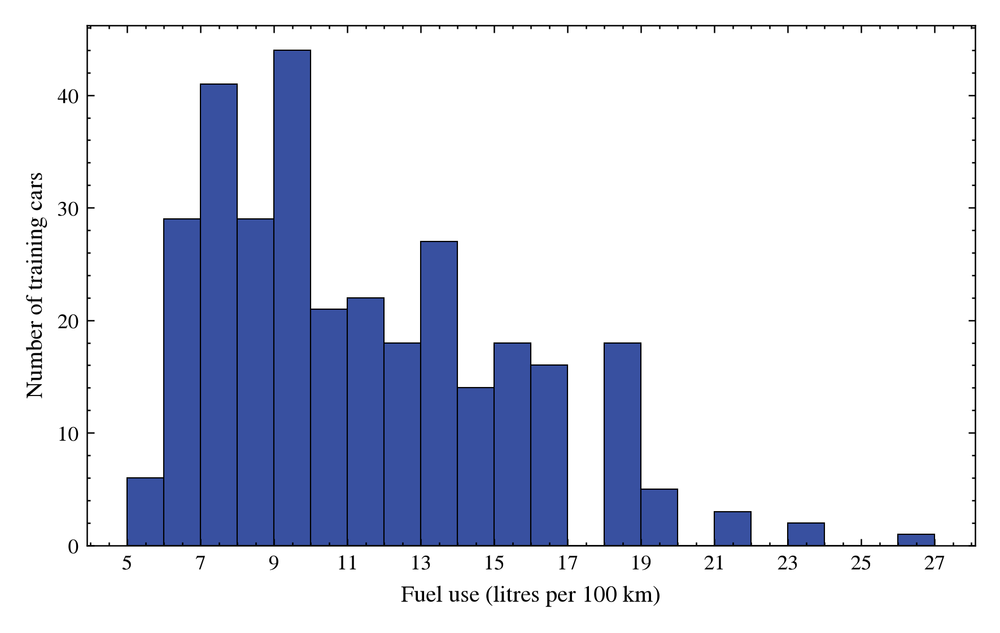
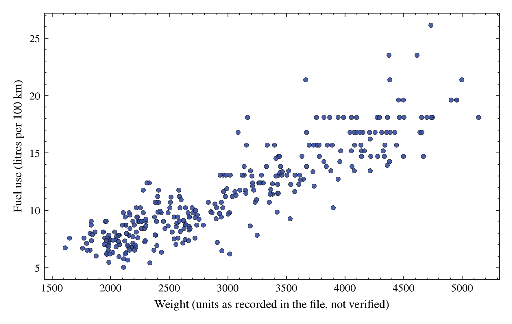
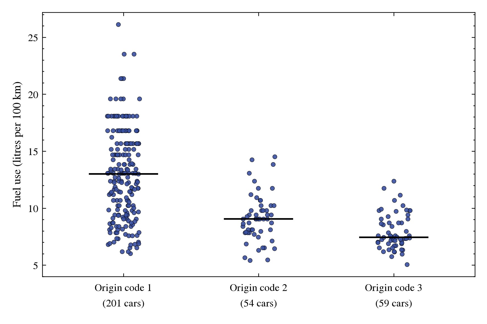
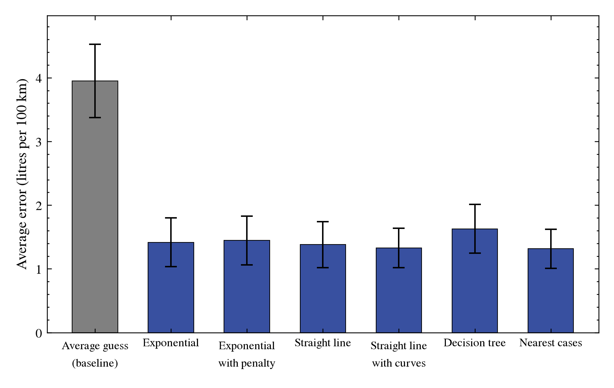
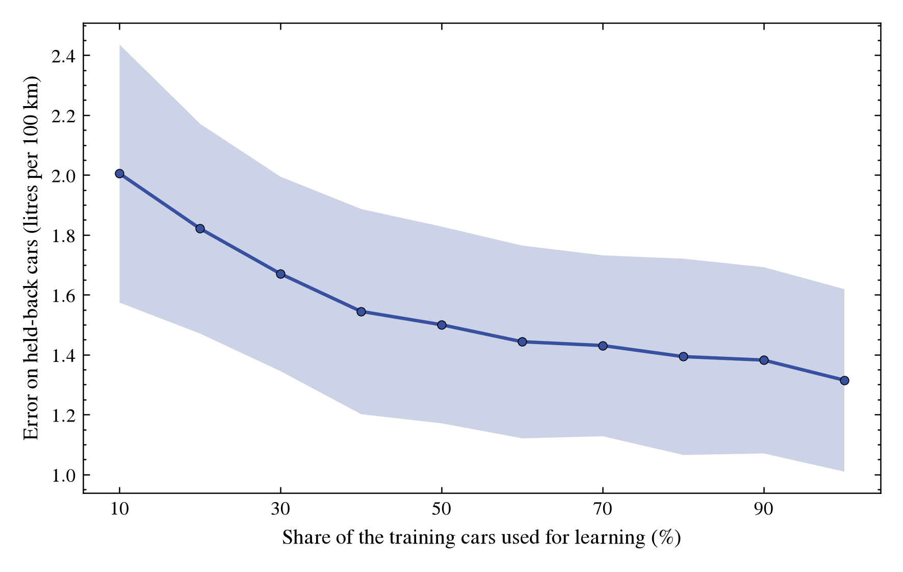

# Predicting the fuel use of cars from their design

## Abstract

This analysis asks whether the fuel use of a car that has not yet been tested on the road, in litres per 100 km, can be predicted from its design, model year and country of origin. The data are 392 cars from model years 1970 to 1982 in the Auto MPG dataset of the UCI Machine Learning Repository, after six cars with no horsepower value were dropped. Cars with the same name were kept together when the data was split, and one in five cars was held back as a test set, used once. Several methods from the book were compared with a baseline that predicts the average fuel use for every car, by cross-validation on the training cars. The nearest-cases method was recommended, with low confidence. On the 78 held-back cars its error was 1.08 litres per 100 km, against 3.66 for the average guess. It clearly beats the average guess, but its error is above the 1-litre limit on the test cars, and it was just above that limit on the training cars too.

## Introduction

A buyer or a car designer would like to know how much fuel a car will use before it is tested on the road. This analysis asks whether that can be predicted from the car's design, using the engine size, horsepower, weight, acceleration, number of cylinders, model year and country of origin recorded for cars from 1970 to 1982.

The figure predicted is the fuel used per 100 km, in litres, computed from the recorded miles per gallon on the assumption of US gallons. A prediction is judged by one error measure, the root mean squared error, which must be at most 1 litre per 100 km on held-out cars, and by whether it does clearly better than predicting the average fuel use of the training cars for every car.

The approach is to compare a small set of model types from the book, each judged by cross-validation on the training cars, in which the training cars are split into parts and each part is held back in turn to test a model fitted to the rest (Lindholm et al., 2026). The chosen model is then evaluated once on the held-out test cars.

The sub-tasks are:

1. Predict the fuel use, in litres per 100 km, of a car that has not yet been tested on the road from its design, model year and country of origin, against the success criterion above.

## Methods

### Data and evaluation

The data are the Auto MPG file of the UCI Machine Learning Repository (Quinlan, 1993), licensed under CC BY 4.0 and downloaded on 11 November 2026. The file holds 398 cars from model years 1970 to 1982. Six cars with no horsepower value were dropped, leaving 392 cars.

The predicted quantity is the fuel used per 100 km, in litres, computed as 235.2 divided by the recorded miles per gallon, on the assumption of US gallons. The seven inputs are engine displacement, horsepower, weight, acceleration, number of cylinders, model year and country of origin, in the units recorded in the file. Those units are not verified.

Cars with the same name are kept together, so that every row with one name lies on the same side of any split. One in five cars is held back as the test set: 78 cars, with 314 cars for training, split at random with seed 2026. The test set is not used until the final evaluation.

The single number that decides between models is the root mean squared error, in litres per 100 km. The mean absolute error, in the same units, is reported beside it but does not decide. The baseline is the average fuel use of the training cars, predicted for every car.

The success criterion has two parts, both checked on the test set. First, the root mean squared error is at most 1 litre per 100 km. Second, the method beats the baseline by a clear margin: the margin over the baseline is at least as large as one times its variation across the cross-validation folds of the training cars.

The charts of the training data use the 314 training cars only. The test cars are not read until the final evaluation. The chart of the fuel figure to be predicted is a histogram with bars one litre per 100 km wide, which shows how the figure is spread across the cars and does not relate it to the inputs.

### Fuel use of a car not yet tested on the road

Eight model settings are admissible for a positive output. They are the straight-line model, with or without the penalty that keeps settings small (L2), and with or without curved terms; the exponential model, with or without the penalty; the nearest-cases method (k-nearest neighbours); and the decision tree. Before any model was trained, a prior ranking ordered them by how well each model type suits a positive output, and kept the baseline, the exponential model as the simple starting method, the exponential model with the penalty, the nearest-cases method and the decision tree. At the user's request, the straight-line model was also kept as a simple starting method. In a diagnosis check, a straight-line model with curved terms (degree 2 or 3) was added, because the error on the training cars was high compared with the gap to the held-back error.

The baseline predicts the average fuel use of the training cars for every car. The models are compared by cross-validation (Lindholm et al., 2026): the 314 training cars are divided into ten parts, kept together by car name, and each part is held back in turn while the model is fitted to the other nine. The same ten parts are used for every model, with seed 2026. Within each training part, the settings are chosen by a further five-part cross-validation, from these grids: the penalty strength from 0.0001 to 10000 in powers of ten; the number of neighbours from 1 to 51; the depth of a tree from 1 to 20 and its smallest leaf from 1 to 20; and the degree of the curved terms, 2 or 3. The chosen settings are then tested on the held-back part. The measure of success is the root mean squared error. Any scaling of the inputs is fitted inside each training part only.

The recommendation follows the rule for choosing a method, which was fixed before any results were seen. Only methods whose margin over the baseline is clear, meaning at least as large as the variation of that margin across the ten parts, are eligible. The method with the lowest average error is the leader; methods whose margin to the leader is below half that variation are candidates, and the candidate with the fewest add-ons (penalty or curved terms) is chosen, then the higher prior score, then the lower average error. The selection confidence is rated from three factors: the margin over the next best method, the margin over the baseline, and a learning check of whether more training cars would still reduce the error. The chosen method is then refitted on all 314 training cars and evaluated once on the 78 test cars, with the baseline evaluated on the same cars. For the final fit, the number of neighbours is the one with the lowest average error across the ten parts, and the method is then refitted on all 314 training cars. The variation across the ten parts gives the uncertainty of that result.

## Results

### The training data

<small><b>Figure 1.</b> Number of training cars in each band of fuel use, in litres per 100 km. Training cars only, 314 cars; the test cars are not shown.</small>

Each bar covers a band of one litre per 100 km. Its height is the number of training cars whose fuel use falls in that band. The chart shows how the figure to be predicted is spread across the cars, and nothing about its relation to the inputs.

<small><b>Figure 2.</b> Fuel use against weight for the training cars, one dot per car. Training cars only, 314 cars; the test cars are not shown. Weight is in the units recorded in the file, which are not verified.</small>

Each dot is one training car: its weight across the bottom and its fuel use up the side. No line is drawn; the dots are shown as they are.

<small><b>Figure 3.</b> Fuel use by origin code, one dot per training car. Each column is one origin code, labelled with its number of training cars; the line marks the median of the column. The sideways spread of the dots within a column has no meaning. Training cars only; the test cars are not shown. The file does not name the countries behind the codes.</small>

Each dot is one training car, placed at its fuel use. The line in each column is the middle value of that column. The columns are of different sizes, as the labels show.

### Fuel use of a car not yet tested on the road

Across the ten parts of the training cars, the average error in litres per 100 km was 3.95 for the baseline, and about 1.3 to 1.6 for the methods compared. The nearest-cases method had the lowest average error, 1.32, with the number of neighbours chosen as 3 in six parts and 5 in four. The straight-line model with curved terms had 1.33, the straight-line model 1.38, the exponential model 1.42, the exponential model with the penalty 1.45, and the decision tree 1.63. Each method beat the baseline by more than the variation of that margin across the parts.

The recommended method is the nearest-cases method, with the number of neighbours chosen inside each part. The selection confidence is low. The margin of the nearest-cases method over the next best method, the straight-line model with curved terms, was 0.01 litres per 100 km, against a variation of 0.22, so the margin over the next best is none. The margin over the baseline is clear. The learning check found that the error had fallen by 0.08 litres per 100 km between 80 % and 100 % of the training cars, against a half-variation of 0.15, so it is not counted as still falling. The prior ranking had expected the exponential model to come first; the cross-validation did not agree.

<small><b>Figure 4.</b> Average error of each method across the ten parts of the training cars, in litres per 100 km. The grey bar is the average guess (the baseline). The line on each bar runs one standard deviation either side of the average across the parts. Training cars only; the test cars are not shown.</small>

Each bar is one method. A lower bar means a smaller typical error. The line on each bar shows how much the error varied from part to part.

<small><b>Figure 5.</b> Learning curve of the nearest-cases method: the error on held-back cars, averaged across the ten parts, when the method is trained on 10 % to 100 % of the training cars. The shaded band is one standard deviation across the parts. Training cars only; the test cars are not shown.</small>

Each point is the average error when the method learned from that share of the training cars. The error at 100 % is lower than at 80 %; the band shows the variation across the parts.

On the 78 test cars, which were held back until this point, the recommended method had an average error of 1.08 litres per 100 km, against 3.66 for the average guess. The uncertainty of the result is 0.34 litres per 100 km, the spread of the error across the training parts. The success criterion is not met: the first part (an error of at most 1 litre per 100 km) is not met, and the second part (a clear margin over the average guess) is met. Counting each miss by its size, whether an over- or an under-estimate, the average size of the miss was 0.81 litres per 100 km for the recommended method, against 3.02 for the average guess.

## Discussion

The nearest-cases method had the lowest average error across the ten training parts, 1.32 litres per 100 km, and it was the method taken to the final check. The straight line with curved terms was almost as good, with a difference of 0.01 litres per 100 km against a variation of 0.22, so the evidence does not separate the two. The two exponential models, which the prior ranking placed first, were behind the nearest-cases method and the straight line, and the decision tree was clearly behind. The prior had expected the exponential family to lead; the cross-validation did not show this, so the rule for positive outputs did not separate the families on these data.

For a car that has not yet been tested on the road, the nearest-cases method finds the three training cars whose inputs are most similar to it, once the inputs are put on a common scale, and reports their average fuel use. A person can see which cars were used for any prediction. The method has no formula that shows how each input moves the prediction. The choice of three neighbours was made inside each training part, and three was the choice in six of the ten parts.

The success criterion has two parts. The margin over the average guess is clear: on the 78 test cars the method's error was 1.08 litres per 100 km, against 3.66 for the average guess on the same cars, a margin of 2.58 against a variation of 0.56. The first part, an error of at most 1 litre, was not met on the test cars. The method's average error on the training cars was 1.01, so the limit was not reached even on the cars it learned from. The analysis cannot show whether another method, more data or a different problem would reach it. The results support using the model to estimate the typical fuel use of cars like those in the data, with an uncertainty of about 0.34 litres per 100 km across the training parts. They do not support using it to predict the fuel use of any single car within a stated margin, or of cars unlike those in the data.

The limits of these results are as follows. The error is an average over cars like those in the data. It says nothing about the worst single prediction, and it was measured on 78 test cars. The cars are model years 1970 to 1982, so the results say nothing about newer cars. The six cars with no horsepower value were dropped; they had smaller engines (four or six cylinders, none with eight), so small-engine cars are fewer in the 392 cars used than in the file. The units of the inputs (engine size, horsepower, weight and acceleration) are not verified. The conversion to litres per 100 km assumes US gallons; this is an assumption, not checked against the source. The file codes the origin as 1, 2 or 3 and does not name the countries, so the country of origin in the question rests on the user's statement. Finally, the learning curve was still falling a little: the error on held-back cars was lower with all the training cars than with 80 %, by about 0.08 litres per 100 km, which is less than half a spread. More cars might help slightly; the analysis did not test this.

## Disclaimer

This report was written with the help of agentic AI at every stage: importing and describing the data, cleaning it, framing the questions, choosing and fitting the models, producing the figures, and drafting the text. Each step was directed and reviewed by the author, who agreed every method before it was applied, and each number reported here comes from code that can be re-run. The record of what was done, including what was tried and abandoned, is in the appendix.

## Appendix

*A pointer to [Appendix.md](Appendix.md), where the data, the decisions and the full workings are recorded.*

## References

- Lindholm, A., Wahlström, N., Lindsten, F. and Schön, T. B. (2026). *Machine Learning – A First Course for Engineers and Scientists*. 2nd edition, online draft version of 1 September 2026. [smlbook.org](https://smlbook.org/).
- Quinlan, R. (1993). Auto MPG [Dataset]. UCI Machine Learning Repository. [https://doi.org/10.24432/C5859H](https://doi.org/10.24432/C5859H).

