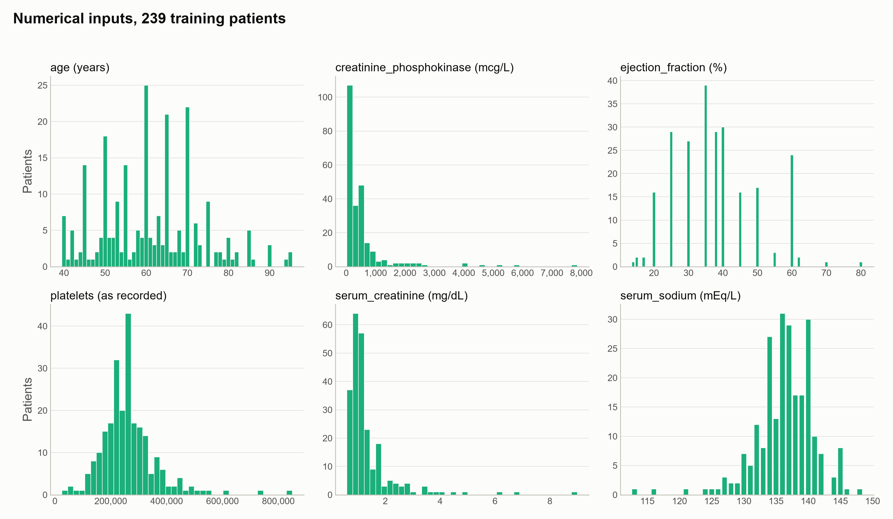
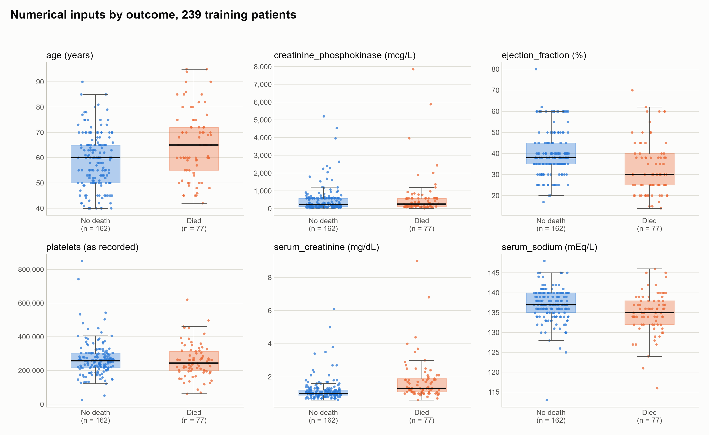
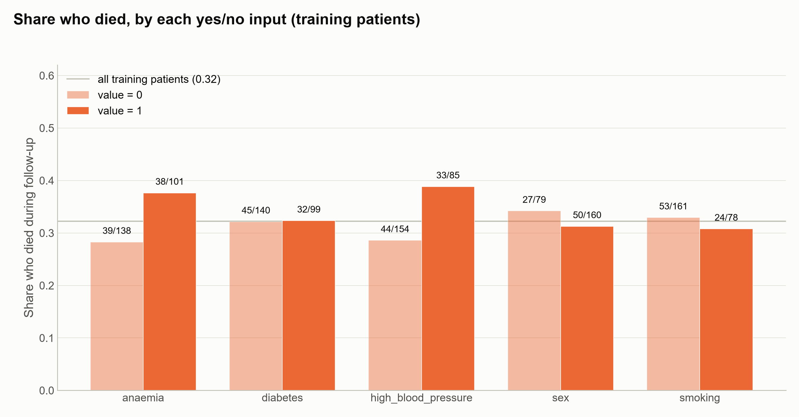
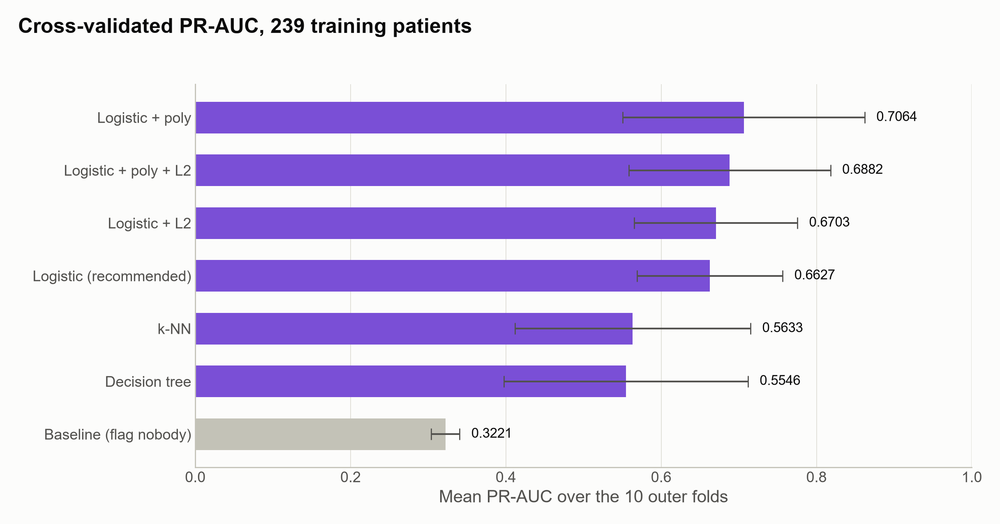
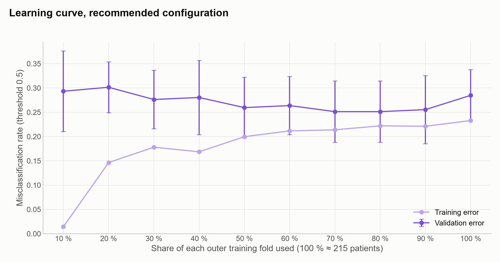
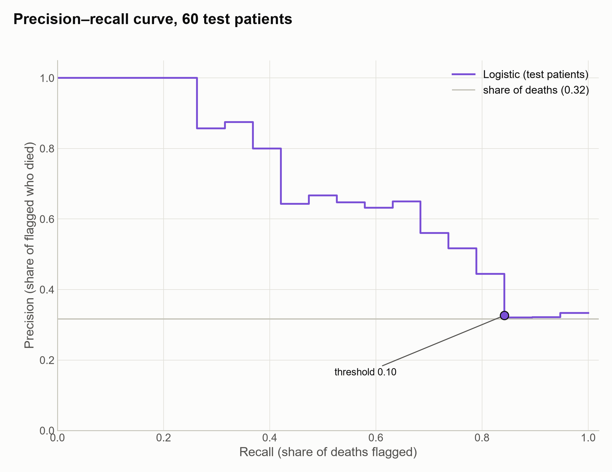
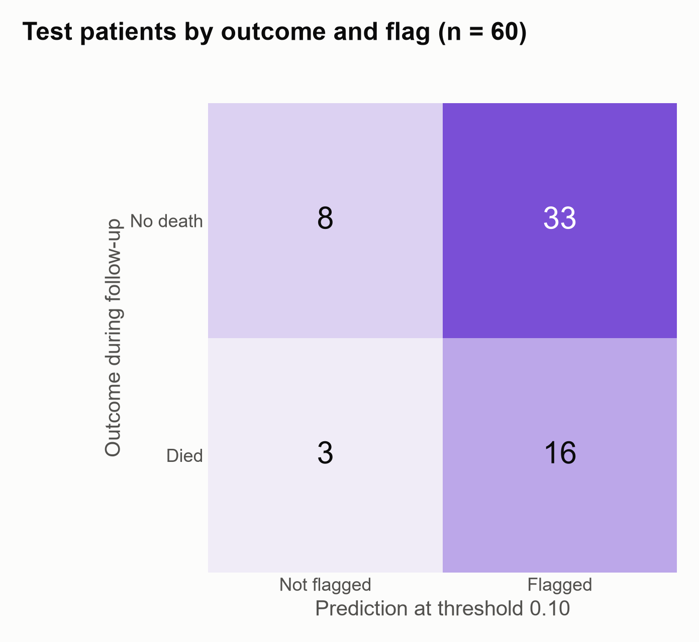

# Predicting death during follow-up in heart failure patients from routine clinical measurements

## Introduction

Patients with advanced heart failure who are likely to die in the coming months could be followed more closely if they could be recognised when follow-up starts. We want to flag such patients from routine clinical measurements. The data are the Heart Failure Clinical Records dataset (Heart Failure Clinical Records, 2020): 299 patients with left ventricular systolic dysfunction in NYHA class III or IV, treated at two hospitals in Faisalabad, Pakistan, between April and December 2015 (Chicco and Jurman, 2020). For each patient the data record age and sex; whether they had anaemia, diabetes or high blood pressure, and whether they smoked; their ejection fraction; and blood levels of creatinine phosphokinase, platelets, serum creatinine and serum sodium. They also record whether the patient died during a follow-up period whose length varies from patient to patient. 96 of the 299 died. A patient recorded as not having died was not observed to die during their follow-up; the source does not say how follow-up ended for them. The length of follow-up is not used as an input, because it is known only once follow-up ends.

Missing a patient who dies is worse than a false alarm. Models are compared by the area under the precision–recall curve, which summarises how well a model ranks patients over all decision thresholds; a model with no skill scores the share of patients who die. Alongside it we report F2, which counts recall twice as heavily as precision, and precision and recall themselves, at a decision threshold chosen on the training patients. We count the model as successful if its area under the precision–recall curve on the held-out patients exceeds their share of deaths by more than the area varies across the cross-validation folds. We compare a small set of model types from Lindholm et al. (2026) by cross-validation on 239 of the patients, and then evaluate the chosen one once on the remaining 60. These are the same held-out patients as in an earlier analysis of these data, so that the two methods can be compared on equal terms. The question is one of prediction for new patients, not of how the measurements are connected to death.

1. Predict, from the 11 clinical measurements, whether a patient dies during the follow-up period.

## Methods

### 1. Death during follow-up

The 11 clinical measurements are used as recorded, with each of the five yes/no measurements as a single 0/1 input. The models compared are the types in Lindholm et al. (2026) that suit a yes/no outcome. Four were chosen first: logistic regression, logistic regression with L2 regularisation, and each of these with squares and cubes of the numerical inputs added. They were preferred to k-nearest neighbours and a decision tree because they give probabilities from which a decision threshold can be chosen. The models were compared on the 239 training patients by nested cross-validation, with ten outer folds that keep the share of deaths the same in every fold. Inside each outer training fold, each model's regularisation strength or polynomial degree was tuned by five-fold cross-validation on the area under the precision–recall curve. Because the best of these models fitted the training patients little better than it fitted new ones, k-nearest neighbours and a decision tree were then compared on the same folds, with the number of neighbours and the tree size tuned in the same way. Among the models whose mean margin over flagging nobody exceeded the variation of that margin across the folds, models within half the variation of the best were treated as indistinguishable from it, and the one with the fewest additions to the basic model was chosen. The selection confidence is computed from three factors: the margin over the runner-up, the margin over flagging nobody, and whether the validation error was still falling when the last fifth of the training data was added. The decision threshold was then chosen by cross-validation on the training patients to maximise F2. The chosen model was refitted on all training patients and evaluated once on the 60 held-out patients. The uncertainty reported with that result is the standard deviation of the model's area under the curve across the ten outer folds. Each fold holds 23 or 24 patients, fewer than the 60 held out, so this approximates the uncertainty of the held-out result rather than measuring it.

## Results

Figures 1 to 5 use the 239 training patients; the 60 held-out patients appear only in Figures 6 and 7. Where patients are split by outcome, those who died during follow-up are orange and the others blue.

<small><b>Figure 1.</b> Number of training patients (of 239) at each value of the six numerical measurements, as recorded. Ejection fraction and serum sodium have one bar per recorded value. Age is grouped into one-year bins centred on whole years. Creatinine phosphokinase, platelets and serum creatinine are grouped into 40 bins of equal width between their smallest and largest values. Each panel has its own vertical scale. Platelets are shown in the units of the file, which the source labels kiloplatelets/mL.</small>

In Figure 2, each point is one patient, spread sideways only so that the points do not overlap. The box spans the middle half of the patients in that group, the line inside it is the median, and the whiskers reach the most extreme values within one and a half box heights of the box.

<small><b>Figure 2.</b> The six numerical measurements for the 162 training patients who did not die during follow-up (blue) and the 77 who did (orange). Each point is one patient.</small>

In Figure 3, the height of a bar is the share of patients in that group who died during follow-up, and the label above it gives the deaths and the size of the group.

<small><b>Figure 3.</b> Share of training patients who died during follow-up, for each of the five yes/no measurements, among patients with the value 0 (light orange) and with the value 1 (full orange). The grey line is the share among all 239 training patients, 0.32. The source does not say which value of sex is a woman.</small>

### 1. Death during follow-up

The recommended model is logistic regression without regularisation, which flags a patient when the predicted probability of death exceeds 0.10. On the 60 held-out patients, 19 of whom died during follow-up, its area under the precision–recall curve is 0.6983, with a standard deviation of 0.0938 across the cross-validation folds; flagging nobody scores 0.3167, the share of deaths (Figure 6). The success criterion required more than 0.3167 after subtracting the standard deviation (0.6045), and it is met. At the threshold, 49 patients are flagged, 16 of them among the 19 who died: precision 0.3265, recall 0.8421 and F2 0.6400 (Figure 7). In cross-validation, the mean areas under the curve were:
- 0.7064 for logistic regression with squares and cubes;
- 0.6882 for the same with L2 regularisation;
- 0.6703 for logistic regression with L2;
- 0.6627 for logistic regression;
- 0.5633 for k-nearest neighbours;
- 0.5546 for the decision tree;
- 0.3221 for flagging nobody (Figure 4).

The four logistic models were within half the variation of the best, and the one without additions was chosen. The selection confidence is low. The margin over the runner-up is −0.0437 (spread 0.1171), because the runner-up has the higher mean. The margin over flagging nobody, 0.3406, exceeds its spread of 0.0892. Adding the last fifth of the training data did not lower the validation error (Figure 5).

<small><b>Figure 4.</b> Mean area under the precision–recall curve over the ten outer cross-validation folds on the 239 training patients, for flagging nobody (grey) and the six models compared (purple). The error bars show the standard deviation across the folds.</small>

In Figure 5, each point is the average over the ten outer folds of the model trained on the given share of the fold. The darker line is its error on the fold's held-out patients and the lighter line its error on the patients it was trained on. The error is the share of patients misclassified at a probability threshold of 0.5.

<small><b>Figure 5.</b> Misclassification rate of logistic regression trained on 10 % to 100 % of each outer training fold (about 215 patients at 100 %), on the fold's held-out patients (dark purple, with the standard deviation across folds) and on its training patients (light purple), averaged over the ten outer folds.</small>

In Figure 6, each step of the curve is one more death flagged as the threshold is lowered. The height is the share of flagged patients who died, and the horizontal position is the share of all deaths that are flagged.

<small><b>Figure 6.</b> Precision against recall of logistic regression on the 60 held-out patients (19 deaths), over all decision thresholds (purple). By convention the curve starts at precision 1 at recall 0. The grey line is the share of deaths, 0.32: the precision of flagging patients at random, and the area under the curve of flagging nobody. The marked point is the chosen threshold, 0.10: recall 0.8421, precision 0.3265. The area under the purple curve is 0.6983.</small>

<small><b>Figure 7.</b> The 60 held-out patients by whether they were flagged at the threshold of 0.10 (columns) and whether they died during follow-up (rows), with the number of patients in each cell.</small>

## Discussion

Logistic regression without regularisation was chosen because it is the simplest of four logistic models that cross-validation could not tell apart (Figure 4). The model with squares and cubes added had the highest mean, 0.7064 against 0.6627, but the difference was smaller than half its variation across the folds, which was 0.1171. In that case the rule takes the model with the fewest additions. The selection confidence is therefore low. This does not mean the chosen model is poor: it means that, with 239 training patients and 7 or 8 deaths in each validation fold, the data could not separate four similar models. k-nearest neighbours and the decision tree were added when the diagnosis showed that the leading model fitted the training patients little better than new ones. Both scored below all four logistic models, at 0.5633 and 0.5546.

The model gives each patient a score: a constant plus each of the 11 measurements, first put on a common scale and then multiplied by a weight learned from the training patients. The logistic function turns that score into a probability of death between 0 and 1. The largest weights belong to ejection fraction, age and serum creatinine. A lower ejection fraction, an older age and a higher serum creatinine each raise the predicted probability, with the other measurements held fixed. Platelets, diabetes and smoking have the smallest weights.

As a worked example, take a patient with every measurement at its median among the training patients and the most common yes/no values: aged 60, ejection fraction 38 %, serum creatinine 1.1 mg/dL. That patient's predicted probability of death is 0.108, just above the threshold of 0.10, so the patient is flagged.

The weights describe how this fitted model separates patients in these data. They do not show that any measurement causes death: the question was framed as one of prediction, not of how the measurements are connected to death.

The model met its success criterion. On the 60 held-out patients its area under the precision–recall curve, 0.6983, is above the share of deaths, 0.3167, by more than the variation across the folds. It ranks patients who died above those who did not more often than chance would.

The threshold tells a different story from the ranking. At 0.10, chosen to maximise F2, which counts recall twice as heavily as precision, the model flags 49 of the 60 patients and catches 16 of the 19 deaths. But 33 of the 41 patients who did not die are flagged too, so the share of flagged patients who died, 0.3265, is close to the share of deaths overall. Its F2 on the held-out patients, 0.6400, is below the 0.6985 that flagging every patient would reach. As a ranking of risk, the model carries information. As a rule for whom to flag, at this threshold, it scores below flagging everyone on the measure the threshold was chosen for.

What a flag means is limited further by the data. A patient recorded as not having died was not observed to die during a follow-up of varying length; the source does not say how follow-up ended, so some of these patients may have died later. The unit of the platelet count is uncertain, and the model uses it as recorded. An earlier analysis of the same 60 held-out patients, using a decision tree, reached an F2 of 0.6780 under a different deciding metric and success criterion.

The area of 0.6983 estimates the average performance on new patients like these held-out ones: patients in NYHA class III or IV at two hospitals in Faisalabad in 2015. It says nothing about how wrong the worst single prediction can be, and it holds only while new patients resemble these. It rests on 60 patients, 19 of whom died. Its uncertainty, 0.0938, is the variation across cross-validation folds of 23 or 24 patients, so it approximates rather than measures the uncertainty of an estimate from 60 patients.

The held-out patients are also the test set of the earlier analysis, whose result was known before this one began. They informed none of this analysis's choices, but they are not unseen in the sense the method assumes. The learning curve did not fall over the last fifth of the training data (Figure 5), so more patients of the same kind are not indicated as the way to improve the model; the diagnosis instead pointed to the information in the inputs, and no further measurements were available.

## Disclaimer

This report was written with the help of agentic AI at every stage: importing and describing the data, cleaning it, framing the questions, choosing and fitting the models, producing the figures, and drafting the text. Each step was directed and reviewed by the author, who agreed every method before it was applied, and each number reported here comes from code that can be re-run. The record of what was done, including what was tried and abandoned, is in the appendix.

## Appendix

The data, the decisions and the full workings behind this report are recorded in [Appendix.md](Appendix.md).

## References

- Chicco, D. and Jurman, G. (2020). Machine learning can predict survival of patients with heart failure from serum creatinine and ejection fraction alone. *BMC Medical Informatics and Decision Making*, 20, 16. [https://doi.org/10.1186/s12911-020-1023-5](https://doi.org/10.1186/s12911-020-1023-5).
- Heart Failure Clinical Records [Dataset]. (2020). UCI Machine Learning Repository. [https://doi.org/10.24432/C5Z89R](https://doi.org/10.24432/C5Z89R).
- Lindholm, A., Wahlström, N., Lindsten, F. and Schön, T. B. (2026). [*Machine Learning – A First Course for Engineers and Scientists*](https://smlbook.org/), 2nd edition, online draft version of 1 September 2026. Cambridge University Press (to be published).
