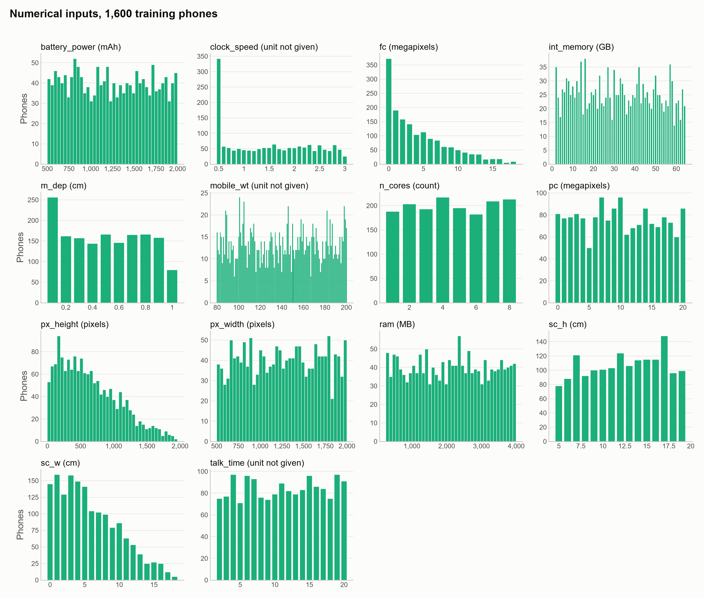
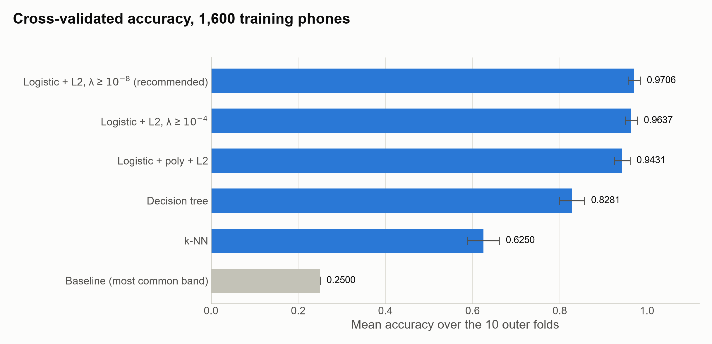
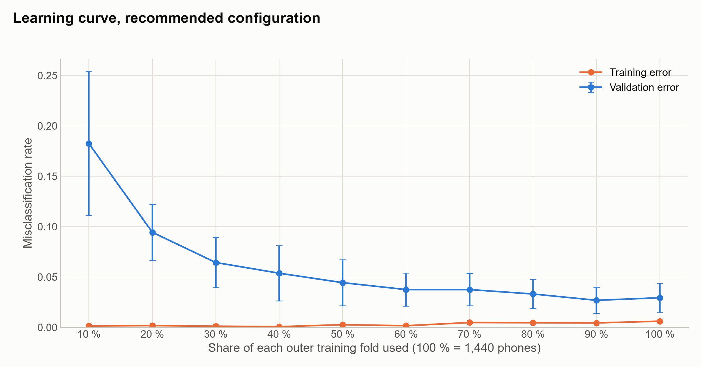
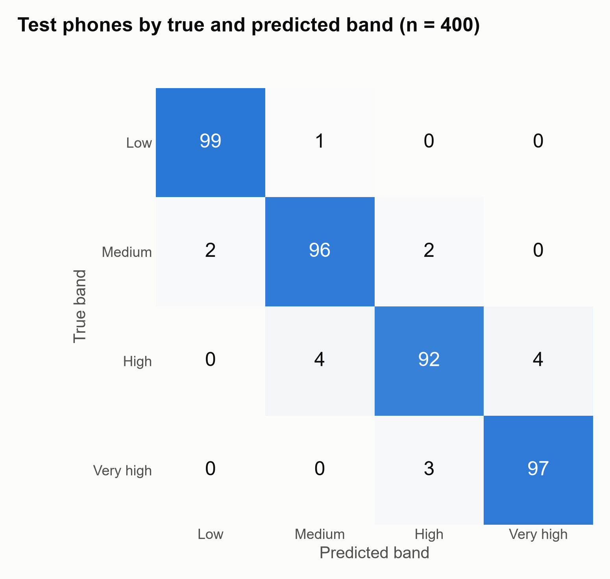

# Predicting a mobile phone's price band from its specifications

## Introduction

A maker designing a new mobile phone has to decide which price band it belongs in. We want to place a phone in one of four price bands, from low to very high cost, using only its specifications. The data are the Mobile Price Classification dataset (Sharma, 2018): 2,000 phones, each described by 20 specifications and labelled with its price band, with 500 phones in each band. Fourteen specifications are numbers, such as battery capacity, memory, screen size, pixel resolution, camera megapixels and the number of processor cores. Six record whether the phone has Bluetooth, dual SIM, 3G, 4G, a touch screen or wifi. The source does not say where the phones come from, what their prices were, or where the boundaries between the bands lie.

Each band is treated as a separate category, so the order of the bands is not used, and every wrong band counts as one error. Models are compared by accuracy, the share of phones placed in the right band. Alongside it we report which bands are mistaken for which. The reference is a rule that always predicts the same band. Because the four bands are equally common, it places 25 % of phones correctly. We count a model as successful if its accuracy on the held-out phones, less the amount its accuracy varies across the cross-validation folds, is above 25 %. We compare a small set of model types from Lindholm et al. (2026) by cross-validation on 1,600 of the phones, and then evaluate the chosen one once on the remaining 400, held out until that point. The question is one of prediction for new phones, not of how the specifications are connected to price.

1. Predict a phone's price band (low, medium, high or very high cost) from its 20 specifications.

## Methods

### 1. Price band of a new phone

The 20 specifications are used as recorded, with each of the six yes/no features as a single 0/1 input. The models compared are the types in Lindholm et al. (2026) that suit an outcome with several categories: logistic regression with L2 regularisation, the same with squares and cubes of the numerical inputs added, k-nearest neighbours, and a decision tree. Logistic regression without regularisation was not fitted, because a linear boundary separates the four bands perfectly in the training data, and its parameters then grow without limit. The models were compared on the 1,600 training phones by nested cross-validation, with ten outer folds that keep a quarter of each band in every fold. Inside each outer training fold, each model's regularisation strength, number of neighbours or tree size was tuned by five-fold cross-validation on accuracy. For logistic regression with L2, the tuned strength was the smallest in the range searched in every fold, so the range was extended downwards by four orders of magnitude and the model was cross-validated again. That model was then cross-validated with each of the 20 specifications left out in turn, and a removal was to be kept only if it raised the accuracy by at least half the variation of the gain across the folds; none did, so all 20 were kept. Among the models whose mean margin over the baseline exceeded the variation of that margin across the folds, models within half the variation of the best were treated as indistinguishable from it, and the one with the fewest additions to the basic model was chosen. The selection confidence is computed from three factors: the margin over the runner-up, the margin over the baseline, and whether the validation error was still falling when the last fifth of the training data was added. The chosen model was refitted on all training phones with the regularisation strength selected most often across the outer folds, and evaluated once on the 400 held-out phones. The uncertainty reported with that result is the standard deviation of the model's accuracy across the ten outer folds. Each fold holds 160 phones, fewer than the 400 held out, so this approximates the uncertainty of the held-out result rather than measuring it.

## Results

Figures 1 to 3 use the 1,600 training phones; the 400 held-out phones appear only in Figure 4.

Figure 1 describes the 1,600 training phones, all four price bands together. Each panel is one of the 14 numerical specifications, and the height of a bar is the number of phones with that value. For the ten specifications with up to 121 distinct values, there is one bar per recorded value. Battery capacity, pixel height, pixel width and memory (RAM) take about 1,000 values or more, and are grouped into 40 bins of equal width.

<small><b>Figure 1.</b> Number of training phones (of 1,600) at each value of the 14 numerical specifications, as recorded. Each panel has its own vertical scale. Units are those given in the source; clock speed, weight and talk time have none. The value 0 occurs for front-camera megapixels in 372 phones, screen width in 145, primary-camera megapixels in 81 and pixel height in 2.</small>

### 1. Price band of a new phone

The recommended model is logistic regression with L2 regularisation (λ = 10⁻⁵), which assigns each phone the band with the highest predicted probability. On the 400 held-out phones it places 384 in the right band, an accuracy of 0.9600. The standard deviation of its accuracy across the cross-validation folds is 0.0141. A rule that always predicts the same band places 100 of the 400 correctly, an accuracy of 0.2500. The success criterion required the accuracy less its standard deviation, 0.9459, to exceed 0.2500, and it is met. Each of the 16 misplaced phones is placed in a neighbouring band (Figure 4). In cross-validation, the mean accuracies were:
- 0.9706 for the recommended model;
- 0.9637 for the same model with the original range of regularisation strengths;
- 0.9431 with squares and cubes added;
- 0.8281 for the decision tree;
- 0.6250 for k-nearest neighbours;
- 0.2500 for the baseline (Figure 2).

The selection confidence is high. The margin over the runner-up, 0.0069, exceeds its spread across the folds, 0.0055. The margin over the baseline, 0.7206, exceeds its spread of 0.0141. Adding the last fifth of the training data lowered the validation error by 0.0037, less than half its fold spread (Figure 3).

<small><b>Figure 2.</b> Mean accuracy over the ten outer cross-validation folds on the 1,600 training phones, for the baseline (grey) and the five models compared with all 20 specifications (blue). The error bars show the standard deviation of accuracy across the folds. The two rows for logistic regression with L2 differ only in the range of regularisation strengths searched.</small>

In Figure 3, each point is the average over the ten outer folds of a model trained on the given share of the fold. The orange line is its error on the phones it was trained on, and the blue line its error on the fold's held-out phones.

<small><b>Figure 3.</b> Misclassification rate of the recommended model trained on 10 % to 100 % of each outer training fold (1,440 phones at 100 %), on its training phones (orange) and on the fold's held-out phones (blue), averaged over the ten outer folds. The error bars on the validation error show its standard deviation across the folds.</small>

<small><b>Figure 4.</b> The 400 held-out phones by true price band (rows) and the band predicted by the recommended model (columns), with the number of phones in each cell. The diagonal holds the 384 phones placed in the right band.</small>

## Discussion

Logistic regression with L2 regularisation was chosen because it had the highest cross-validated accuracy of the models compared, 0.9706, and was ahead of each of the others by more than the variation of that difference across the folds (Figure 2). Adding squares and cubes of the inputs lowered the accuracy to 0.9431, the decision tree reached 0.8281, and k-nearest neighbours 0.6250. Before any model was fitted, the ranking drawn from the stated requirements placed k-nearest neighbours and the decision tree first. That was only because they have fewer additions to the basic model: none of the requirements favoured any model type. Cross-validation reversed that order.

One reading of the reversal is that in these data the boundaries between bands are close to straight. On the training phones a straight boundary separates the four bands without error, and the models that can bend the boundary did not improve on the one that cannot. The results are consistent with this reading, but it was not tested directly. For k-nearest neighbours, the number of neighbours chosen was the largest tried in every fold, so its accuracy may understate what the method can reach on these data.

The cross-validated accuracy of the chosen model also carries a selection effect. 25 variants were compared on the same folds before the choice was made: the five models in Figure 2, and 20 versions of the chosen model with one specification left out at a time, none of which was kept. A score that wins such a comparison may be somewhat optimistic. The held-out accuracy, 0.9600, comes from phones that informed no choice. It is the independent estimate, and it is 0.0106 lower than the cross-validated figure, a difference smaller than the fold standard deviation of 0.0141.

The model gives each phone four scores, one per price band. Each score is a constant plus the phone's 20 specifications, each first put on a common scale and then multiplied by a weight the model learned for that band. The four scores are turned into four probabilities that add up to one, and the phone is placed in the band with the highest probability. Because every score is a weighted sum, the boundaries between bands are straight lines in the space of the specifications.

The weights for memory (RAM) rise from the low band to the very high band, so a phone with more memory than the typical training phone is pulled towards the higher bands. The gap between memory's lowest and highest weight is about four times that of battery capacity, and more than six times that of the pixel height or the pixel width. Those three come next, and the other sixteen specifications have gaps less than a twentieth of memory's.

As a worked example, take a phone with every specification at its median training value, such as 2,156 MB of memory and a 1,225 mAh battery, and with the most common yes/no features. Its scores for the medium and high bands are close, at 10.32 and 9.75, while the low and very high bands score about −10. The model therefore gives it a probability of 0.64 of being in the medium band and 0.36 of being in the high band, and places it in the medium band.

The weights describe how this fitted model separates the bands in these data. They do not show that more memory causes a higher price band: the question was framed as one of prediction, not of how the specifications are connected to price.

The model met its success criterion. On the 400 held-out phones it placed 384 in the right band, and its accuracy less the variation across folds, 0.9459, is above the 0.2500 reached by always predicting the same band. It can be used to place a new phone, described by the same 20 specifications, in one of the four bands as this dataset defines them.

It cannot be used to estimate a price, and it says nothing about real phones or a real market. The source does not say where the phones come from, what their prices were, or where the boundaries between the bands lie, so the model reproduces the dataset's own labelling, whatever rule produced it.

Some recorded values are implausible for a phone, and they were used as recorded: a screen width of 0 cm in 180 of the 2,000 phones, and a pixel height below 100 in 150 of them. 35 and 28 of these, respectively, are among the 400 held-out phones, so the accuracy describes data that contain such values, not corrected data.

In the evaluation, every wrong band counted as one error and the order of the bands was not used. Yet each of the 16 misplaced held-out phones went to a neighbouring band (Figure 4), as did every misplaced phone in cross-validation. An evaluation that took the distance between bands into account would treat these errors differently, but that was not the agreed measure.

The accuracy of 0.9600 is an estimate of the average accuracy on new phones like the 400 held out, which were drawn from the same file as the training phones. It says nothing about how wrong the worst single prediction can be, and it holds only while new phones resemble these. Its uncertainty, 0.0141, is the variation across the ten cross-validation folds of 160 phones each, so it approximates rather than measures the uncertainty of an estimate from 400 phones. The learning curve had nearly levelled off by the time all training phones were used: the last fifth of the data lowered the validation error by 0.0037 (Figure 3). This suggests that more phones of the same kind would change the estimate little; it says nothing about phones of a different kind.

## Disclaimer

This report was written with the help of agentic AI at every stage: importing and describing the data, cleaning it, framing the questions, choosing and fitting the models, producing the figures, and drafting the text. Each step was directed and reviewed by the author, who agreed every method before it was applied, and each number reported here comes from code that can be re-run. The record of what was done, including what was tried and abandoned, is in the appendix.

## Appendix

The data, the decisions and the full workings behind this report are recorded in [Appendix.md](Appendix.md).

## References

- Lindholm, A., Wahlström, N., Lindsten, F. and Schön, T. B. (2026). [*Machine Learning – A First Course for Engineers and Scientists*](https://smlbook.org/), 2nd edition, online draft version of 1 September 2026. Cambridge University Press (to be published).
- Sharma, A. (2018). *Mobile Price Classification* [Dataset], version 1. Kaggle. [https://www.kaggle.com/datasets/iabhishekofficial/mobile-price-classification](https://www.kaggle.com/datasets/iabhishekofficial/mobile-price-classification).
