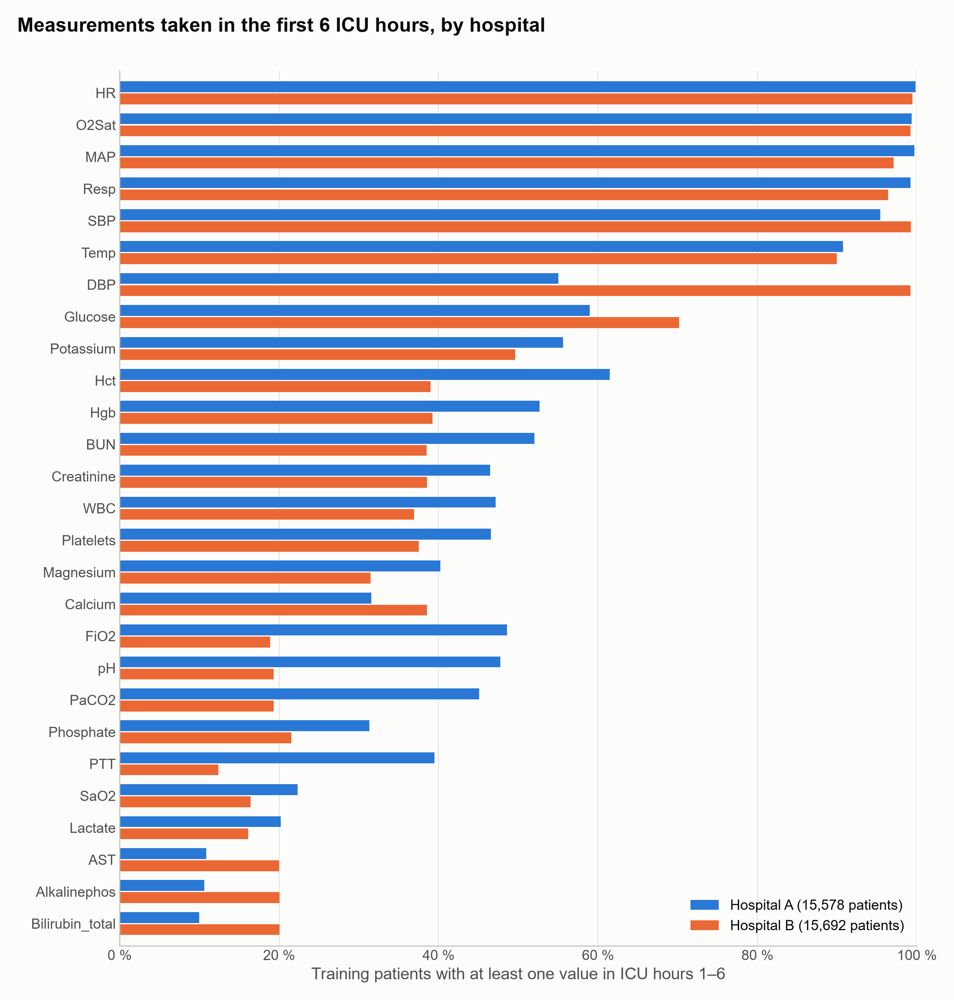
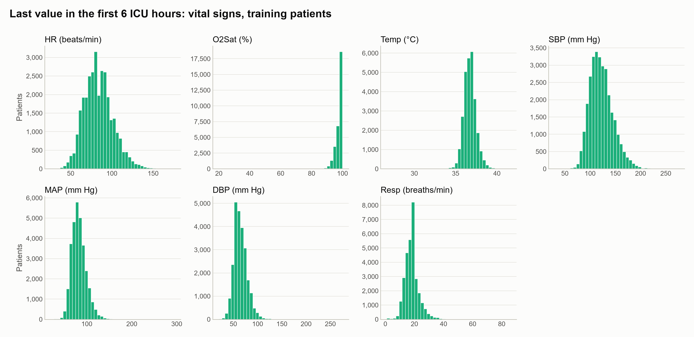
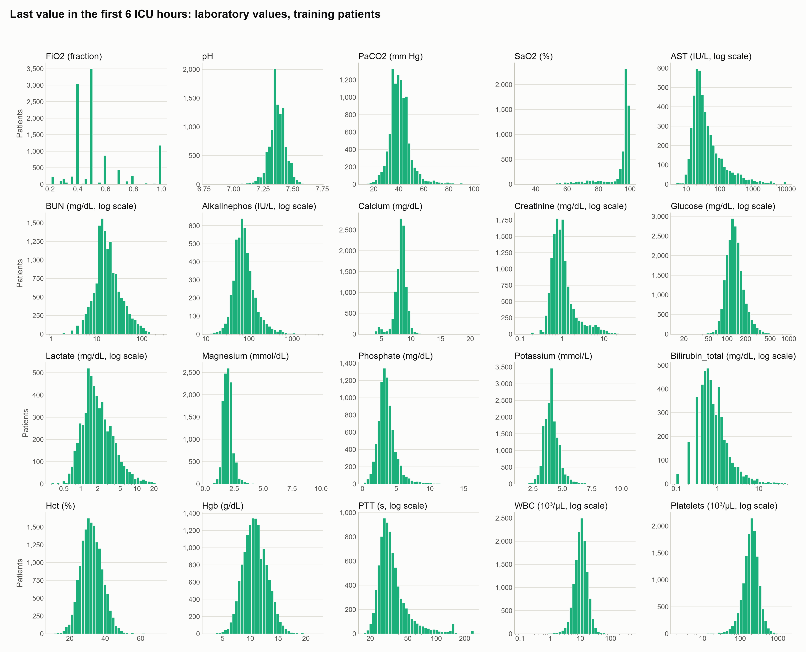
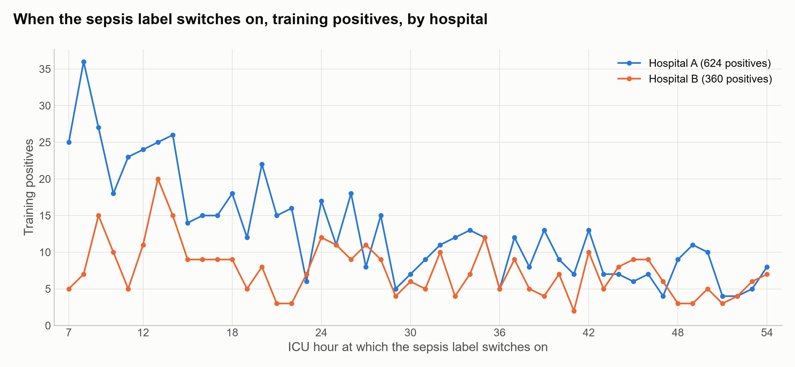
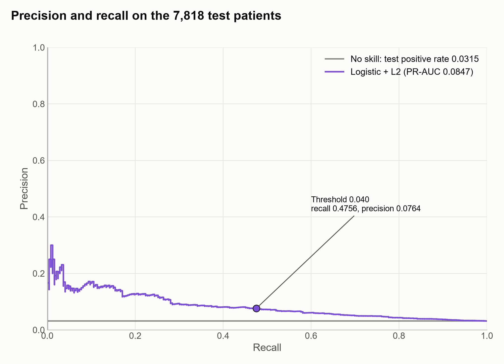
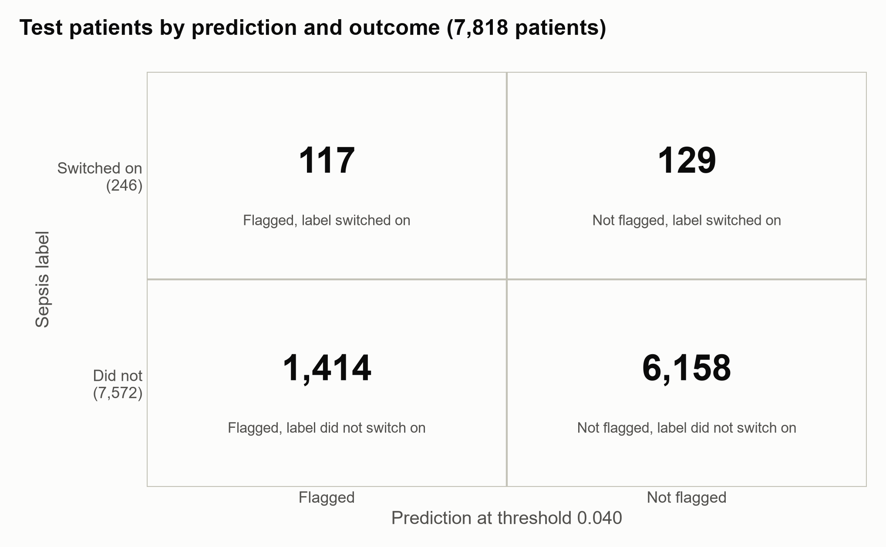

# Predicting sepsis from the first six hours in intensive care

## Introduction

Patients in intensive care who are about to develop sepsis could be watched more closely if they could be recognised early in their stay. We want to flag such patients using only what is recorded in their first six hours in the intensive care unit (ICU). The data are the training data of the PhysioNet/Computing in Cardiology Challenge 2019 (Reyna et al., 2019): hourly vital signs, laboratory values and patient characteristics for 40,336 ICU patients at two US hospitals, Beth Israel Deaconess Medical Center and Emory University Hospital (Reyna et al., 2020). Whether a patient has sepsis is not recorded at the bedside. It is a label constructed from the Sepsis-3 criteria, which switches on six hours before the estimated onset.

For each patient we predict whether the sepsis label switches on within the 48 hours after the first six ICU hours, while the patient is still in the ICU. A patient who leaves the ICU within that period without it counts as not having developed sepsis. The inputs are the 27 vital signs and laboratory values recorded in the first six hours, together with age, sex, the type of ICU and the time between hospital and ICU admission. The time the patient has spent in the ICU, and the length of the stay, are not used. The analysis covers the 39,088 patients who were in the ICU during the first six hours and whose label had not yet switched on, of whom 3.15 % develop sepsis within the period. The question is one of prediction for new patients, not of which measurements are connected to sepsis.

Missing a patient who develops sepsis is worse than a false alarm. Models are compared by the area under the precision–recall curve, which summarises how well a model ranks patients over all decision thresholds; a model with no skill scores the share of patients who develop sepsis. Alongside it we report F2, which counts recall twice as heavily as precision, and precision and recall themselves, at a decision threshold chosen on the training patients. We count the model as successful if its area under the precision–recall curve on the held-out patients exceeds their share of sepsis cases by more than the area varies across the cross-validation folds. We compare a small set of model types from Lindholm et al. (2026) by cross-validation on 31,270 of the patients, and then evaluate the chosen one once on the remaining 7,818, drawn from both hospitals and held out until that point.

1. Predict, from the first six ICU hours, whether the sepsis label switches on within the following 48 hours while the patient is still in the ICU.

## Methods

### 1. Sepsis within 48 hours from the first six ICU hours

Each patient's first six ICU hours are summarised as one row: the last value of each of the 27 vital signs and laboratory values, ten of the laboratory values on a logarithmic scale, and for each of the 27 whether it was measured at all. An empty value is filled with the median over the training patients; the same applies to age, sex and the time from hospital to ICU admission, which was empty for one held-out patient. The models compared are the types in Lindholm et al. (2026) that suit a yes/no outcome: logistic regression with L2 regularisation, the same with squares and cubes of the numerical inputs added, k-nearest neighbours, and a decision tree. Logistic regression without regularisation was not fitted, because the three indicator columns for the type of ICU always sum to one and so duplicate the intercept. The models were compared on the 31,270 training patients by nested cross-validation, with ten outer folds that keep the share of sepsis cases from each hospital the same in every fold. Inside each outer training fold, each model's regularisation strength, number of neighbours or tree size was tuned by five-fold cross-validation on the area under the precision–recall curve. Among the models whose mean margin over flagging nobody exceeded the variation of that margin across the folds, models within half the variation of the best were treated as indistinguishable from it, and the one with the fewest additions to the basic model was chosen. The selection confidence is computed from three factors: the margin over the runner-up, the margin over flagging nobody, and whether the validation error was still falling when the last fifth of the training data was added. The decision threshold was then chosen by cross-validation on the training patients to maximise F2. The chosen model was refitted on all training patients and evaluated once on the 7,818 held-out patients. The uncertainty reported with that result is the standard deviation of the model's area under the curve across the ten outer folds; each fold holds about a tenth of the training patients, fewer than the held-out set, so this approximates the uncertainty of the held-out result rather than measuring it.

## Results

Figures 1 to 4 describe the 31,270 training patients; the 7,818 held-out patients appear only in Figures 5 and 6. Where the two hospitals are shown separately, hospital A is blue and hospital B orange.

<small><b>Figure 1.</b> Share of the 31,270 training patients with at least one value of each of the 27 clinical columns in ICU hours 1–6, for hospital A (15,578 patients, blue) and hospital B (15,692 patients, orange). Columns are ordered by the share over both hospitals, from HR (99.65 %) to Bilirubin_total (15.04 %). A patient without a value has it filled with the training median, and that column's "measured" indicator set to 0.</small>

<small><b>Figure 2.</b> Distribution of the last value in ICU hours 1–6 of each vital sign, over the training patients who have one: from 24,143 patients for DBP to 31,160 for HR, of 31,270. Each panel spans its full range in 40 bins of equal width and has its own vertical scale. Patients without a value are not drawn.</small>

<small><b>Figure 3.</b> As Figure 2, for the 20 laboratory values: from 4,704 patients with a value for Bilirubin_total to 20,191 for Glucose. The ten inputs that enter the models on a log scale are drawn on a log axis, with bins of equal width on that scale. FiO2 is stored as a fraction. Magnesium and Lactate are labelled with their documented units, although their values fit mg/dL and mmol/L respectively (Data Summary).</small>

<small><b>Figure 4.</b> Number of the 984 training positives whose sepsis label switches on in each ICU hour from 7 to 54, for hospital A (624 positives, blue) and hospital B (360, orange); each point is one hour. The label switches on 6 hours before the estimated Sepsis-3 onset, so hour h corresponds to onset at hour h + 6. Median hour 21 in A (quartiles 13 and 35) and 26 in B (quartiles 15 and 39).</small>

### 1. Sepsis within 48 hours from the first six ICU hours

The recommended model is logistic regression with L2 regularisation (λ = 10⁻³) and a decision threshold of 0.040. On the 7,818 held-out patients, 246 of whom had the sepsis label switch on within the period, its area under the precision–recall curve is 0.0847, with a standard deviation of 0.0156 across the cross-validation folds; flagging nobody scores 0.0315, the share of positives (Figure 5). The success criterion required more than 0.0471, and it is met. At the threshold, 1,531 patients are flagged, 117 of them positive: precision 0.0764, recall 0.4756 and F2 0.2326 (Figure 6). In cross-validation, the mean areas under the curve were 0.0930 for logistic regression with L2, 0.0907 for the same with squares and cubes, 0.0706 for k-nearest neighbours, 0.0678 for the decision tree and 0.0315 for flagging nobody. The selection confidence is low: the margin over the runner-up, 0.0023, is less than half its spread across the folds, 0.0077; the margin over flagging nobody, 0.0615, exceeds its spread of 0.0156; and adding the last fifth of the training data lowered the validation error by 0.0015, less than half its fold spread.

<small><b>Figure 5.</b> Precision against recall of logistic regression with L2 regularisation on the 7,818 held-out patients (246 positive), over all decision thresholds (purple); each step is one change in which patients are flagged, and by convention the curve starts at precision 1 at recall 0. The grey line is the share of positives, 0.0315: the precision of flagging patients at random, and the area under the curve of flagging nobody. The marked point is the chosen threshold, 0.040: recall 0.4756, precision 0.0764. The area under the purple curve is 0.0847.</small>

<small><b>Figure 6.</b> The 7,818 held-out patients by whether they were flagged at the threshold of 0.040 (columns) and whether their sepsis label switched on within the period (rows), with the number of patients in each cell.</small>

## Discussion

Logistic regression with L2 regularisation is recommended because it had the highest mean in cross-validation and, among the models that could not be told apart from it, the fewest additions to the basic model. Linear, Poisson and exponential regression do not suit a yes/no outcome, and logistic regression without regularisation was not fitted, because the three columns for the type of ICU always sum to one and so duplicate the intercept. Logistic regression with L2 (0.0930) and the same model with squares and cubes added (0.0907) could not be told apart: the difference, 0.0023, is less than half its variation across the folds, 0.0077, and the rule then prefers the model with fewer additions. The low selection confidence comes from this near-tie between two versions of the same model, not from the comparison with flagging nobody, which the recommended model beats by 0.0615 against a fold variation of 0.0156. k-nearest neighbours (0.0706) and the decision tree (0.0678) were outperformed by more than the variation of their margins. For k-nearest neighbours this holds for the neighbour counts tried: it chose 51, the largest in its grid, in every fold, and how it would rank with more neighbours was not tested. Before any model was fitted, the tree had been expected to rank above k-nearest neighbours; the order came out reversed, by 0.0028 against a fold variation of 0.0088.

The model multiplies each of a patient's 60 standardised inputs by a weight, adds them up, and turns the sum into a probability that the sepsis label will switch on within the 48 hours; the patient is flagged when that probability exceeds 0.040. Six of the ten largest weights belong to whether a measurement was taken at all in the first six hours: having FiO2, calcium, white blood cell count, mean arterial pressure or lactate measured raises the predicted probability, and having systolic blood pressure measured lowers it. Three belong to measured values: with the other inputs held fixed, a higher heart rate or respiratory rate raises the predicted probability and a higher mean arterial pressure lowers it. The tenth belongs to the type of ICU. These weights describe what the model relies on to predict, not what causes sepsis. Whether a value was measured partly reflects clinicians' ordering habits and how each hospital records its data, not only the patient's condition, so these weights cannot be read as properties of the patients alone, and they may not carry over where ordering habits differ. The calcium indicator also depends on a cleaning choice: calcium values below 2.0 mg/dL, all but one of them from hospital B, were set to missing, which reduced the training patients with a calcium value from 12,386 to 10,967, while a separate cluster of hospital B values between 4.0 and 5.25 mg/dL was kept. The weights of the three ICU-type columns can be compared only with each other, because those columns duplicate the intercept.

On the 7,818 held-out patients the model's area under the precision–recall curve is 0.0847, against 0.0315 for flagging nobody, so the success criterion of more than 0.0471 is met; in cross-validation it was 0.0930, with a fold variation of 0.0156. At the threshold of 0.040 it flags 1,531 patients, of whom 117 had the sepsis label switch on, and 129 of the 246 patients whose label switched on were not flagged. The model can be used to rank adult ICU patients at these two hospitals from their first six hours by how likely their sepsis label is to switch on, as a basis for choosing whom to watch more closely. It is not a diagnosis, and it does not show which measurements are connected to sepsis, since the aim was prediction. What it predicts is the label, not sepsis as a clinician would judge it: the label is built from the Sepsis-3 criteria, partly from the same kinds of measurement that are inputs, and switches on six hours before the estimated onset. Patients who left the ICU before hour 54 without the label count as negatives, although some of them may have developed sepsis after leaving; methods for outcomes whose follow-up ends early, such as survival analysis, are not covered in Lindholm et al. (2026) and were not tried. Whether the model applies at other hospitals was not tested.

The area under the curve on the held-out patients estimates how the model would do on average over new patients like them: from the same two hospitals, recorded in the same way (Lindholm et al., 2026). It says nothing about how wrong an individual prediction can be, and it holds only while new patients resemble these. Its uncertainty is given as the variation across the cross-validation folds, each of about 3,127 patients, while the held-out set has 7,818, so that figure approximates the uncertainty of the held-out result rather than measuring it. Some recorded values were kept although they may not be in their documented units, magnesium and lactate in particular, and some vital signs are cut off at fixed limits; the model was evaluated on data with these properties, and they are part of what "patients like these" means.

## Disclaimer

This report was written with the help of agentic AI at every stage: importing and describing the data, cleaning it, framing the questions, choosing and fitting the models, producing the figures, and drafting the text. Each step was directed and reviewed by the author, who agreed every method before it was applied, and each number reported here comes from code that can be re-run. The record of what was done, including what was tried and abandoned, is in the appendix.

## Appendix

The data, the decisions and the full workings behind this report are recorded in [Appendix.md](Appendix.md).

## References

- Lindholm, A., Wahlström, N., Lindsten, F. and Schön, T. B. (2026). [*Machine Learning – A First Course for Engineers and Scientists*](https://smlbook.org/), 2nd edition, online draft version of 1 September 2026. Cambridge University Press (to be published).
- Reyna, M., Josef, C., Jeter, R., Shashikumar, S., Moody, B., Westover, M. B., Sharma, A., Nemati, S. and Clifford, G. D. (2019). *Early Prediction of Sepsis from Clinical Data: the PhysioNet/Computing in Cardiology Challenge 2019* (version 1.0.0) [Dataset]. PhysioNet. [https://doi.org/10.13026/v64v-d857](https://doi.org/10.13026/v64v-d857).
- Reyna, M. A., Josef, C. S., Jeter, R., Shashikumar, S. P., Westover, M. B., Nemati, S., Clifford, G. D. and Sharma, A. (2020). Early prediction of sepsis from clinical data: the PhysioNet/Computing in Cardiology Challenge 2019. *Critical Care Medicine*, 48(2), 210–217. [https://pmc.ncbi.nlm.nih.gov/articles/PMC6964870/](https://pmc.ncbi.nlm.nih.gov/articles/PMC6964870/).
