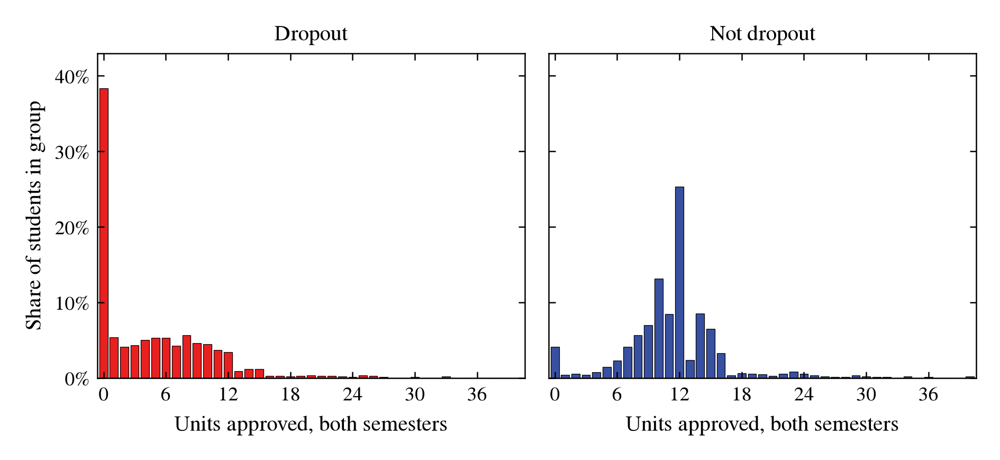
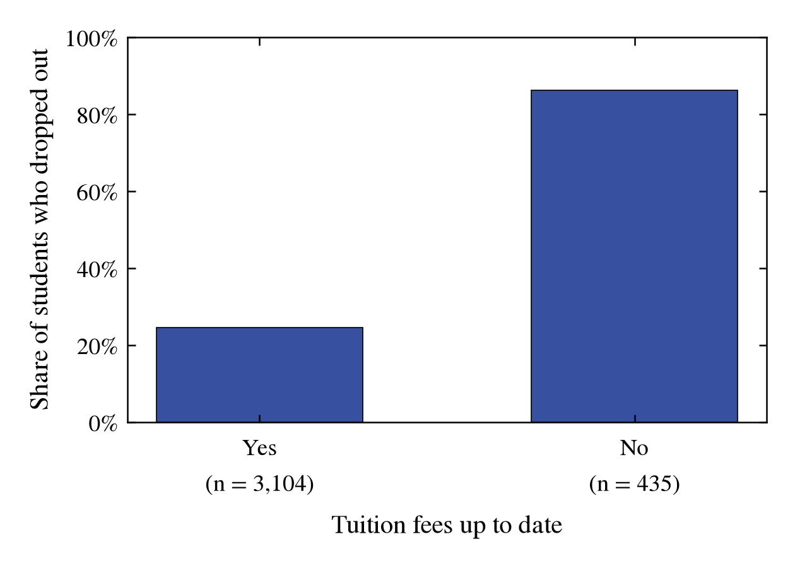
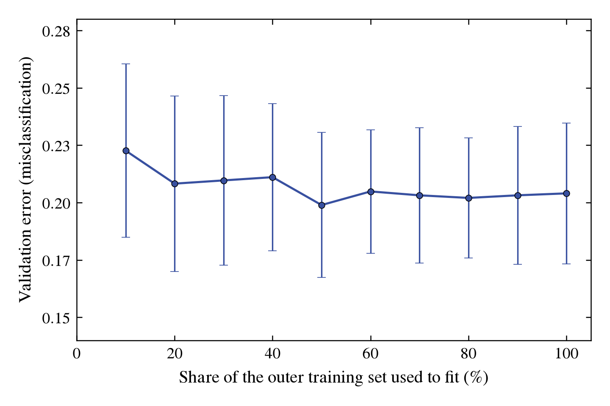

# Predicting student dropout from first-year results with logistic regression

## Abstract

This analysis asks whether students who will drop out of a higher-education course can be identified after their first year. The data are 4,424 students, with 36 inputs describing enrolment, demographics, and results in the first and second semesters. The outcome is Dropout yes or no; students still enrolled are counted as not dropped out. Two configurations of logistic regression were compared by cross-validation, and the chosen one was evaluated once on 885 held-out students. Success is judged by F2, which weights catching dropouts more heavily than unneeded flags, and the model must beat flagging every student. The chosen model reaches an F2 of 0.835 on the test students, against 0.703 for flagging everyone, so the success criterion is met. The two configurations are not separated by the cross-validation, and the estimate applies to students like those in the data, which was not checked for other institutions or for periods outside 2008/2009 to 2018/2019.

## Introduction

Students who leave higher education before finishing their course leave without a degree, and support can reach them only if they are identified in time. This analysis asks whether students who end their course as dropouts can be recognised from what is recorded by the end of their first year: their enrolment information and their results in the first and second semesters.

The data describe 4,424 students of the Polytechnic Institute of Portalegre, Portugal, the authors' own institution (Realinho et al., 2022). Each student is labelled Dropout or not; students who graduated and students still enrolled at the end of the normal course duration are both labelled not dropout. The aim is to predict this label for students who are not yet in the data, so that support can be offered to those flagged. Success is judged by F2, a score that weights catching dropouts more heavily than unneeded flags, because a missed dropout is the costlier error. A prediction is measured against two references: a baseline that never flags a student, and flagging every student.

The approach compares a small set of model types from the book by cross-validation on the training data, chooses one, and then evaluates the chosen model once on a held-out test set that has informed no choice.

1. Predict Dropout yes/no after the first year, for students not yet in the data, from enrolment information and the first and second semester results, with success measured by F2 on the test set against the two references.

## Methods

### Data and evaluation

The data come from one file of 4,424 students, one row per student: the Student Dropout dataset published by the UCI Machine Learning Repository (Realinho et al., 2021). The repository documents the inputs as the information known at enrolment and the students' results at the end of the first and second semesters, and the outcome as the student's status at the end of the normal course duration. The repository page does not name the institution or the enrolment years. The source paper does: the data come from the authors' own institution, the Polytechnic Institute of Portalegre, and the enrolments cover the academic years 2008/2009 to 2018/2019 (Realinho et al., 2022). No value is missing, and no row was removed or changed. Nine integer columns that are codes rather than amounts are treated as categories, and the yes/no flags and counts as numbers. The inputs are the first and second semester results. The source paper does not use the words "first year"; this analysis reads the two semesters as the first year, which is our reading and not a statement of the source.

The outcome is binary: Dropout is 1, and Graduate or still Enrolled is 0. Dropout is 32.1% of students. The data are split at random into 3,539 students for training and 885 for testing (20%). The split is stratified so that both sets keep the same share of dropouts, and the seed is 2026. Each student is one row, so no group is kept together. The test set is held out and used once, in the final evaluation; no choice is made with it.

The metric that decides between models is F2, the F-beta score with β = 2, which weights recall (the share of dropouts flagged) twice as heavily as precision (the share of flags that were right) (Lindholm et al., 2026). Recall, precision and the confusion matrix are reported alongside it. The baseline is the most common training class, which here means "not dropout" for every student. That baseline has F2 = 0. Flagging every student is reported beside each model as a reference. The success criterion is that the chosen model's F2 on the test set is above the F2 of flagging every student on the same test rows.

### Dropout after year one

The admissible configurations were set before any model was compared. Class probabilities are required, so only logistic regression is admissible. Plain logistic regression without the penalty is excluded, because its coefficients are not unique when the encoded inputs are exactly collinear. Two configurations remain: logistic regression with an L2 penalty, and the same with polynomial terms in the non-binary numeric inputs. The baseline, which always predicts "not dropout", is included in every comparison. Logistic regression with the L2 penalty is the simple-first model. It is compared with the baseline first, and the polynomial version is added afterwards.

Each configuration is compared by nested cross-validation on the training data. The outer loop uses 10 stratified, shuffled folds with seed 2026, the same for every configuration. Within each outer training set, an inner 5-fold grid search chooses the L2 strength, over values from 10⁻⁴ to 10⁴, and, for the polynomial version, the degree (2 or 3). The decision threshold is also chosen in the inner loop, by F2 over a grid from 0.05 to 0.95, so that each configuration is compared at its own best threshold. The L2 strength and the threshold of the final model are chosen in the same way, by 5-fold cross-validation on all training data, for the single refit described below.

The comparison between two configurations is the mean of the ten outer-fold differences in F2, and its uncertainty is the standard deviation of those differences. A configuration is eligible for recommendation if it beats the baseline by a clear margin, which is at least one standard deviation, and meets every requirement. The eligible configuration with the best mean F2 is identified, and any eligible configuration whose difference from it is less than half a standard deviation is treated as tied with it. Among the tied configurations, the one with the fewest add-ons is recommended. Selection confidence is reported from three factors: the margin over the runner-up, the margin over the baseline, and whether the learning curve of the recommended configuration is still falling at the full training set, judged by the validation error at 80% and 100% of the training data. The chosen configuration is refitted on all training data, and the locked test set is evaluated once, with the baseline evaluated on the same rows.

## Results

### The training data

Each panel is one outcome, and each bar counts the students with a given total of approved units, as a share of their own panel. The two panels can be compared although the groups differ in size.

<small><b>Figure 1.</b> Total curricular units approved over the first and second semesters, for the training students: 1,137 who dropped out (left panel) and 2,402 who did not (right panel). Each bar is the share of its panel's students with the total shown on the horizontal axis; the bars in each panel sum to 100%.</small>

Each bar is one group of training students, split by whether their tuition fees are up to date. The height of a bar is the share of that group who dropped out; the number under the bar is the number of students in the group.

<small><b>Figure 2.</b> Share of the training students who dropped out, for those whose tuition fees are up to date (left bar) and those whose fees are not (right bar). The number under each bar is the number of students in that group.</small>

### Dropout after year one

Logistic regression with an L2 penalty and the same model with polynomial terms both beat the baseline on each of the ten outer folds. The baseline, which predicts "not dropout" for every student, has an F2 of 0. Logistic regression with the L2 penalty has a mean F2 of 0.831 (SD 0.032) across the outer folds, and the polynomial version has 0.830 (SD 0.027). Their fold-by-fold difference is −0.0006 with SD 0.0116, which is within the spread of the folds, so the comparison does not separate the two. Logistic regression with the L2 penalty is recommended: it has no add-ons, and the polynomial version is within the same margin. On all training data, the chosen settings are an L2 strength of 0.01 and an F2 threshold of 0.20. Flagging every student gives an F2 of 0.703 on the same folds, as a reference. Selection confidence is Low. The margin over the runner-up is none, the margin over the baseline is clear, and the learning curve is adequate: the validation error at 100% of the training data is not lower than at 80%. The cross-validation ranking agrees with the prior ranking, which placed logistic regression with the L2 penalty first.

Each point in Figure 3 is the average validation error over the ten outer folds, at one share of the outer training set used for fitting. The bars show one standard deviation across the folds.

<small><b>Figure 3.</b> Validation error of logistic regression with the L2 penalty against the share of the outer training set used to fit, averaged over the ten outer folds; the bars show one standard deviation across the folds. Training and cross-validation data only.</small>

On the locked test set of 885 students, 284 of whom dropped out, the recommended model has an F2 of 0.835. Flagging every student on the same rows gives 0.703, and the baseline gives 0. The success criterion is met. The spread of F2 across the outer folds, 0.032, is the uncertainty reported with this result. The decision threshold, 0.20, was chosen by cross-validation on the training data. Of the 284 dropouts, 252 are flagged; of the 601 students who did not drop out, 121 are flagged. Precision is 0.676 and recall 0.887.

## Discussion

Logistic regression with an L2 penalty is recommended, and not the other configurations, for three reasons. The outcome is binary, which admits logistic regression, k-NN and tree models. The must-have that the model gives probabilities excludes k-NN and trees. Unpenalised logistic models are excluded, because the encoded inputs are exactly collinear, so their coefficients are not unique. Of the two configurations that remain, the version with polynomial terms has a mean F2 of 0.8305 against 0.8311 for the simpler one. The difference, 0.0006, is well inside the fold spread of 0.0116, so the comparison does not separate the two, and the simpler model was chosen on that basis. The selection confidence is Low for this reason: the margin over the runner-up is none, although the margin over the baseline is clear and the learning curve is adequate.

The model adds up the inputs, each multiplied by a weight learned from the training data, and turns the total into a probability that a student drops out. A student is flagged when that probability reaches 0.20, the threshold chosen by cross-validation to favour catching dropouts over unneeded flags. The L2 penalty, with strength 0.01 in the final fit, keeps the weights small. Each category of a categorical input has its own weight, and rare categories are grouped together. The model gives each student an estimate from these weights; it does not give a separate reason for any one student.

On the 885 test students, 284 of whom dropped out, the model has an F2 of 0.835. Flagging every student gives 0.703 on the same rows, and the baseline gives 0. Of the 284 dropouts, 252 are flagged and 32 are missed. Of the 601 students who did not drop out, 121 are flagged. The model flags 373 of the 885 students, 42% of the test group. Whether to act on those flags, and how many unneeded flags to accept, is a decision for the user; the threshold of 0.20 reflects the choice to weight missed dropouts more heavily. The success criterion is met on this test set. The uncertainty of the result is the spread of F2 across the outer folds, 0.032, and with 284 dropouts in the test set a few predictions either way move F2 noticeably.

The estimate applies to students like those in the data: in the first two semesters of their course, with the same kind of enrolment information. It is an average over such students and says nothing about the worst individual prediction. It was not checked for students at other institutions or in other periods. The data come from the authors' own institution, the Polytechnic Institute of Portalegre, and cover enrolments in the academic years 2008/2009 to 2018/2019 (Realinho et al., 2022). The outcome is the status at the end of the normal course length, as the source describes it. Students still enrolled are counted as not dropped out, and some of them may later leave. The source's preprocessing of outliers and missing values is not described, and no column has a stated unit.

Three limits qualify the evaluation beyond these. First, the comparison rests on ten outer folds, so a difference smaller than the spread cannot be told apart, which is the case for the two configurations. Second, the diagnosis found that the training error is high relative to the gap between training and validation error (underfitting holds). This suggests that the model may be too simple for the signal in these inputs, or that the inputs carry limited information about dropout. The data do not say which. Three more flexible families are open possibilities that were not tested: bagging, random forests and boosting (Chapter 8), neural networks (Chapters 6 and 7), and kernel methods (Chapter 9). None is claimed to do better. Third, the learning curve is flat from about half the training data, with a validation error of 0.199 at 50% and 0.204 at 100%. Settings were not re-tuned at each fraction, so the curve says little about what more data would do for other models. A fourth point: the check of whether the training error exceeds what the application needs could not be made, because the success criterion is stated in F2 and the training error is a misclassification rate; it was treated as not holding.

The prior ranking, made before any model was fitted, placed logistic regression with the L2 penalty first and the polynomial version second. Cross-validation agreed with that order, and the polynomial version tied with the first, as the prior expected. With two configurations compared, this is a weak check of the prior, and it does not show that the prior would agree across a larger set of models.

## Disclaimer

This report was written with the help of agentic AI at every stage: importing and describing the data, cleaning it, framing the questions, choosing and fitting the models, producing the figures, and drafting the text. Each step was directed and reviewed by the author, who agreed every method before it was applied, and each number reported here comes from code that can be re-run. The record of what was done, including what was tried and abandoned, is in the appendix.

## Appendix

*A pointer to [Appendix.md](Appendix.md), where the data, the decisions and the full workings are recorded.*

## References

- Lindholm, A., Wahlström, N., Lindsten, F. and Schön, T. B. (2026). *Machine Learning – A First Course for Engineers and Scientists*, 2nd edition, online draft of 1 September 2026. [https://smlbook.org/](https://smlbook.org/). Details taken from `ML Guide.md`. Not yet checked against the title page on smlbook.org; the local copy in `Attachments/smlbook/` is not in the workspace.
- Realinho, V., Vieira Martins, M., Machado, J. and Baptista, L. (2021). Predict Students' Dropout and Academic Success [Dataset]. UCI Machine Learning Repository. [https://doi.org/10.24432/C5MC89](https://doi.org/10.24432/C5MC89). Checked on the UCI dataset page and its metadata on 10 November 2026.
- Realinho, V., Machado, J., Baptista, L. and Martins, M. V. (2022). Predicting Student Dropout and Academic Success. *Data*, 7(11), 146. [https://doi.org/10.3390/data7110146](https://doi.org/10.3390/data7110146). Quotations and the enrolment years checked by the user against the paper; the agent's fetch of the paper returned HTTP 403, so the agent has not read it.
