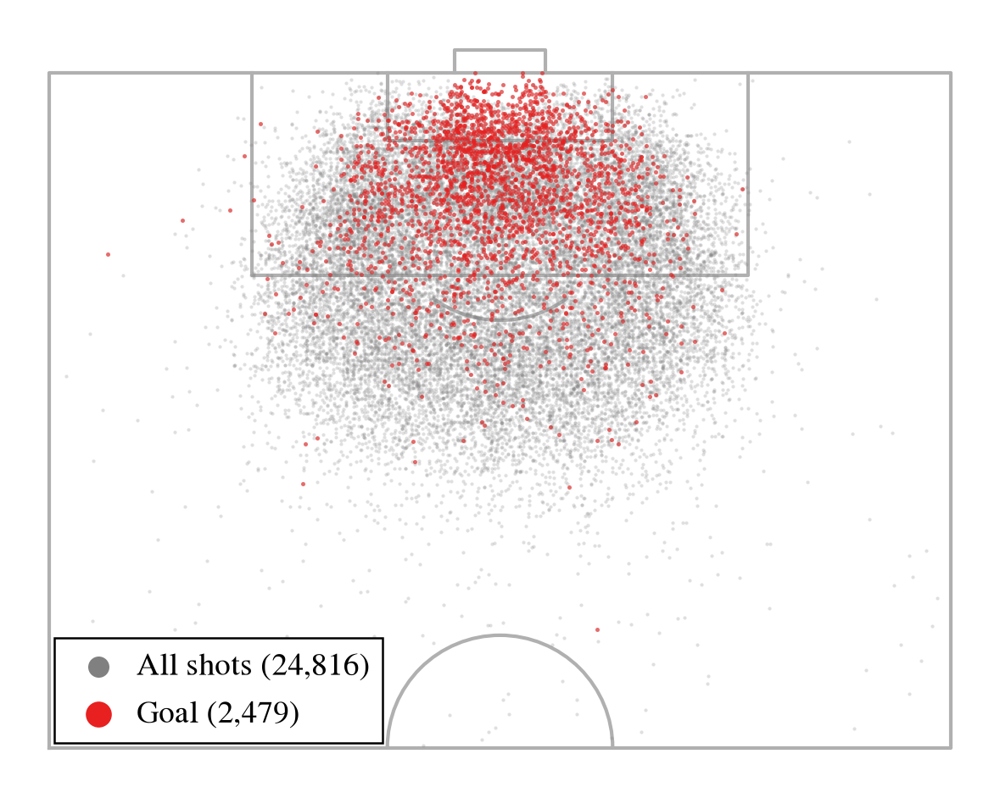
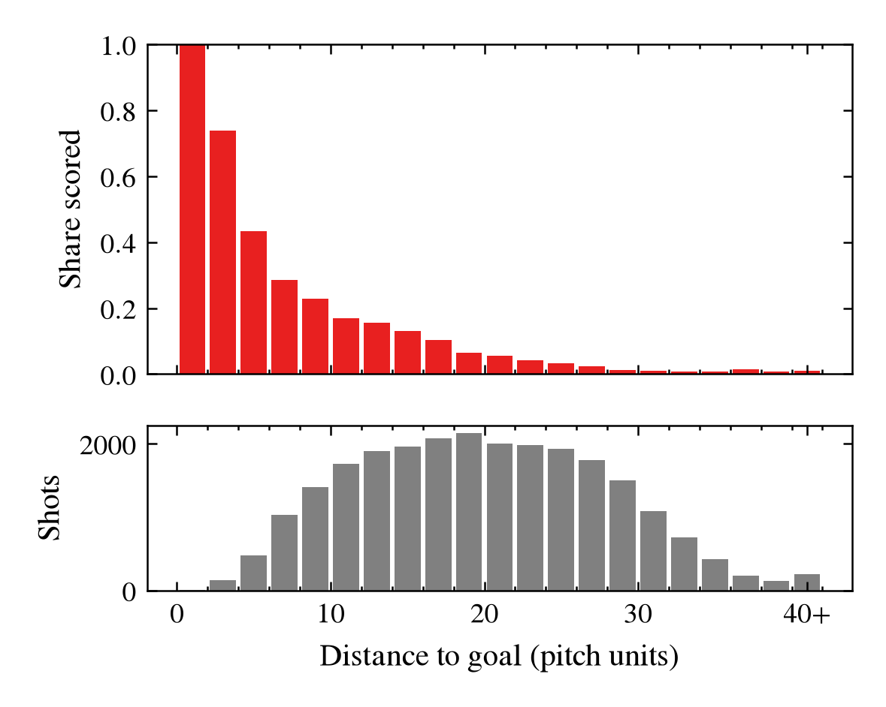
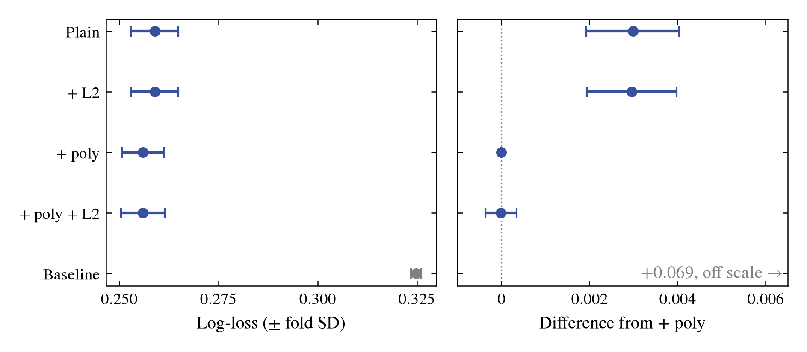
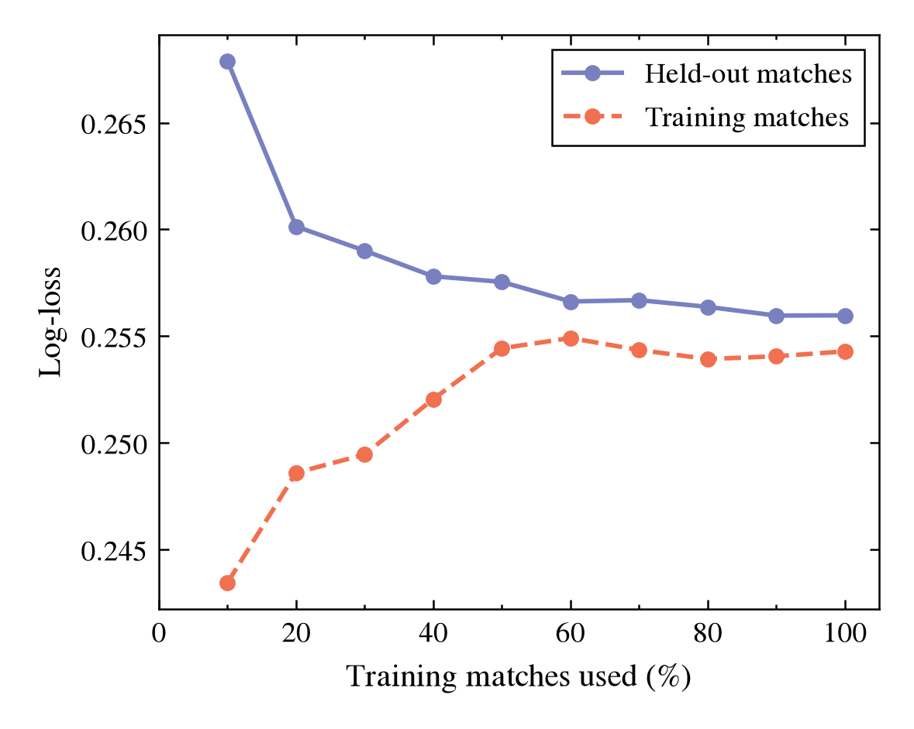
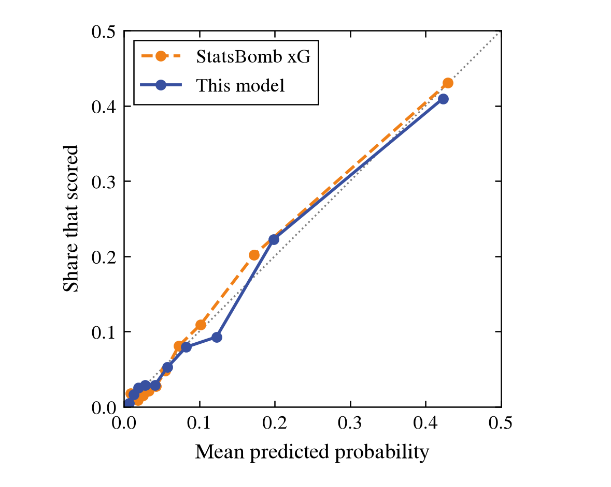
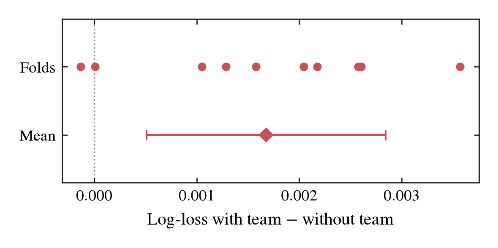
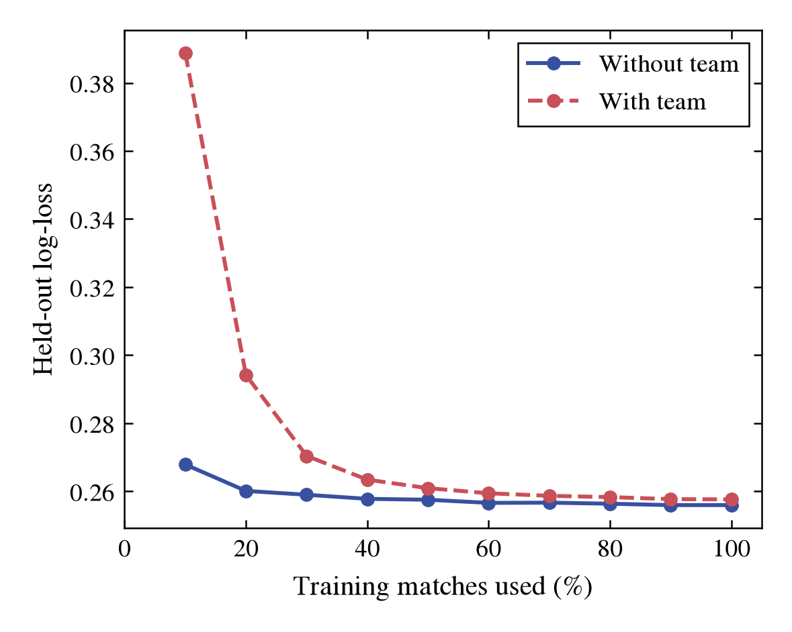

# Using expected goals to test whether some football teams convert their chances better than others

## Abstract

Do some football teams convert their chances better than others? We test this as a question of prediction: whether knowing which team took a shot improves the predicted probability that new shots score, once the quality of the chance is accounted for by an expected-goals (xG) model. The xG model is built from 31,509 open-play shots in StatsBomb's event data for the 2015/16 Premier League, La Liga, Serie A and Ligue 1, using each shot's distance and angle to goal, the opponents between the ball and the goal, the goalkeeper's position, and how the shot was struck and set up. Logistic regression models are compared by cross-validation on whole matches and the chosen one evaluated once on 6,693 held-out shots. As a measure of chance quality, the model reached a log-loss of 0.246, against 0.316 for a baseline giving every shot the same probability and 0.240 for StatsBomb's own xG: 92.6 % of StatsBomb's improvement over the baseline. Adding the shooting team did not improve the predictions, either in cross-validation or on the held-out shots. This shows that the team carried no information that helped predict new shots from one season of data; it is not a test of whether the teams' finishing differs.

## Introduction

Do some football teams convert their chances better than others? A team that scores more goals may simply create better chances, so the question can only be answered by comparing teams on chances of the same quality. Expected goals (xG) provides that comparison: the probability that a shot like this one ends in a goal, given where and how it was taken. If teams differ in how well they finish, knowing which team took a shot should say something about whether it scores beyond what the chance itself does.

We use event data from the 2015/16 season of four European men's leagues, the Premier League, La Liga, Serie A and Ligue 1, published by StatsBomb (StatsBomb Open Data). Analysts coded each shot from match video: where it was taken, how it was struck, how the attack was built, whether the shooter was under pressure, and the positions of the players around the ball. We use shots from open play. The outcome is whether the shot scored. A prediction is used as a probability rather than a yes or no, so models are judged by how well their probabilities match what happened, against a baseline that gives every shot the same probability and against StatsBomb's own xG values.

We test this as a question of prediction. First we build an xG model from the attributes of each chance and check it against StatsBomb's own xG, so that the measure of chance quality can be relied on. Then we add the shooting team to the model and ask whether its predictions for new shots improve. In both steps a small set of logistic regression models from Lindholm et al. (2026) is compared by cross-validation, and the chosen model is evaluated once on matches held out until that point. A test of this kind asks whether the team carries information that helps to predict new shots; a statistical test of differences between the teams themselves lies outside the methods used here.

1. Build the measure of chance quality: predict whether an open-play shot scores from the attributes of the chance alone, and compare the result with StatsBomb's xG.
2. Test the teams: predict the same with the shooting team added, and compare the result with the model from sub-task 1.

## Methods

### Data and evaluation

The data are StatsBomb's open event data for the 2015/16 Premier League, La Liga, Serie A and Ligue 1 (StatsBomb Open Data): 1,517 matches. We keep shots from open play. Penalties, direct free kicks and direct corners are excluded, and so are shots set up directly by a pass from a restart: a corner, free kick, throw-in, goal kick or kick-off. We also remove 73 shots whose records are implausible: one with a recorded duration of nearly half an hour, 41 taken from the shooter's own half, and 31 whose freeze frame shows no opposing goalkeeper. That leaves 31,509 shots, of which 3,121 (9.9 %) were goals. Information recorded only after the shot, such as where the ball ended up, whether it was deflected and the outcome itself, is never used as an input, and neither is StatsBomb's own xG value.

Shots from the same match share conditions, so the data is divided by match. Eight of the 38 rounds of fixtures in each league, drawn at random, form the test set: 319 matches and 6,693 shots. Every team plays in eight of them, except two Ligue 1 teams with seven, because one match is missing from the data. The test set is held out until a single final evaluation of each sub-task. The remaining 1,198 matches and 24,816 shots are used to fit and compare models.

Predictions are probabilities, so models are compared by log-loss: the average, over shots, of minus the logarithm of the probability the model gave to what actually happened. Lower is better. The Brier score, the area under the ROC curve, and the total of predicted goals against actual goals are reported alongside. The baseline gives every shot the training share of goals, 0.0999. StatsBomb's own xG values, scored on the same test shots, serve as a reference. Sub-task 1 succeeds if its model's improvement in test log-loss over the baseline is at least 90 % of the improvement achieved by StatsBomb's xG. Sub-task 2 succeeds if adding the shooting team improves the cross-validated log-loss of the sub-task 1 model by more than the variation of that improvement across folds, and the model with the team also has the lower log-loss on the test set.

### Sub-task 1: the measure of chance quality

The model sees thirteen inputs for each shot. Two describe where it was taken: the distance to the centre of the goal and the angle between the lines to the two posts. Two come from the freeze frame: the number of opponents other than the goalkeeper inside the triangle formed by the ball and the posts, and the distance from the shot to the goalkeeper. The rest were recorded by the analysts: the body part, the technique, how the attack started, the type of pass that set up the shot, and whether the shooter was under pressure, struck the ball first time, was one-on-one with the goalkeeper, faced an open goal or had won an aerial duel. Because every prediction must be a probability, the models compared are four forms of logistic regression (Lindholm et al., 2026): the plain model, the model with squared and cubed terms of the four numeric inputs, the model with an L2 penalty on its coefficients, and the model with both. The plain model is compared with the baseline first, and the others only once it clearly beats it. Each model is assessed by ten-fold cross-validation on the training matches, with every match kept whole within one fold. The penalty strength and the polynomial degree are tuned by a further five-fold cross-validation inside each training fold, so that the folds used for the comparison play no part in the tuning. A model is preferred only if its log-loss is lower than the others' by more than the variation across folds; between models that cannot be told apart, the simpler is chosen. The chosen model is refitted on all training shots and evaluated once on the test set, and the uncertainty of that result is taken as the spread of log-loss across the ten folds. We also compare its predicted probabilities with the observed share of goals among the test shots (a calibration curve); this check is our addition, since the book leaves the evaluation of calibration outside its scope (Lindholm et al., 2026).

### Sub-task 2: testing the teams

The model for sub-task 2 sees the same thirteen inputs as in sub-task 1, plus the team that took the shot, entered as one indicator per team. Each team's coefficient then measures how much more or less often its shots scored than those of a reference team with chances of the same quality, as described by the other inputs. The models compared, the cross-validation on the same ten folds of whole matches, the tuning and the choice between models are as in sub-task 1. The chosen model is then compared with the sub-task 1 model fold by fold, on the same matches; the team is counted as improving the predictions if the gain in log-loss exceeds the variation of that gain across folds and the model with the team also has the lower log-loss on the test set, where it is evaluated once.

## Results

### The training data

Figures 1 and 2 describe the 24,816 training shots, of which 2,479 were goals; the 6,693 test shots are not shown. In both, red marks goals or the share of shots that scored, and grey marks all shots.

<small><b>Figure 1.</b> Where the training shots were taken. The attacking half of the pitch, seen from behind the shooter with the goal at the top. Each grey dot is one shot (24,816); each red dot is a shot that scored (2,479), drawn on top of the grey.</small>

<small><b>Figure 2.</b> Share of training shots that scored, by distance from the shot to the centre of the goal. Each bar is a band 2 pitch units wide (a unit is about a yard); shots 40 units or more from goal are pooled in the last band. Top: share of the shots in the band that scored. Bottom: number of shots in the band.</small>

The bottom panel of Figure 2 shows how many shots lie behind each bar in the top panel: the closest band holds 8 shots and the last pooled band 217, while the bands between 10 and 28 units hold between 1,726 and 2,141 shots each.

### Sub-task 1: the measure of chance quality

All four logistic regression models predicted the held-out matches better than the baseline: their cross-validated log-loss lay between 0.2560 and 0.2590, against 0.3249 for the baseline (Figure 3). The two models with squared and cubed terms of the numeric inputs had a log-loss 0.0030 lower than the two without, a difference about three times its variation across folds. Adding the L2 penalty changed log-loss by less than 0.0001, with or without the polynomial terms. The recommended model is logistic regression with squared and cubed terms and no penalty. Its selection confidence is low: it cannot be told apart from the same model with the penalty (difference 0.00001, against a variation of 0.00035 across folds), while it is better than the baseline by 13.7 times the variation and its learning curve has levelled off (Figure 4).

<small><b>Figure 3.</b> How the models compared in ten-fold cross-validation on the training matches. Left: log-loss of each model on the held-out folds, dot = mean over the ten folds, line = ± one standard deviation across folds; the baseline gives every shot the training share of goals. Right: each model's log-loss minus that of the model with polynomial terms (+ poly), computed fold by fold on the same matches, dot = mean, line = ± one standard deviation of the fold-by-fold differences; positive is worse. The baseline lies off the right panel's scale. "Plain" is logistic regression without additions.</small>

The two panels of Figure 3 answer different questions. The left shows how much each model's log-loss varies from one group of matches to another; the right removes the part of that variation the models share, because they are scored on the same matches, and so shows how far apart the models are.

<small><b>Figure 4.</b> Learning curve of the recommended model. Log-loss on the training matches used (coral, dashed) and on the held-out matches (lavender, solid), against the share of the training matches used, from 10 % to 100 %. Each point is the average over the ten cross-validation folds.</small>

In Figure 4 the held-out log-loss falls from 0.2679 with 10 % of the training matches to 0.2564 with 80 % and 0.2560 with all of them, while the log-loss on the training matches rises from 0.2435 to 0.2543.

Refitted on all 24,816 training shots and evaluated once on the 6,693 test shots (642 goals, 319 matches), the recommended model had a log-loss of 0.2457, with an uncertainty of ± 0.0053 (the standard deviation across the cross-validation folds). On the same shots the baseline had 0.3161 and StatsBomb's xG 0.2401. The model's improvement over the baseline was 92.6 % of StatsBomb's, above the 90 % set as the success criterion. Its Brier score was 0.0704 (baseline 0.0867, StatsBomb 0.0683), its area under the ROC curve 0.831 (StatsBomb 0.838), and its predicted probabilities summed to 664.5 goals against the 642 scored.

<small><b>Figure 5.</b> Calibration on the test shots. The 6,693 test shots are sorted by predicted probability and split into ten groups of about 670 shots; each point is one group, placed at its mean predicted probability (horizontal) and the share of its shots that scored (vertical). Blue: the recommended model; orange, dashed: StatsBomb's xG, grouped by its own predictions. Grey dotted: the diagonal, where predicted and observed rates are equal.</small>

In the group with the highest predicted probabilities, the model's mean prediction was 0.423 and 41.0 % of the shots scored; for StatsBomb's xG the figures were 0.430 and 43.0 %. The largest gap between the model's mean prediction and the observed share in any group was in the eighth group, with a mean prediction of 0.123 and 9.3 % scored.

### Sub-task 2: testing the teams

All four models with the team predicted the held-out matches better than the baseline, with cross-validated log-loss between 0.2577 and 0.2606 against 0.3249. As in sub-task 1, the two with squared and cubed terms were ahead of the two without, by 0.0029, about 2.8 times its variation across folds, and the L2 penalty changed log-loss by less than 0.0001. The recommended model is logistic regression with squared and cubed terms and the team, without a penalty. Its selection confidence is low, because it cannot be told apart from the same model with the penalty (difference 0.0000005, against a variation of 0.00039 across folds). Compared fold by fold with the sub-task 1 model on the same matches, its log-loss was higher by 0.0017 on average, with a variation of 0.0012 across folds: higher in eight of the ten folds, practically equal in one and lower by 0.0001 in one (Figure 6). The cross-validation part of the success criterion is therefore not met. With fewer training matches the difference was larger: with 10 % of them, the held-out log-loss was 0.389 with the team and 0.268 without, and with all of them 0.2577 and 0.2560 (Figure 7).

Refitted on all training shots and evaluated once on the 6,693 test shots, the model with the team had a log-loss of 0.2464, with an uncertainty of ± 0.0058, against 0.2457 for the sub-task 1 model on the same shots, 0.3161 for the baseline and 0.2401 for StatsBomb's xG. The test part of the success criterion, a lower log-loss than the sub-task 1 model, is not met either. Its Brier score was 0.0706 and its area under the ROC curve 0.829.

<small><b>Figure 6.</b> The model with the team against the sub-task 1 model, fold by fold. Each upper dot is one of the ten cross-validation folds: the held-out log-loss of the team model minus that of the sub-task 1 model on the same matches; positive means the team model was worse. Lower: the mean of the ten differences, with ± one standard deviation of them. Dotted: no difference.</small>

<small><b>Figure 7.</b> Held-out log-loss of the recommended models with the team (rose, dashed) and without it (blue, the sub-task 1 model), against the share of the training matches used, from 10 % to 100 %. Each point is the average over the ten cross-validation folds.</small>

## Discussion

The answer to the question in the title, asked as a question of prediction, is that adding the shooting team did not improve the predictions: the model with the team had a higher log-loss than the model without it in eight of the ten cross-validation folds and on the held-out shots. With these inputs and one season of data, knowing which team took a shot did not help to predict whether new shots would score. It does not show that teams do not differ in how well they finish. The model with the team needed many more matches to reach a given accuracy than the model without it, and its held-out log-loss was still falling slightly when all the training matches were used. Whether the teams differ is a question about how variables are connected rather than about prediction, and the statistical methods suited to it lie outside the chapters of the book this work follows.

The comparison rests on the xG model of sub-task 1, logistic regression with squared and cubed terms of the four numeric inputs and no penalty. The squared and cubed terms lowered the cross-validated log-loss by 0.003, about three times its variation across folds, while the L2 penalty changed it by less than 0.0001 with or without them. Before any model was fitted, the ranking used to order the comparison had placed the models with polynomial terms last, because a large number of inputs makes such terms prone to overfitting (Lindholm et al., 2026). Here the terms were added to only four of the inputs and there were about 24,800 training shots, and cross-validation showed no sign of the overfitting the ranking anticipated: the log-loss on held-out matches was within 0.002 of that on the training matches. The selection confidence was low for a narrower reason: the chosen model and the same model with a small penalty could not be told apart, so the choice between them rests on preferring the simpler of two models that predict almost identically, not on a difference in how well they predict.

The model makes a prediction by adding up a contribution from each input on the log-odds scale and turning the sum into a probability between 0 and 1. Each of the four numeric inputs, the distance and angle to goal, the number of opponents between the ball and the goal, and the distance to the goalkeeper, contributes through a curve made of the input, its square and its cube, so that its effect can change in strength and direction across its range. Each recorded attribute of the shot, such as the body part, the technique or whether the shooter was one-on-one with the goalkeeper, shifts the log-odds by a fixed amount. The coefficients describe how these attributes were associated with goals in this data; they do not show that an attribute causes a shot to score.

On the 6,693 held-out shots the model reached 92.6 % of the improvement over the baseline that StatsBomb's own xG reached, above the 90 % set as the criterion before any model was fitted. Its Brier score and its ranking of shots (area under the ROC curve 0.831 against 0.838) were close to StatsBomb's, and across ten groups of shots ordered by predicted probability its mean prediction differed from the observed share of goals by at most 0.030, in the eighth group. The model can therefore be used to give a probability of scoring to an open-play shot of the kind it was trained on, as a measure of the quality of the chance. The data do not show which information StatsBomb's model uses that ours does not, and so they do not explain the remaining difference.

The test result is an estimate of the average error on new shots like those in the test set: open play, not set up directly from a restart, in four men's leagues in the 2015/16 season. It says nothing about how wrong the worst individual prediction can be, and it holds for other seasons only as far as their shots resemble these; with a single season, how much shots change between seasons could not be measured. Shots from the shooter's own half, set pieces and shots assisted directly from a restart were excluded, and the model should not be used for them. The freeze frames record only the players the analysts marked, so the two inputs taken from them are computed from incomplete pictures for some shots.

## Disclaimer

This report was written with the help of agentic AI at every stage: importing and describing the data, cleaning it, framing the questions, choosing and fitting the models, producing the figures, and drafting the text. Each step was directed and reviewed by the author, who agreed every method before it was applied, and each number reported here comes from code that can be re-run. The record of what was done, including what was tried and abandoned, is in the appendix.

## Appendix

The data, every decision with its reasoning, the cross-validation tables, the diagnosis and the full Recommendation Reports for both sub-tasks are recorded in [Appendix.md](Appendix.md). The code that produced every number and figure is in `Code/xg/`, and its outputs in `Code/outputs/xg/`.

## References

- Lindholm, A., Wahlström, N., Lindsten, F. and Schön, T. B. (2026). [*Machine Learning – A First Course for Engineers and Scientists*](https://smlbook.org/), 2nd edition, online draft version of 1 September 2026. Cambridge University Press (to be published).
- StatsBomb Open Data [Dataset]. StatsBomb. [https://github.com/statsbomb/open-data](https://github.com/statsbomb/open-data).
