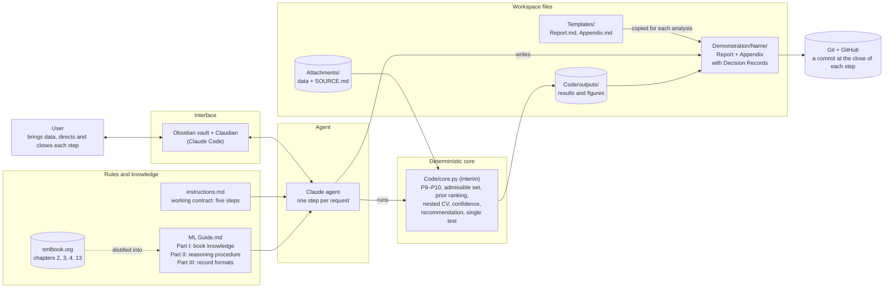
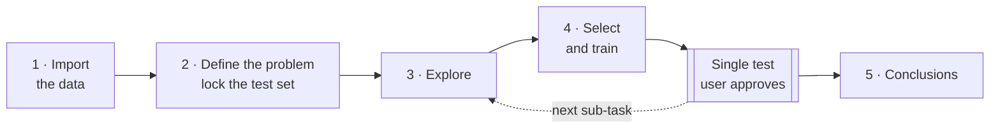

# [Title]

*A plain, literal title naming what the project built and what it is for.*

## Abstract

*The whole project in one paragraph: the problem it addresses, what was built in parts A, B and C, what the heart failure example showed, and the main limitation.*

## Introduction

*The area the project belongs to and why it matters; the background to each of the three parts — guiding a user through an analysis step by step, advising on model choice from a textbook, and keeping the work traceable and reproducible — and the gap each addresses; and what this project does.*

## Methods

Figure 1 shows the main parts of the system and how they connect.

<small><b>Figure 1.</b> System design: the user directs a Claude agent that follows the working contract (instructions.md) and the ML Guide, distilled from smlbook.org; the mechanical parts are computed by a deterministic core, and every analysis is recorded in its own folder and committed with git to a repository on GitHub.</small>

### A. The step-by-step agentic workflow

The workflow is a written contract, [instructions.md](instructions.md), which the agent loads at the start of every session through the project's `CLAUDE.md`. It divides an analysis into five steps, taken in a fixed order: (1) import and describe the data; (2) define the machine learning problem and lock a test set; (3) explore the training data; (4) select, train and evaluate a model for each sub-task; (5) write the conclusions and limitations. Figure 2 shows the five steps in order, with the points at which the user must decide before the work goes on.

The agent does one step per request. When the work is done, it says what changed and what it found. It then lists what the step covered, which parts are settled and which were never discussed, and asks whether anything is missing. It does not propose the next step. Only the user can close a step: an answer about one item does not close the others, and silence closes nothing. Within step 4, the user agrees the method before anything is cross-validated, and approves the single use of the test set.

Two documents grow as the work proceeds. `Appendix.md` is the running record from step 1: the data, the problem, the workings, every decision, the recommendation and a numbered log of each step. `Report.md` receives only what each step owns: the problem and its sub-tasks in step 2, before any model is fitted; figures in step 3; the Methods and Results paragraphs in step 4; and the Discussion in step 5. A disclaimer that agentic AI was used is in the report template from the start.

The contract can change during an analysis. A message that begins with FRAMEWORK edits `instructions.md` and applies the change to the analysis in progress, including work already done. It is committed separately from any analysis content, so that it can be carried over to the template.

<small><b>Figure 2.</b> The five-step workflow. After every step the agent records its decisions, asks the user whether anything is missing, and waits for the user to close the step before the next begins. The stages of step 4 are described in Methods B.</small>

### B. The ML advisor grounded in smlbook.org

The advisor's knowledge is [ML Guide.md](ML%20Guide.md), distilled from chapters 2, 3, 4 and 13 of the book at smlbook.org. It has three parts. Part I summarises what the book says, with page references. Part II is the reasoning procedure the advisor follows for every model decision. Part III fixes the record formats: the Decision Record and the Recommendation Report.

The governing principle is *rules propose, cross-validation decides, and the trace explains*. Constraints decide which configurations are admissible. Cross-validation decides among configurations that can be told apart, and simplicity decides among those that cannot. The prior ranking chooses what to try and records what the advisor expects, but it never decides.

Every rule in Part II carries a provenance tag. `[B p.x]` marks explicit advice from the book; `[B→I p.x]` marks a fact from the book that we have turned into advice; `[I]` marks our own inference or threshold. The tags do not change a rule's weight. They show how much of a recommendation rests on the book and how much on our own judgement.

The solution space is 14 configurations: k-nearest neighbours, decision trees, linear and logistic regression, and Poisson and exponential GLMs, with polynomial terms and L2 regularisation where the guide allows them. Any method outside this space is flagged and not used. A decision then passes through fixed stages:
- **Admissibility:** is this a supervised prediction problem, are rows grouped or ordered in time, and will new cases resemble the data?
- **Properties:** the output type, data size and the user's requirements, recorded as P1–P10.
- **Admissible set:** task gates, must-have requirements and compulsory modifiers.
- **Prior ranking:** a family-by-property matrix scores each configuration; the baseline, the simplest configuration and the three highest-ranked others are kept.
- **Cross-validation:** nested, 10 outer and 5 inner folds.
- **Diagnosis:** one improvement action per pass, in a fixed priority order.
- **Recommendation:** among configurations that clearly beat the baseline, the best and any within noise of it are candidates, and the one with the fewest additions wins. A selection confidence is computed from three stated factors.
- **Test evaluation:** a single evaluation on the held-out test set.

The mechanical parts are computed by code, not by the agent: the admissible set, the prior ranking, the cross-validation, the confidence and the recommendation. The planned reviewed core, `Code/advisor/`, is not yet built. Until it is, the agent writes an interim script for each analysis, `Code/core.py`, which implements the needed sections of Part II with every `[I]` threshold as a named constant. The user sees the script before its first output is used. The agent passes property values to the script and copies its outputs into the records unchanged. If the agent disagrees with an output, it says so in the record and raises it with the user. It never substitutes its own result.

### C. Traceability and reproducibility

Every decision is written at the time it is made as a Decision Record in `Appendix.md`, in a fixed format: the question, the evidence, the rules applied, the thresholds applied, the options, the agent's expectation, the decision, the reason each rejected configuration was ruled out, the user's involvement, and links to code and outputs. There are ten record types, from admissibility (`ADM`) to the final evaluation (`FINAL`). A record that is later reversed stays in place, marked as superseded. Each sub-task ends with a Recommendation Report in thirteen parts, assembled from its records.

Two kinds of tag make each line checkable. Rules carry the provenance tags above. Values carry an evidence tag: `M` for metadata or the user's statement, `T` for the training data, `CV` for cross-validation, and `TEST` for the single final evaluation. An evidence tag shows when the value could first have been known.

Files are identified by checksum. The SHA-256 of each source file is recorded in step 1, and the file is never modified. The version of the interim core is the SHA-256 of `Code/core.py`, and every record that uses the core names it. A `.gitattributes` rule keeps both files byte-identical on checkout, so the checksums stay valid. Every seed is recorded: the split, the folds and any other randomised step.

The test set is locked at the end of step 2. Nothing reads it until the user has approved the recommended configuration, it is used once per sub-task, and the core refuses a second test run. The work is committed at the close of each step, with only named files staged, and contract changes go in separate commits.

## Results

### A. The step-by-step agentic workflow

The demonstration ran all five steps on a heart failure dataset of 299 patients, predicting whether each patient died during follow-up. It produced 19 Decision Records and a 47-row Analysis Log ([Demonstration Appendix.md](Demonstration/Heart%20Failure/Demonstration%20Appendix.md)). Three problems were caught before any model was trained, each by a check the contract requires.

**A leaking input.** The step 1 check for columns that could leak the target flagged `time`, the length of follow-up, which ranged from 4 to 285 days. Follow-up ends either when the patient dies or when observation stops, so this value is fixed at the same moment as the outcome. The user set it aside, which left 11 inputs.

**A success target met by doing nothing.** In step 2 the user set success as an F2 score of at least 0.6. The contract requires a baseline, so the agent worked out what flagging every patient would score: F2 = 0.70 on the training patients, already above the target with no model at all. The user replaced the target. A model now succeeds only if its test F2 beats that 0.70 by more than the spread of F2 across the cross-validation folds (DR-08). The superseded target remains in the record (DR-05).

**A must-have that would have narrowed the comparison.** The user had made class probabilities with a tuned decision threshold a must-have. Under the guide's gates, only the logistic family meets that requirement, so k-nearest neighbours and decision trees would both have been excluded before any comparison. The agent raised this at the end of step 2, and the user changed the requirement to a strong preference (DR-09). The configuration eventually recommended was a tree.

### B. The ML advisor grounded in smlbook.org

The output is binary, so the task gate excluded 8 of the 14 configurations, all of them regression models. That left 6: four logistic regression variants, k-nearest neighbours and a tree (DR-12). The prior ranking kept plain logistic regression, logistic regression with L2, the tree, and logistic regression with polynomial terms. It dropped the other two, which scored lower (DR-13).

Before cross-validation, the agent recorded its expectation: plain and L2 logistic regression first, polynomial terms next, the tree last. Cross-validation reversed this. The tree had the highest mean F2 (0.56), followed by polynomial terms (0.53), with plain and L2 logistic regression tied (0.48) (DR-15). The record marks the prior as *disagree*. It notes that the matrix entries placing the logistic family ahead concern whether predictions can be inspected and whether probabilities are given, not predictive fit.

The recommendation rule chose the tree. The tree and the polynomial model could not be told apart (difference 0.03, against a fold spread of 0.14), and the tree has fewer additions. The selection confidence is *low* because the tree had no margin over the runner-up. It was clearly ahead of predicting no deaths (0.56, spread 0.11), and its validation error was no longer falling (DR-18). One diagnosis pass widened the tree's grid of minimum leaf sizes and gave no clear gain (0.52 against 0.56; DR-17).

The agent disagreed with one output of the core. Rerunning the grid search on all the training data produced a fully grown tree whose out-of-fold probabilities were only 0 and 1, and the guide does not allow a fully grown tree to be reported. The agent recorded the disagreement and held the result rather than replacing it. The user then fixed the tree at the setting chosen most often across the outer folds: depth 3, at least 20 patients per leaf, chosen in 4 of 10 folds. The core was changed and re-run under a new version (DR-18, superseded by DR-19).

The decision threshold was then tuned on the training data, giving 0.2. Refitted on the 239 training patients and evaluated once on the 60 held-out patients, 19 of whom died, the tree reached an F2 of 0.68 (fold spread 0.09), with recall 0.84 and precision 0.38. Success required an F2 above 0.79, so the criterion was not met. On the same patients, flagging everyone scored 0.70 and predicting no deaths scored 0. The model, threshold and criterion were not changed after the result was seen (DR-19).

### C. Traceability and reproducibility

As a worked example, take the test F2 of 0.68 in the Results of [Demonstration Report.md](Demonstration/Heart%20Failure/Demonstration%20Report.md) and follow it back:
1. **Decision Record.** DR-19 gives the value as 0.6780 with evidence tag `TEST`, the fold spread 0.0865, the 60 test rows and 19 deaths, and the user's words approving the single evaluation. It also quotes the success criterion from DR-08 and shows the required value, 0.7903.
2. **Rules.** The single test evaluation rests on the book (`[B pp.74, 328]`). The threshold tuning is a book fact turned into advice (`[B→I pp.53–54, 92–93]`). The success criterion is our own (`[I]`), with its uncertainty measure tagged `[B→I pp.71–73]`. A reader can see which parts of the claim come from the book and which are ours.
3. **Code.** The record names `core.final` at version `434ff8cd…`. That is exactly the SHA-256 of `Code/core.py` in the step 4 commit (`74e4a6e`). The outputs are `core_final.json` and `core_test_predictions.csv`. A separate script, `07_recompute_test_metric.py`, recomputes F2, recall, precision and the confusion counts from the saved predictions without the core, and gives the same values.
4. **Data.** The predictions cover the 60 test rows listed in `split.json`, which were drawn with seed 2026. The split was made from the source file whose SHA-256, `9c73cea7…`, was recorded in step 1 and still matches the file in `Attachments/`.

Steps 1, 2, 3 and 5 each have one commit. Step 4 has two: one for 4a–4g and one for the write-up in 4h. One gap appeared in tracing: the working copy of `Code/core.py` now hashes to a later version (`48840eba…`), because a command was added in step 4h, so the version that produced the test result has to be recovered from git.

## Discussion

*What the project achieved, what the findings on A, B and C mean when taken together, and what the work makes possible next.*

## Limitations

*What qualifies the findings: problems met, what was not built or not tested, and what a single worked example cannot show.*

## Disclaimer

This report was written with the help of agentic AI: designing the workflow, writing the code, running the example analysis and drafting the text. Each part was directed and reviewed by the author.

## Appendix

*Pointers to the material behind this report: [ML Guide.md](ML%20Guide.md), the advisor's knowledge and reasoning procedure; [instructions.md](instructions.md), the working contract; and [Demonstration/Heart Failure/](Demonstration/Heart%20Failure/), the worked example with its full record.*

## References

*Works cited in this report, each cited in the text in author–date style. Always the last section.*
