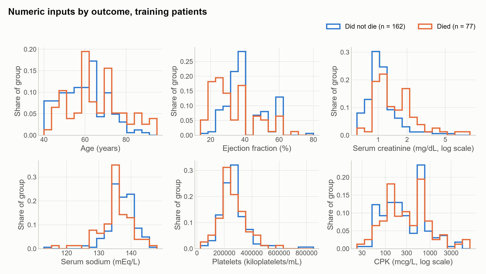
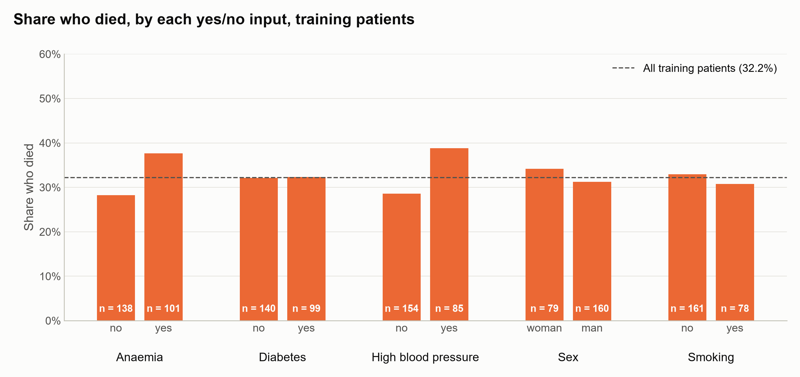
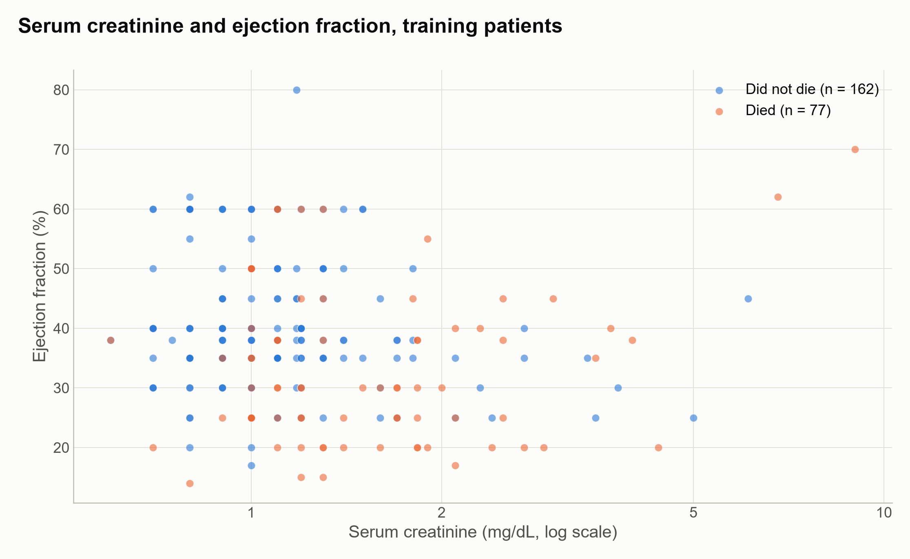
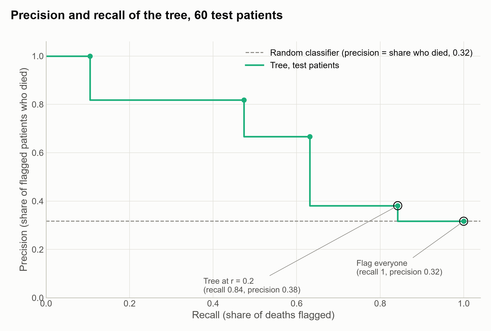

# Flagging heart failure patients at risk of death from routine clinical measurements: a comparison of simple models

## Introduction

Heart failure patients at high risk of dying could be monitored more closely if that risk could be recognised in advance. We want to flag such patients from the clinical measurements recorded in their medical records. The data, from the UCI Machine Learning Repository (Heart Failure Clinical Records, 2020), cover 299 patients with severe heart failure, NYHA class III or IV, treated at two hospitals in Faisalabad, Pakistan, in 2015. For each patient we predict whether they died during their follow-up period. Follow-up lasted between 4 and 285 days, so the outcome records death within each patient's own follow-up, not survival over a fixed period.

We predict from eleven inputs: age, sex, smoking, anaemia, diabetes, high blood pressure, ejection fraction, and the blood levels of creatinine phosphokinase, platelets, serum creatinine and serum sodium. The length of follow-up is in the data but isn't used, because it ends when the outcome happens. The question is one of prediction for new patients, not of which factors cause death. Missing a patient who dies is worse than a false alarm. So we judge models by the F2 score, which counts recall twice as heavily as precision. The same score is used to choose the model, to set the decision threshold on its predicted probabilities, and to judge whether it succeeded. We count the model as successful if its F2 on the held-out patients is above that of flagging every patient, 0.70 on the training patients, by more than F2 varies across the cross-validation folds.

We compare a small set of model types from Lindholm et al. (2026), *Machine Learning – A First Course for Engineers and Scientists*, by cross-validation on 239 of the patients, and then evaluate the chosen one once on the remaining 60, which are held out until that point.

1. Predict whether a patient dies during their follow-up period from the eleven inputs.

## Methods

### Predicting death during follow-up

For a yes/no outcome, the model types in scope are logistic regression, k-nearest neighbours and a classification tree. Logistic regression can also be given polynomial terms (the square, or the square and cube, of each numeric input), an L2 penalty, or both. Before any model was fitted, we ranked these options by a fixed set of rules that score how well each suits the problem as stated, for example our preference for models whose predictions can be inspected and that give probabilities. The ranking kept four for comparison: plain logistic regression, logistic regression with an L2 penalty, logistic regression with polynomial terms, and a tree. Serum creatinine and creatinine phosphokinase enter every model as their logarithms. We compared the four by nested cross-validation on the 239 training patients. The outer loop has 10 folds and is the same for every model. Within each outer training fold, a 5-fold inner loop tunes the model's settings: the tree's depth and minimum leaf size, the penalty strength, and the polynomial degree. Scaling is fitted within each fold, and every split keeps the share of deaths. Models are compared on F2 with a patient flagged when the predicted probability of death is above 0.5. From the models that clearly beat predicting no deaths, we take the one with the highest mean F2, together with any whose mean is within half the spread of the fold-by-fold differences, and choose the one with the fewest additions to its basic form.

For the chosen model we then tuned the probability threshold for F2, using probabilities predicted for training patients by models that hadn't seen them. Because models were compared at 0.5 and only the chosen one was tuned, the comparison may not pick the model that would do best after tuning. The final model uses the setting chosen most often across the outer folds, so the cross-validation estimate describes the tuning procedure rather than exactly this setting. We refitted it on all 239 training patients and evaluated it once on the 60 held-out patients. Its uncertainty is the standard deviation of F2 across the 10 outer folds at the tuned thresholds.

## Results

Figures 1 to 3 describe the 239 training patients; the 60 held-out patients are not shown. In all three, blue marks patients who did not die during follow-up and orange those who died.

<small><b>Figure 1.</b> Distribution of the six numeric inputs among training patients who did not die (blue, n = 162) and who died (orange, n = 77). Each outline is a histogram whose bar heights are the share of that group, so the two outlines can be compared despite the different group sizes. Serum creatinine and creatinine phosphokinase are drawn on a logarithmic axis.</small>

Each panel compares the shapes of two distributions, not their counts. Where the orange outline lies to one side of the blue one, patients who died tended to have values on that side.

<small><b>Figure 2.</b> Share of training patients who died, within each level of the five yes/no inputs. The number inside each bar is the number of patients at that level. The dashed line is the share who died among all 239 training patients, 32.2 %.</small>

<small><b>Figure 3.</b> Serum creatinine (logarithmic axis) against ejection fraction for each training patient, coloured by outcome. Ejection fraction takes only 16 distinct values among the training patients, so many points lie on the same horizontal lines and some overlap.</small>

### Predicting death during follow-up

In cross-validation the tree had the highest mean F2 (0.56), followed by logistic regression with polynomial terms (0.53), and plain and penalised logistic regression (both 0.48). Predicting no deaths scores 0, and flagging every patient scores 0.70. The tree and the logistic model with polynomial terms couldn't be told apart (difference 0.03, with a fold spread of 0.14), and the tree was chosen as the simpler of the two. The selection confidence is low. The tree is clearly ahead of predicting no deaths (by 0.56, spread 0.11) but not of the runner-up, and its validation error wasn't still falling as training data was added. The chosen tree has a depth of at most 3 and at least 20 training patients in each leaf, and it flags a patient when the predicted probability of death is above 0.2. On the 60 held-out patients, 19 of whom died, it reached an F2 of 0.68 (fold spread 0.09). It flagged 16 of the 19 deaths (recall 0.84), and 16 of the 42 patients it flagged died (precision 0.38). Success required an F2 above 0.79, which is the 0.70 that flagging everyone scores on the training patients plus the fold spread, so the criterion was not met. On the same 60 patients, predicting no deaths scores an F2 of 0 and flagging every patient 0.70.

<small><b>Figure 4.</b> Precision against recall for the recommended tree on the 60 held-out patients, 19 of whom died. Each marker is one threshold the tree can distinguish. The curve has few points because the tree gives only 5 distinct probabilities. The two ringed points are the tree at the chosen threshold of 0.2 and flagging every patient. The dashed line is the precision of a random classifier, the share of patients who died (0.32). The flag-everyone point lies on it by definition, since flagging everyone has full recall and precision equal to that share.</small>

Moving right along the curve means a lower threshold: more patients are flagged, so recall rises and precision falls. The curve's last point, at full recall, is the tree flagging every patient.

## Discussion

We chose the tree because, in cross-validation, it and logistic regression with polynomial terms couldn't be told apart, and the tree is the simpler of the two. The difference in F2 between them was 0.03, against a fold spread of 0.14. That is why the selection confidence is low: the choice rests on simplicity, not on a demonstrated advantage. Before any model was fitted, our ranking expected the logistic models to lead and the tree to come last. The rules behind that ranking concern whether a model can be inspected and whether it gives probabilities, not how well it fits. Since the two leading models couldn't be told apart, the disagreement may be chance. Two features of the method qualify the choice further. As described in the methods, models were compared at a threshold of 0.5 and only the tree's threshold was tuned, so the comparison may not have picked the model that would do best after tuning. And the tree's final setting is the one chosen in 4 of the 10 folds, so the cross-validation estimate of 0.69 at the tuned thresholds describes the tuning procedure rather than this tree exactly.

The tree uses two of the eleven inputs, ejection fraction and serum creatinine, and sorts patients into five groups. At the threshold of 0.2 it flags four of the five. So in practice it flags most patients and picks out a single group as low risk: those with an ejection fraction above 27.5 % and serum creatinine at or below 0.95 mg/dL. In the training data, 2 of the 56 patients in that group died (4 %). Within the tree, a lower ejection fraction and a higher serum creatinine go with a higher share of deaths, which is the direction reported by Chicco and Jurman (2020; see Appendix, References) and expected at the outset. This describes the rule the tree learned. It doesn't show that either measurement causes death, and our aim was prediction, not explanation. Nor does the absence of the other nine inputs show that they carry no information about the outcome. The tree is limited to three levels and at least 20 patients per group, so it can use only a few inputs. Its predicted probabilities take only five values, and it is meant only for patients whose measurements lie within the range of these data.

The tree didn't meet our success criterion. On the 60 held-out patients its F2 of 0.68 was close to the 0.70 of flagging every patient, and the difference between them is much smaller than the fold spread of 0.09. It flagged 42 of the 60 patients and missed 3 of the 19 deaths. In practice it differs from flagging everyone only through the low-risk group, and the held-out patients qualify that group. Of the 18 held-out patients the tree didn't flag, 3 died (17 %), against 2 of 56 (4 %) in the training data. This evaluation doesn't show the low-risk group to be safe, and 18 patients are too few to estimate its death rate precisely. More generally, with 19 deaths among 60 held-out patients, only large differences in F2 could be detected. Follow-up also varied from 4 to 285 days, so not being flagged means not expected to die within that patient's own follow-up, not over any fixed period. On this evaluation, the tree doesn't support monitoring the low-risk group less closely.

All of these results are averages over patients like those in the data. They say nothing about how wrong the prediction for an individual patient can be. They hold only while new patients resemble these: people with NYHA class III or IV heart failure, treated at two hospitals in Faisalabad, Pakistan, in 2015. Before the tree, or this way of building it, is used for any other population, it would have to be evaluated on patients from that population.

## Disclaimer

This report was written with the help of agentic AI at every stage: importing and describing the data, cleaning it, framing the questions, choosing and fitting the models, producing the figures, and drafting the text. Each step was directed and reviewed by the author, who agreed every method before it was applied, and each number reported here comes from code that can be re-run. The record of what was done, including what was tried and abandoned, is in the appendix.

## Appendix

*A pointer to [Appendix.md](Appendix.md), where the data, the decisions and the full workings are recorded.*

## References

- Chicco, D. and Jurman, G. (2020). [Machine learning can predict survival of patients with heart failure from serum creatinine and ejection fraction alone](https://doi.org/10.1186/s12911-020-1023-5). *BMC Medical Informatics and Decision Making*, 20, 16.
- Heart Failure Clinical Records [Dataset]. (2020). UCI Machine Learning Repository. [https://doi.org/10.24432/C5Z89R](https://doi.org/10.24432/C5Z89R).
- Lindholm, A., Wahlström, N., Lindsten, F. and Schön, T. B. (2026). [*Machine Learning – A First Course for Engineers and Scientists*](https://smlbook.org/), 2nd edition, online draft version of 1 September 2026. Cambridge University Press (to be published).
