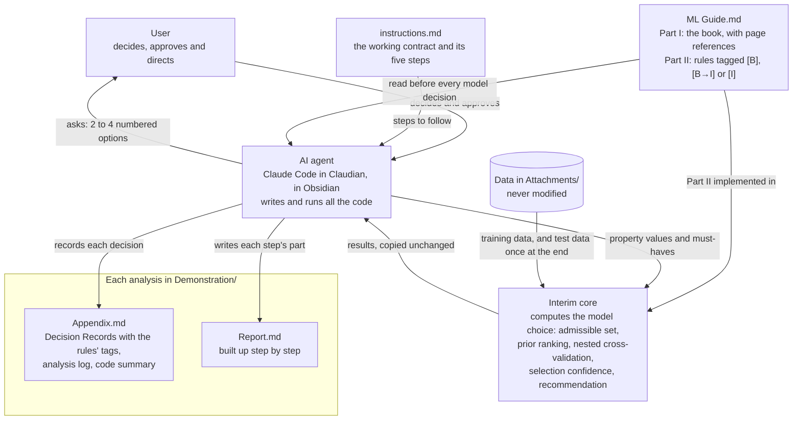

# A Step-by-Step Workflow for Supervised Machine Learning Models with an AI Agent, Following a Textbook

## Abstract

Supervised machine learning involves many choices besides fitting a model. A reader can check these choices only if they are recorded as they are made. This project builds a step-by-step workflow in which an AI agent proposes each step and writes all the code, and the user takes every decision. It carries the workflow through six analyses of five public datasets: death in heart failure, twice, the second time with the workflow as revised during the project; sepsis in intensive care; the price band of mobile phones; student dropout from first-year results; and the fuel use of cars from their design, the one analysis with a numerical outcome. The workflow chooses among linear, logistic and generalised linear models, k-nearest neighbours and decision trees, with polynomial terms and L2 regularisation where the book allows them. It removes configurations that cannot serve the problem, ranks the rest before any model is fitted, and recommends the simplest whose score cannot be told apart from the best. The model types and the working practice come from Lindholm et al. (2026), and each rule applied is tagged with its source where the guide has a tag for it. Models are compared by nested cross-validation on the training data. The recommended model is evaluated once on held-out test data, and the spread of the metric across the outer cross-validation folds is its uncertainty. The success criterion was met in four analyses: Sepsis (test PR-AUC 0.0847 against 0.0315 for flagging nobody), Mobile Price (test accuracy 0.9600 against 0.2500), the Heart Failure rerun (test PR-AUC 0.6983 against 0.3167) and Student Dropout (test F2 0.8350 against 0.7026 for flagging every student). It was not met in the original Heart Failure analysis (test F2 0.6780, where more than 0.7903 was required) or in the fuel-use analysis, where the root mean squared error on 78 test cars was 1.08 litres per 100 km, against 3.66 for the average guess, above the 1-litre limit. The selection confidence was Low in five analyses and High only in Mobile Price. The ranking placed the cross-validation winner first in two analyses. The workflow was revised on the same analyses that test it, and only one analysis has a numerical output, so how it performs on other kinds of problem has not been tested. The next steps are to run the analyses through a single reviewed core, and to test the workflow on further problems with numerical or count outputs.

## Introduction

Fitting a model is the smaller part of supervised machine learning. The larger part is the set of choices around it. Made after the results are seen, these choices can turn an evaluation into a description of whatever happened to work. Unless they are written down as they are made, a reader cannot check them. This matters more when an AI agent does much of the work: a reader then needs to see not only what was chosen, but who chose it and on what grounds. This report covers three parts of these choices: the models that are compared, how the work relates to the book, and how the models are trained and validated.

Some of these choices concern the model: what exactly is predicted and from what, which model types are compared, and when to stop. Lindholm et al. (2026) set out a working practice for these choices. For the model, the practice is to start simple and to add complexity only when the errors call for it.

The book is openly available at smlbook.org. Its chapters 2, 3, 4 and 13 cover both the model types and this practice, so it gives a fixed reference against which each choice can be checked. Where the book gives advice, a choice can cite it. Where it does not, the choice has to be marked as ours.

The other choices concern training and validation: which metric decides between models, which baseline a model must beat, and which data are held back for the final test. Here the book's practice is to fix the problem, the metric, a baseline and the test data before any model is fitted. Models are then compared by cross-validation on the training data, and the test data are used once, at the end.

This project builds a step-by-step workflow that follows this practice, from the data to a model evaluated once on held-out test data. An AI agent proposes each step and writes and runs all the code; the user takes every decision that is theirs. The book's advice is distilled into a guide, in which every rule is tagged as the book's advice, a fact from the book turned into advice, or our own. The mechanical parts of the model choice are computed by code rather than judged by the agent. Every choice is written down as it is made, with the tags of the rules it applies, so that each can be traced to its source. The aim is not the best possible model for any one problem. It is a record of how each model was chosen that a reader can check against the book.

The workflow was carried through six analyses of five public datasets. Five of the analyses predict a category, and one predicts a number:
1. Heart Failure: predicting death during follow-up for 299 heart failure patients from eleven clinical inputs, five of them yes/no (Chicco and Jurman, 2020; Heart Failure Clinical Records, 2020).
2. Sepsis: predicting, from a patient's first six hours in intensive care, whether the sepsis label switches on during hours 7 to 54. The dataset holds 40,336 intensive-care patients at two US hospitals, of whom the analysis used 39,088 (Reyna et al., 2019, 2020).
3. Mobile Price: predicting which of four price bands a mobile phone falls in from 20 of its specifications, for 2,000 phones (Sharma, 2018).
4. Heart Failure rerun: the first problem again, on the same data and the same test patients, with the workflow as it stood after the changes made while the other analyses were worked through. It was run to see what the changes to the workflow did, by comparing the two versions on exactly the same patients.
5. Student Dropout: predicting whether a student drops out, from the enrolment information and the first- and second-semester results of 4,424 students. Students still enrolled are counted as not dropping out (Realinho et al., 2021; Realinho et al., 2022).
6. Auto MPG: predicting the fuel use, in litres per 100 km, of a car that has not yet been tested on the road, from its design, model year and country of origin, for 392 cars from model years 1970 to 1982 (Quinlan, 1993).

## Methods

The method is described under three headings, which Results follows in the same order.

Figure 1 shows the parts of the workflow and how they connect: who asks, who decides, who computes and what is recorded.

<small><b>Figure 1.</b> The parts of the workflow and how they connect. Arrows show who asks, who decides, who computes and what is recorded.</small>

### The machine learning methods used

The workflow chooses among a fixed set of model types from chapters 2 and 3 of Lindholm et al. (2026): linear regression, logistic regression, Poisson and exponential generalised linear models, k-nearest neighbours and decision trees. Polynomial terms (squares and cubes of the numerical inputs) and L2 regularisation can be added to the regression models where the book allows them, giving fourteen configurations in all. Methods from other chapters are not used, and which inputs a model receives is agreed with the user beforehand. The output decides the families (Lindholm et al., 2026). In five of the six analyses the output is a category, so linear regression, the Poisson model and the exponential generalised linear model were excluded, and only logistic regression, k-nearest neighbours and decision trees remained. In Auto MPG the output is a positive amount, so the logistic and Poisson models were excluded and eight configurations remained. Two rules remove logistic regression without regularisation when its parameters would not be well defined: when a straight boundary separates the training classes perfectly, and when some inputs exactly duplicate others (Lindholm et al., 2026). The second is our reading of the book. These rules removed the unregularised logistic models in Mobile Price, Sepsis and Student Dropout. In Student Dropout the user also marked class probabilities as essential, which left only the logistic configurations.

The remaining configurations are ranked before any model is fitted, from properties of the problem and the user's stated preferences. This ranking is our addition, not the book's, and it decides what is compared first, not what is chosen. The best-ranked few are kept, with the simplest model for the task and a baseline. In the original Heart Failure analysis and its rerun, the ranking left out k-nearest neighbours, and in the rerun also the decision tree. In Auto MPG the exponential generalised linear model was ranked first, the same model with L2 regularisation second, and k-nearest neighbours and decision trees third; the four linear regression configurations were left out, and the user then asked for linear regression to be kept as a simple starting model. The kept configurations are compared by cross-validation on the agreed metric, as the book recommends (Lindholm et al., 2026), with each model's own settings tuned inside the training part of each fold. The leading model is then checked for underfitting and overfitting, following the book's chapter on working practice (Lindholm et al., 2026), and the comparison is extended where the check points. In Mobile Price this widened the range of regularisation strengths, and in the rerun it brought back k-nearest neighbours and the decision tree. In Student Dropout the check found underfitting, but the options it allowed were excluded: more polynomial terms, because the inputs were already many, and the other model types, because the required class probabilities excluded them. In Auto MPG the leading method's training error was just above the 1-litre limit, which the user chose to keep. A check for underfitting then added linear regression with polynomial terms, which did not change the leading method, and the checks stopped when the user said that no further measurements were available.

The recommendation is the simplest of the models whose cross-validated score cannot be told apart from the best, following the book's advice not to settle on a complicated model where a simpler one would do (Lindholm et al., 2026). "Cannot be told apart" means a difference smaller than half its variation across the folds, a threshold that is ours. The rule decided four of the six analyses: the decision tree in the original Heart Failure analysis; logistic regression with L2 regularisation in Sepsis; plain logistic regression in the rerun; and, in Student Dropout, logistic regression with L2 regularisation over the same model with polynomial terms, whose cross-validated F2 differed by less than half its variation. In Mobile Price, one model was ahead of the others by more than that variation, so the rule did not apply. In Auto MPG, k-nearest neighbours, linear regression and linear regression with polynomial terms could not be told apart, and the tie-break on the prior ranking chose k-nearest neighbours. Each recommendation is reported with a selection confidence, which is ours and computed from three factors. C1, the margin over the runner-up, is clear if the recommended model is ahead by at least the variation of the difference across the folds, moderate if by at least half of it, and none otherwise. C2, the margin over the baseline, is clear if it is at least that variation. C3 is whether more training data was still lowering the validation error between 80 % and 100 % of the training data, and is limited if it was. Confidence is High when C1 and C2 are clear and C3 is adequate, Low when C1 is none or C2 is not clear, and Medium otherwise.

### How it relates to smlbook.org

The method rests on chapters 2, 3, 4 and 13 of Lindholm et al. (2026), and Part I of the guide summarises them with page references. The practice that decides a result is the book's (Lindholm et al., 2026): the problem, the metric, a baseline and the test data are fixed before any model is fitted; models are compared by k-fold cross-validation on the training data; the test data are held out and used once, at the end; the work starts simple and adds complexity only when the errors call for it; and when one outcome is rare, precision, recall and the precision–recall curve are used rather than the misclassification rate. Every rule in the guide is tagged as the book's advice ([B]), a fact from the book turned into advice ([B→I]), or our own ([I]), and the decision records copy the tags. Where the evidence suggests a method outside the four chapters might help, it is recorded as a flag and never claimed to be better. Student Dropout flagged bagging, random forests and boosting, neural networks, and kernel methods; Sepsis flagged survival analysis, which the book does not cover.

Several parts are ours, and are marked as ours wherever they are used: the step-by-step workflow, in which the user agrees each step before it is applied; the interim programs that compute the mechanical parts, so that the agent does not; the prior ranking of candidates before any model is fitted, with the expected order written down beforehand and checked afterwards; the selection confidence; and the numerical thresholds that turn the book's advice into rules, such as the half-variation test for "cannot be told apart". Three gaps the book leaves are also ours: the folds are stratified in the same way as the test split; the uncertainty of the test result is taken from the spread across the outer folds, resting on the book's account of k-fold cross-validation; and a configuration created by backward elimination can be recommended only if the removal was kept, so that the inputs remain a decision taken with the user. Where a threshold is tuned for F2, the F2 of flagging every case is reported beside the model's, as a reference that decides nothing. Fitting every preprocessing step inside each fold extends the book's rule that preprocessing is fitted on the training data only.

The guide's method changed nine times while the analyses were worked through, and each change is recorded in its version note. Six were made before 10 November 2026: the rule for diagnosis errors on imbalanced classes (18 October); the stratified folds, the test uncertainty and the underfitting check against the required error (27 October); backward elimination (28 October); and the F2 reference (30 October). Three of the six were prompted by Sepsis. Three more were made on 10 November: the diagnosis errors combine two rules, one for an error measure that is itself an error function and one for an imbalanced class, as combined in the merge of the two branches; logistic regression falls under the rule for unregularised fits; and the F2 threshold is tuned inside each configuration's cross-validation. The original Heart Failure analysis ran before any of these changes. Sepsis ran under the first four, and its first diagnosis pass was re-run after the underfitting change. Mobile Price ran under the first four from its start, and the fifth and sixth were made after it finished. The Heart Failure rerun ran under the first six. Student Dropout and Auto MPG ran under the rules as amended on 10 November: Student Dropout applied the amended rule for logistic regression and tuned its threshold inside each configuration, and Auto MPG, a regression, uses its error measure as it is.

### Training and validation methods

Each analysis divided its data once into training data and test data, before any model was fitted (Lindholm et al., 2026), and held back a fifth of the rows as test data. The rows were shuffled first, as the book advises. Every split except Auto MPG's was also stratified, so that both parts keep the same share of each outcome; stratifying the split is our choice. Auto MPG is a regression with no classes, so its split was not stratified; instead, rows with the same car name were kept together on one side of the split, so that no car model appears on both sides. The Heart Failure rerun made no new split: at the user's choice, it reused the original test set, so the two versions are compared on exactly the same 60 patients. The test data were locked, and nothing in the exploration or the model choice read them. All six analyses used seed 2026 for the split and the folds.

The models were compared on the training data by k-fold cross-validation (Lindholm et al., 2026). The training data were divided into ten parts, or folds; each model was fitted ten times, each time on nine folds and scored on the tenth, and the ten scores were averaged. Every model was scored on the same folds, so that two models can be compared fold by fold. The folds were stratified in the same way as the split, except that Sepsis was stratified by outcome and hospital, and Auto MPG was grouped by car name, so that cars with the same name always fell on the same side. Each model's settings were chosen by a second, five-fold cross-validation inside each of the ten training parts, and the model was scored only on the part held back, so that the settings were never chosen on the data that score the model (Lindholm et al., 2026); this nested design is ours. Every step that learns from the data, such as scaling the inputs, was fitted inside the training part each time. Where the metric needed a decision threshold, it was chosen after the model had been selected, on the training data alone, in the original Heart Failure analysis, Sepsis and the rerun. In Student Dropout it was chosen inside each configuration's cross-validation, so that each configuration was compared at its own best threshold. Mobile Price and Auto MPG needed no threshold.

Only after the user had approved the chosen model was it refitted on all the training data and evaluated once on the test data, with the baseline evaluated on the same test data. The uncertainty reported with that result is the standard deviation of the deciding metric across the ten outer folds. Each fold is smaller than the test set, so this approximates the uncertainty of the test result rather than measuring it; using it in this way is ours. Each analysis fixed its success criterion before any model was fitted. The baseline was flagging nobody in Sepsis and the rerun, the most common class in Student Dropout, the most common price band in Mobile Price, the F2 of flagging every patient on the training rows in the original Heart Failure analysis, and the average guess in Auto MPG. In the four analyses other than Student Dropout and Auto MPG, the test result minus its uncertainty had to exceed the baseline. In Student Dropout the model's test F2 had to be above the F2 of flagging every student on the same test rows. In Auto MPG it had two parts: a test error of at most 1 litre per 100 km, and a margin over the average guess of at least the spread. Table 1 sets out these choices for each analysis.

<small><b>Table 1.</b> Split, cross-validation folds, metric, decision threshold and uncertainty for each analysis.</small>

| Analysis | Split | Training / test rows (positives) | Folds stratified or grouped by | Metric for comparing and tuning | Decision threshold | Uncertainty of the test result |
| --- | --- | --- | --- | --- | --- | --- |
| Heart Failure (original) | new | 239 / 60 (77 / 19 deaths) | outcome | F2 | chosen after selection to maximise F2 | fold variation of F2 at the tuned threshold |
| Sepsis | new, by patient | 31,270 / 7,818 (984 / 246 with sepsis) | outcome and hospital | PR-AUC | chosen after selection, on training data, to maximise F2 | fold variation of PR-AUC |
| Mobile Price | new | 1,600 / 400 (400 / 100 per price band) | price band | accuracy | none (not needed) | fold variation of accuracy |
| Heart Failure rerun | reused from the original | 239 / 60 (77 / 19 deaths) | outcome | PR-AUC | chosen after selection to maximise F2 | fold variation of PR-AUC |
| Student Dropout | new | 3,539 / 885 (1,137 / 284 dropouts) | outcome | F2 | chosen inside each configuration's cross-validation, to maximise F2 | fold variation of F2 |
| Auto MPG | new, grouped by car name | 314 / 78 (no classes) | not stratified; grouped by car name | root mean squared error | none (numerical output) | fold variation of the root mean squared error |

All six analyses used seed 2026 for the split and the folds. PR-AUC is the area under the precision'recall curve, computed as average precision.

## Results

Each sub-section reports what came out of the method described under the same heading in Methods.

### The machine learning methods used

Table 2 gives, for each analysis, the recommended configuration, its single evaluation on the test data on the agreed metric with the fold standard deviation (SD) as its uncertainty, and whether the analysis's own success criterion was met. The selection confidence is followed by its three factors, C1 to C3.

<small><b>Table 2.</b> Recommended configuration and test result for each analysis.</small>

| Analysis | Recommended configuration | Deciding metric | Test result (fold SD) | Baseline | Test rows (positives) | Success criterion | Selection confidence (C1, C2, C3) |
| --- | --- | --- | --- | --- | --- | --- | --- |
| Heart Failure (original) | decision tree, depth 3, minimum leaf size 20; threshold 0.2 | F2 | 0.6780 (0.0865) | 0.7038 (flag everyone, on the training rows; the agreed reference); the most common class scores 0 | 60 (19 deaths) | not met (required above 0.7038 + 0.0865 = 0.7903) | Low (none, clear, adequate) |
| Sepsis | logistic regression with L2, λ = 10⁻³; threshold 0.040 | PR-AUC | 0.0847 (0.0156) | 0.0315 (flag nobody, on the test data) | 7,818 (246 with sepsis) | met (required above 0.0315 + 0.0156 = 0.0471) | Low (none, clear, adequate) |
| Mobile Price | logistic regression with L2, λ = 10⁻⁵ | accuracy | 0.9600 (0.0141) | 0.2500 (most common band, on the test data) | 400 (100 per band) | met (0.9600 − 0.0141 = 0.9459, required above 0.2500) | High (clear, clear, adequate) |
| Heart Failure rerun | logistic regression; threshold 0.10 | PR-AUC | 0.6983 (0.0938) | 0.3167 (flag nobody, on the test data) | 60 (19 deaths) | met (0.6983 − 0.0938 = 0.6045, required above 0.3167) | Low (none, clear, adequate) |

#### Heart Failure (original): cross-validation

The mean F2 at threshold 0.5 was:
- flagging every patient 0.7032;
- decision tree 0.5567;
- logistic regression with squares and cubes 0.5286;
- logistic regression, with and without L2, 0.4798 each;
- the most common class 0.

A variant of the tree with a wider range of leaf sizes, added by the diagnosis, scored 0.5207. The tree's margin over the runner-up was 0.0281 (spread 0.1422), and its margin over the most common class 0.5567 (spread 0.1124).

#### Sepsis: cross-validation

The mean PR-AUC was:
- logistic regression with L2 0.0930;
- the same with squares and cubes 0.0907;
- k-nearest neighbours 0.0706;
- decision tree 0.0678;
- flagging nobody 0.0315.

The margin over the runner-up was 0.0023 (spread 0.0077), and over the baseline 0.0615 (spread 0.0156).

#### Mobile Price: cross-validation

The mean accuracy was:
- logistic regression with L2, with λ searched down to 10⁻⁸, 0.9706;
- the same with λ searched down to 10⁻⁴, 0.9637;
- with squares and cubes added, 0.9431;
- decision tree 0.8281;
- k-nearest neighbours 0.6250;
- the most common band 0.2500.

The margin over the runner-up was 0.0069 (spread 0.0055), and over the baseline 0.7206 (spread 0.0141).

#### Heart Failure rerun: cross-validation

The mean PR-AUC was:
- logistic regression with squares and cubes 0.7064;
- the same with L2 0.6882;
- logistic regression with L2 0.6703;
- logistic regression 0.6627;
- k-nearest neighbours 0.5633;
- decision tree 0.5546;
- flagging nobody 0.3221.

The recommended model's margin over the runner-up was −0.0437 (spread 0.1171), and over the baseline 0.3406 (spread 0.0892).

#### The two Heart Failure analyses on the same 60 test patients (19 deaths)

- The two analyses used different deciding metrics and success criteria. The rerun decided on PR-AUC: success meant test PR-AUC minus its fold SD above the test share of deaths. The original decided on F2: success meant test F2 above the flag-everyone F2 on the training rows by more than its fold SD.
- The original analysis's decision tree, at threshold 0.2, had a test F2 of 0.6780.
- The rerun's logistic regression had a test PR-AUC of 0.6983, and a test F2 of 0.6400 at threshold 0.10.
- In nested cross-validation at their tuned thresholds, the mean F2 was 0.6943 for the tree and 0.7127 for the logistic regression.

Flagging every patient gives an F2 of 0.6985 on these test patients and 0.7038 on the 239 training patients.

### How it relates to smlbook.org

Table 3 counts the rules applied in each analysis's Decision Records by provenance tag. Each row of a record's table of rules applied is counted once, under one tag, in this order of precedence: a rule not in the guide (UNLISTED), then [B→I], then [B], then [I]. Records later superseded in full are not counted, and neither are the diagnosis records, which have no such table.

<small><b>Table 3.</b> Rules applied in the Decision Records in force, by provenance tag.</small>

| Analysis | Records in force (of all) | Rules applied | [B] | [B→I] | [I] | UNLISTED | No tag |
| --- | --- | --- | --- | --- | --- | --- | --- |
| Heart Failure (original) | 15 (19) | 45 | 17 | 12 | 15 | 1 | 0 |
| Sepsis | 15 (20) | 52 | 31 | 11 | 7 | 3 | 0 |
| Mobile Price | 17 (21) | 50 | 23 | 5 | 18 | 1 | 3 |
| Heart Failure rerun | 16 (17) | 52 | 26 | 8 | 15 | 1 | 2 |
| All four | 63 | 199 | 97 | 36 | 55 | 6 | 5 |

The six UNLISTED rows are rules not in the guide, recorded as ours. In the original Heart Failure analysis, the diagnosis judged whether the training error was above what the application needs by comparing the training F2 with the flag-everyone reference. In Sepsis, they were the flag for survival analysis, and the stratification of the test split and of the folds by hospital as well as outcome. In Mobile Price, the misclassification rate was the main metric for four classes, with the full confusion matrix reported. In the rerun, PR-AUC was computed as average precision. The five untagged rows either record that a rule had nothing to act on, such as no ranking entry applying or no hyperparameter to tune, or cite the working contract (`instructions.md`) rather than the guide.

The expectation, prior agreement and grounding, defined under Methods, were as follows.
- Heart Failure (original): expectation disagree, the decision tree, expected last, coming first; prior agreement disagree, the tree being third in the ranking; grounding one [B→I] entry, that an inspectable model was preferred.
- Sepsis: expectation partial, the two logistic configurations leading as expected but k-nearest neighbours above the decision tree, the reverse of the order expected; prior agreement agree; grounding two [B→I] entries, that an inspectable model was preferred and that class probabilities or a tuned threshold were needed.
- Mobile Price: expectation agree, the two logistic configurations leading; prior agreement disagree, logistic regression with L2 being third in a ranking in which no entry applied, so that every prior score was 0 and the order came from the number of add-ons alone; grounding none.
- Heart Failure rerun: expectation disagree, logistic regression with squares and cubes, expected last of the four logistic configurations, coming first; prior agreement partial, the winner being second in the ranking; grounding one [B→I] entry, that class probabilities or a tuned threshold were needed.

Of the changes to the method listed under Methods, the change to how underfitting is judged (27 October, ML Guide.md §18 O4) led Sepsis to re-run its first diagnosis pass (DR-17). In Mobile Price, the fifth change replaced the reading of the guide agreed with the user at its recommendation step with a general rule, and nothing was re-run.

### Training and validation methods

Table 1 gives the training and test rows of each analysis, with the positives or the rows per class. Table 2 gives the spread of the deciding metric across the outer folds for each recommended configuration, and whether each success criterion was met. Mobile Price needed no decision threshold. For the other three analyses, Table 4 gives the threshold chosen on the training data, the nested cross-validation result at that threshold, and the test F2; for the two Heart Failure analyses it also gives the F2 of flagging every patient.

<small><b>Table 4.</b> Decision threshold, nested cross-validation at the tuned threshold, and F2 on the test data, with the F2 of flagging every patient.</small>

| Analysis | Threshold | Nested CV F2 (fold SD) | Nested CV precision (fold SD) | Nested CV recall (fold SD) | Test F2 | Flag everyone: F2 on the training rows | Flag everyone: F2 on the test rows |
| --- | --- | --- | --- | --- | --- | --- | --- |
| Heart Failure (original) | 0.2 | 0.6943 (0.0865) |  |  | 0.6780 | 0.7038 | 0.6985 |
| Sepsis | 0.040 | 0.2204 (0.0182) | 0.0723 (0.0050) | 0.4582 (0.0737) | 0.2326 |  |  |
| Heart Failure rerun | 0.10 | 0.7127 (0.0614) | 0.4012 (0.0553) | 0.8946 (0.1056) | 0.6400 | 0.7038 | 0.6985 |

## Discussion

The project carried one workflow through four analyses of three datasets: heart failure, twice, sepsis and mobile phone prices. Each analysis fixed its problem, metric, baseline and test data before any model was fitted. It chose among the book's configurations by nested cross-validation, and evaluated the chosen model once on its test data. Every choice was written down as a Decision Record: the 63 records still in force hold 199 rules applied, each tagged with its source (Table 3). This shows that the procedure can be followed from the data to a recommendation, and that it leaves a record a reader can check rule by rule.

Three of the four recommendations were logistic regression: plain in the Heart Failure rerun, and with L2 regularisation in Sepsis and Mobile Price. The fourth, in the original Heart Failure analysis, was a decision tree of depth 3. The selection confidence was High only in Mobile Price, where logistic regression with L2 led every other configuration by more than the variation of the difference across the folds. In the other three it was Low, each time because the recommended model could not be told apart from the runner-up (C1 none). In Sepsis and the rerun it was also clearly ahead of its baseline (C2 clear). In the original Heart Failure analysis C2 was measured against the most common class; its tree was not ahead of the agreed reference, flagging every patient (see below). In those three, the data did not single out one configuration, and the rule that prefers the simpler model chose among the leaders. In the rerun, that rule recommended plain logistic regression although logistic regression with squares and cubes had the higher cross-validated mean (0.7064 against 0.6627). A Low confidence therefore says that another configuration near the top would have served about as well. It does not say that the recommended model fails to beat its baseline.

The ranking made before any model was fitted placed the cross-validation winner first in one of the four analyses. Prior agreement was agree in Sepsis, partial in the rerun, where the winner was second, and disagree in the original Heart Failure analysis and in Mobile Price. Few entries lay behind the recommended configurations' prior scores: two in Sepsis, one in each Heart Failure analysis and none in Mobile Price. All were facts from the book turned into advice ([B→I]) about wanting an inspectable model or needing class probabilities or a tuned threshold, not about predictive fit. In Mobile Price no entry applied at all, so the order came from the number of add-ons alone. The ranking therefore did what the method asks of it: it decided what was compared first, while cross-validation decided what was chosen. Predicting the cross-validation order is not what its entries were built to do, and in these analyses it mostly did not. The advisor's written expectation of the order behaved differently from the ranking. It agreed with cross-validation in Mobile Price, where the ranking disagreed, and disagreed in the rerun, where the ranking partly agreed.

Of the 199 rules applied, 97 were the book's advice, 36 were facts from the book turned into advice and 55 were ours. Six were rules not in the guide, and five carried no tag because they recorded that a rule had nothing to act on or cited the working contract (Table 3). The mix varied with the problem: Sepsis applied the most of the book's advice (31 of 52 rules), and Mobile Price the most of ours (18 of 50). The method follows the book where a result is decided: in the held-out test data, the comparison by cross-validation and the start from simple models. It is ours mainly in how that practice is turned into rules and thresholds. The six changes made during the work kept that balance. Two brought the diagnosis closer to the book, in how error is measured when one outcome is rare and in judging underfitting against what the application needs; three filled gaps the four chapters leave, and one added a reference for F2. Some gaps showed up first as rules not in the guide: Sepsis stratified its folds by hospital before the guide allowed it, and a change on 27 October made that a rule. A further change, on 27 October (commit 492bfea), altered how the work is done rather than what the method computes. Under it, the agent writes and runs all the code, and every decision that is the user's is put as two to four numbered options, each with its trade-off and book page. Mobile Price (step 1 began on 28 October) and the rerun were worked through under it from the start. Table 3 does not show this change, since it counts the rules applied, not how decisions were put to the user.

The two Heart Failure analyses were evaluated on the same 60 patients, 19 of whom died. The original analysis decided on F2 and did not meet its success criterion: its tree reached a test F2 of 0.6780, where the criterion required more than 0.7903. The rerun decided on PR-AUC and met its criterion: 0.6983 against 0.3167 for flagging nobody, and still above it after subtracting the fold spread. The two outcomes answer different questions. PR-AUC summarises how well a model ranks patients by risk across all thresholds (Lindholm et al., 2026), so the rerun's result shows that its logistic model orders these patients by risk better than chance. F2 at a threshold scores one rule for whom to flag. On that measure, at their tuned thresholds, both models were below flagging every patient on the test data: 0.6780 for the tree and 0.6400 for the logistic model, against 0.6985. In nested cross-validation, the logistic model's F2 (0.7127) was above flagging every patient on the training rows (0.7038), and the tree's (0.6943) was below it. The two analyses differ in metric, criterion and method revisions, so these results do not show which difference decided why one met its criterion and the other did not.

These findings do not show that the procedure works for every kind of problem. All four outputs were categories, so linear regression and the Poisson and exponential models were excluded every time, and the parts of the method for numerical outputs have not been exercised. The code that computed each analysis's mechanical steps was written for that analysis alone, and its records label it as not reviewed. Four analyses, all with categorical outputs, do not show that logistic regression is generally the better choice either. They are also too few to say how often the ranking or the written expectation would be right on another problem. The reading of a Low confidence needs one qualification in the original Heart Failure analysis, where C2 was measured against the most common class, which scores an F2 of 0. Against flagging every patient, its agreed baseline, the tree's cross-validated F2 at threshold 0.5 (0.5567) was below (0.7032). The tally in Table 3 counts each rule once, whatever its effect on the result, so it shows how the rules applied are sourced, not how much each source weighed in a recommendation.

The Heart Failure comparison does not show that the rerun's model is a better rule for whom to flag, nor that the changes to the method improved the prediction. The figures come from 60 patients, and the fold spreads of F2 at the tuned threshold (0.0865 for the tree, 0.0614 for the logistic model) are larger than the differences between the two models' test F2, and between either and flagging every patient. The rerun also reused a test set whose result was already known, so its test result is a like-for-like comparison with the original rather than a fresh estimate of performance on new patients.

The work points to three next steps. First, the workflow foresees a single core in `Code/advisor/`, built once and reviewed, in place of the interim core each analysis wrote for itself. Running the four analyses through it and comparing with their recorded outputs would show whether it reproduces them. Second, both Heart Failure analyses compared the model's F2 at its threshold with flagging every patient, which reaches a high F2 when about a third of patients die. Only the original made it the baseline, and Sepsis, which also tuned a threshold, did not report it. A sixth change to the method, on 30 October, turned this into a rule: wherever a threshold is tuned for F2, the F2 of flagging every case is reported beside the model's (`instructions.md` step 4g; `ML Guide.md` §16). Every such analysis will carry the comparison, starting with the next one. Finally, a problem with a numerical or count output would exercise the parts of the method these four analyses never reached.

## Limitations

Problems met:
- **The method changed while it was being applied.** Four of the first five changes were made while Sepsis was in progress, three of them prompted by its data, and Sepsis re-ran a diagnosis pass under one of them. The fifth was made at the end of Mobile Price, prompted by its data. Mobile Price then used the first four, which it had not prompted. The sixth, made on 30 October after Mobile Price had finished, was prompted by the two Heart Failure analyses. The Heart Failure rerun used all six, although the user and the advisor had already seen its data and earlier results, and its test result was already known.
- **The data carry their own limits.** In Mobile Price, the origin of the rows and the rule that set the price bands are undocumented, so no claim about real phones or a real market rests on it. In Sepsis, the data's publisher constructed the label from the Sepsis-3 criteria, and it starts six hours before onset. Patients who left intensive care before the outcome could be observed count as negatives. In Heart Failure, a patient recorded as not having died was only not observed to die, during a follow-up of varying length; that is not the same as surviving.
- **The Heart Failure test set is small, and every uncertainty is approximate.** Heart Failure was tested on 60 patients, 19 of whom died. Every reported uncertainty is the spread across the outer cross-validation folds. These folds are smaller than the test sets, so the spread approximates the uncertainty of the test result rather than measuring it.

Not built or not tested:
- **The interim cores are not reviewed.** Each analysis wrote its own, and some readings of the guide built into them were not checked, such as how the L2 strength converts for four classes in Mobile Price.
- **Only categorical outputs were tested.** The configurations for numerical and count outputs were never fitted, so the rules that choose among them are untried on data.
- **Only four chapters of the book are used.** Methods from other chapters, such as ensembles and neural networks, were left out, and survival analysis, which the book does not cover, was flagged. None was fitted, so the project says nothing about how they would compare.
- **One person directed and reviewed the work.** The agent did the work, and the author directed and reviewed each part. No independent review of the method, its changes or the code is recorded, and the supervisor has not yet reviewed the method changes or the open questions.

## Disclaimer

This report was written with the help of agentic AI: designing the workflow, writing the code, running the six analyses and drafting the text. Each part was directed and reviewed by the author.

## Appendix

The material behind this report:
- The four analyses, each with a report and an appendix holding its data summary, problem definition, Decision Records, Recommendation Report, analysis log and code summary:
  - Heart Failure (original): [Demonstration/Heart Failure/](Demonstration/Heart%20Failure/Demonstration%20Report.md), as `Demonstration Report.md` and `Demonstration Appendix.md`;
  - Sepsis: [Demonstration/Sepsis/](Demonstration/Sepsis/Report.md);
  - Mobile Price: [Demonstration/Mobile Price/](Demonstration/Mobile%20Price/Report.md);
  - Heart Failure rerun: [Demonstration/Heart Failure rerun/](Demonstration/Heart%20Failure%20rerun/Report.md).
- [ML Guide.md](ML%20Guide.md): the guide the advisor follows. Part I summarises the four chapters with page references, Part II is the selection procedure with a provenance tag on every rule, and its version note records the six changes to the method.
- [instructions.md](instructions.md): the working contract for the step-by-step workflow.
- [Code/outputs/project/provenance_tally.md](Code/outputs/project/provenance_tally.md): the tally behind Table 3, produced by `Code/project_01_provenance_tally.py`.

The xG analysis (`Demonstration/xG/`) was added by David on 10 November 2026 and is not part of this report.

## References

- Chicco, D. and Jurman, G. (2020). Machine learning can predict survival of patients with heart failure from serum creatinine and ejection fraction alone. *BMC Medical Informatics and Decision Making*, 20, 16. [https://doi.org/10.1186/s12911-020-1023-5](https://doi.org/10.1186/s12911-020-1023-5).
- Heart Failure Clinical Records [Dataset]. (2020). UCI Machine Learning Repository. [https://doi.org/10.24432/C5Z89R](https://doi.org/10.24432/C5Z89R).
- Lindholm, A., Wahlström, N., Lindsten, F. and Schön, T. B. (2026). [*Machine Learning – A First Course for Engineers and Scientists*](https://smlbook.org/), 2nd edition, online draft version of 1 September 2026. Cambridge University Press (to be published).
- Reyna, M., Josef, C., Jeter, R., Shashikumar, S., Moody, B., Westover, M. B., Sharma, A., Nemati, S. and Clifford, G. D. (2019). *Early Prediction of Sepsis from Clinical Data: the PhysioNet/Computing in Cardiology Challenge 2019* (version 1.0.0) [Dataset]. PhysioNet. [https://doi.org/10.13026/v64v-d857](https://doi.org/10.13026/v64v-d857).
- Reyna, M. A., Josef, C. S., Jeter, R., Shashikumar, S. P., Westover, M. B., Nemati, S., Clifford, G. D. and Sharma, A. (2020). Early prediction of sepsis from clinical data: the PhysioNet/Computing in Cardiology Challenge 2019. *Critical Care Medicine*, 48(2), 210–217. [https://pmc.ncbi.nlm.nih.gov/articles/PMC6964870/](https://pmc.ncbi.nlm.nih.gov/articles/PMC6964870/).
- Sharma, A. (2018). *Mobile Price Classification* [Dataset], version 1. Kaggle. [https://www.kaggle.com/datasets/iabhishekofficial/mobile-price-classification](https://www.kaggle.com/datasets/iabhishekofficial/mobile-price-classification).
