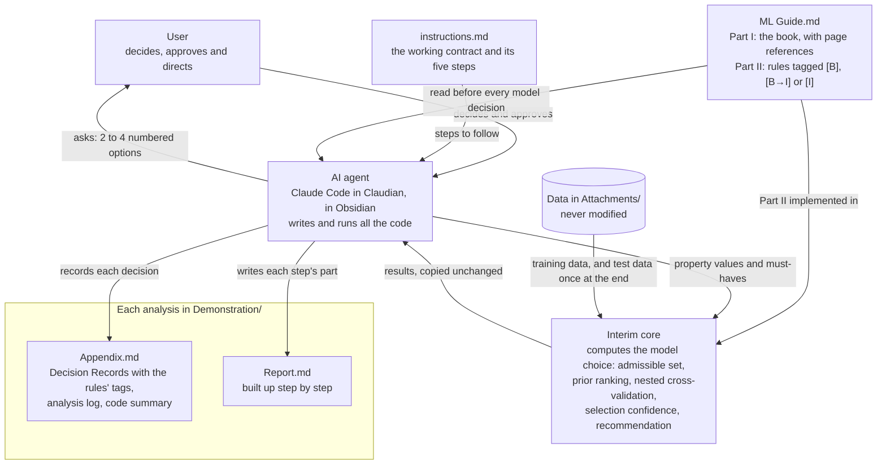

# An Agentic AI Workspace for Guided Development of Supervised Machine Learning Models: Supporting Explained Decision-Making, Model Selection, and Traceable Reporting

## Abstract

Supervised machine learning involves many choices besides fitting a model. A reader can check these choices only if they are recorded as they are made. This project builds a step-by-step workflow in which an AI agent proposes each step and writes all the code, and the user takes every decision. The workflow is adapted from chapters 2, 3, 4 and 13 of the textbook by Lindholm et al. (2026), and the parts not taken from the book are marked as such. It carries the workflow through six analyses of five public datasets: death in heart failure, twice, the second time with the workflow as revised during the project; sepsis in intensive care; the price band of mobile phones; student dropout from first-year results; and the fuel use of cars from their design, the one analysis with a numerical outcome. The workflow chooses among linear, logistic and generalised linear models, k-nearest neighbours and decision trees, with polynomial terms and L2 regularisation where the book allows them. It removes configurations that cannot serve the problem, ranks the rest before any model is fitted, and recommends the simplest whose score cannot be told apart from the best. The model types and the working practice come from Lindholm et al. (2026), and each rule applied is tagged with its source where the guide has a tag for it. Models are compared by nested cross-validation on the training data. The recommended model is evaluated once on held-out test data, and the spread of the metric across the outer cross-validation folds is its uncertainty. The success criterion was met in four analyses: Sepsis (test PR-AUC 0.0847 against 0.0315 for flagging nobody), Mobile Price (test accuracy 0.9600 against 0.2500), the Heart Failure rerun (test PR-AUC 0.6983 against 0.3167) and Student Dropout (test F2 0.8350 against 0.7026 for flagging every student). It was not met in the original Heart Failure analysis (test F2 0.6780, where more than 0.7903 was required) or in the fuel-use analysis, where the root mean squared error on 78 test cars was 1.08 litres per 100 km, against 3.66 for the average guess, above the 1-litre limit. The selection confidence was Low in five analyses and High only in Mobile Price. The ranking placed the cross-validation winner first in two analyses. The workflow was revised on the same analyses that test it, and only one analysis has a numerical output, so how it performs on other kinds of problem has not been tested. The next steps are to run the analyses through a single reviewed core, and to test the workflow on further problems with numerical or count outputs.

## Introduction

Fitting a model is the smaller part of supervised machine learning. The larger part is the set of choices around it. Made after the results are seen, these choices can turn an evaluation into a description of whatever happened to work. Unless they are written down as they are made, a reader cannot check them. This matters more when an AI agent does much of the work: a reader then needs to see not only what was chosen, but who chose it and on what grounds. This report covers three parts of these choices: the models that are compared, how the work relates to the book, and how the models are trained and validated.

Some of these choices concern the model: what exactly is predicted and from what, which model types are compared, and when to stop. Lindholm et al. (2026) set out a working practice for these choices. For the model, the practice is to start simple and to add complexity only when the errors call for it.

The book is openly available at smlbook.org. Its chapters 2, 3, 4 and 13 cover both the model types and this practice, so it gives a fixed reference against which each choice can be checked. Where the book gives advice, a choice can cite it. Where it does not, the choice has to be marked as ours.

The other choices concern training and validation: which metric decides between models, which baseline a model must beat, and which data are held back for the final test. Here the book's practice is to fix the problem, the metric, a baseline and the test data before any model is fitted. Models are then compared by cross-validation on the training data, and the test data are used once, at the end.

This project builds a step-by-step workflow that follows this practice, from the data to a model evaluated once on held-out test data. An AI agent proposes each step and writes and runs all the code; the user takes every decision that is theirs. The workflow runs in a workspace: an Obsidian vault in which the agent (Claude Code, through the Claudian plugin) works beside the documents it writes, following a written working contract. Before each decision, the agent explains the choice to the user in plain words, with the book page behind it, and the user chooses between numbered options. The book's advice is distilled into a guide, in which every rule is tagged as the book's advice, a fact from the book turned into advice, or our own. The mechanical parts of the model choice are computed by code rather than judged by the agent. Every choice is written down as it is made, with the tags of the rules it applies, so that each can be traced to its source. The aim is not the best possible model for any one problem. It is a record of how each model was chosen that a reader can check against the book.

The workflow was carried through six analyses of five public datasets. Five of the analyses predict a category, and one predicts a number:
1. Heart Failure: predicting death during follow-up for 299 heart failure patients from eleven clinical inputs, five of them yes/no (Chicco and Jurman, 2020; Heart Failure Clinical Records, 2020).
2. Sepsis: predicting, from a patient's first six hours in intensive care, whether the sepsis label switches on during hours 7 to 54. The dataset holds 40,336 intensive-care patients at two US hospitals, of whom the analysis used 39,088 (Reyna et al., 2019, 2020).
3. Mobile Price: predicting which of four price bands a mobile phone falls in from 20 of its specifications, for 2,000 phones (Sharma, 2018).
4. Heart Failure rerun: the first problem again, on the same data and the same test patients, with the workflow as it stood after the changes made while the other analyses were worked through. It was run to see what the changes to the workflow did, by comparing the two versions on exactly the same patients.
5. Student Dropout: predicting whether a student drops out, from the enrolment information and the first- and second-semester results of 4,424 students. Students still enrolled are counted as not dropping out (Realinho et al., 2021; Realinho et al., 2022).
6. Auto MPG: predicting the fuel use, in litres per 100 km, of a car that has not yet been tested on the road, from its design, model year and country of origin, for 392 cars from model years 1970 to 1982 (Quinlan, 1993).

## Methods

The method is described under three headings, which Results follows in the same order.

Figure 1 shows the parts of the workflow and how they connect: who asks, who decides, who computes and what is recorded.

<small><b>Figure 1.</b> The parts of the workflow and how they connect. Arrows show who asks, who decides, who computes and what is recorded.</small>

### The machine learning methods used

The workflow chooses among a fixed set of model types from chapters 2 and 3 of Lindholm et al. (2026): linear regression, logistic regression, Poisson and exponential generalised linear models, k-nearest neighbours and decision trees. Polynomial terms (squares and cubes of the numerical inputs) and L2 regularisation can be added to the regression models where the book allows them, giving fourteen configurations in all. Methods from other chapters are not used, and which inputs a model receives is agreed with the user beforehand. The output decides the families (Lindholm et al., 2026). In five of the six analyses the output is a category, so linear regression, the Poisson model and the exponential generalised linear model were excluded, and only logistic regression, k-nearest neighbours and decision trees remained. In Auto MPG the output is a positive amount, so the logistic and Poisson models were excluded and eight configurations remained. Two rules remove logistic regression without regularisation when its parameters would not be well defined: when a straight boundary separates the training classes perfectly, and when some inputs exactly duplicate others (Lindholm et al., 2026). The second is our reading of the book. These rules removed the unregularised logistic models in Mobile Price, Sepsis and Student Dropout. In Student Dropout the user also marked class probabilities as essential, which left only the logistic configurations.

The remaining configurations are ranked before any model is fitted, from properties of the problem and the user's stated preferences. This ranking is our addition, not the book's, and it decides what is compared first, not what is chosen. The best-ranked few are kept, with the simplest model for the task and a baseline. The kept configurations are compared by cross-validation on the agreed metric, as the book recommends (Lindholm et al., 2026), with each model's own settings tuned inside the training part of each fold. The leading model is then checked for underfitting and overfitting, following the book's chapter on working practice (Lindholm et al., 2026), and the comparison is extended where the check points. The checks are repeated until a stopping rule applies, and the rule that applied is recorded.

The recommendation is the simplest of the models whose cross-validated score cannot be told apart from the best, following the book's advice not to settle on a complicated model where a simpler one would do (Lindholm et al., 2026). "Cannot be told apart" means a difference smaller than half its variation across the folds, a threshold that is ours. Each recommendation is reported with a selection confidence, which is ours and computed from three factors. C1, the margin over the runner-up, is clear if the recommended model is ahead by at least the variation of the difference across the folds, moderate if by at least half of it, and none otherwise. C2, the margin over the baseline, is clear if it is at least that variation. C3 is whether more training data was still lowering the validation error between 80 % and 100 % of the training data, and is limited if it was. Confidence is High when C1 and C2 are clear and C3 is adequate, Low when C1 is none or C2 is not clear, and Medium otherwise.

### How it relates to smlbook.org

The method rests on chapters 2, 3, 4 and 13 of Lindholm et al. (2026), and Part I of the guide summarises them with page references. The practice that decides a result is the book's (Lindholm et al., 2026): the problem, the metric, a baseline and the test data are fixed before any model is fitted; models are compared by k-fold cross-validation on the training data; the test data are held out and used once, at the end; the work starts simple and adds complexity only when the errors call for it; and when one outcome is rare, precision, recall and the precision–recall curve are used rather than the misclassification rate. Every rule in the guide is tagged as the book's advice ([B]), a fact from the book turned into advice ([B→I]), or our own ([I]), and the decision records copy the tags. Where the evidence suggests a method outside the four chapters might help, it is recorded as a flag and never claimed to be better. Student Dropout flagged bagging, random forests and boosting, neural networks, and kernel methods; Sepsis flagged survival analysis, which the book does not cover.

Several parts are ours, and are marked as ours wherever they are used: the step-by-step workflow, in which the user agrees each step before it is applied; the interim programs that compute the mechanical parts, so that the agent does not; the prior ranking of candidates before any model is fitted, with the expected order written down beforehand and checked afterwards; the selection confidence; and the numerical thresholds that turn the book's advice into rules, such as the half-variation test for "cannot be told apart". Three gaps the book leaves are also ours: the folds are stratified in the same way as the test split; the uncertainty of the test result is taken from the spread across the outer folds, resting on the book's account of k-fold cross-validation; and a configuration created by backward elimination can be recommended only if the removal was kept, so that the inputs remain a decision taken with the user. Where a threshold is tuned for F2, the F2 of flagging every case is reported beside the model's, as a reference that decides nothing. Fitting every preprocessing step inside each fold extends the book's rule that preprocessing is fitted on the training data only.

The guide's method changed nine times while the analyses were worked through, and each change is recorded in its version note. Six were made before 10 November 2026: the rule for diagnosis errors on imbalanced classes (18 October); the stratified folds, the test uncertainty and the underfitting check against the required error (27 October); backward elimination (28 October); and the F2 reference (30 October). Three of the six were prompted by Sepsis. Three more were made on 10 November: the diagnosis errors combine two rules, one for an error measure that is itself an error function and one for an imbalanced class, as combined in the merge of the two branches; logistic regression falls under the rule for unregularised fits; and the F2 threshold is tuned inside each configuration's cross-validation. The original Heart Failure analysis ran before any of these changes. Sepsis ran under the first four, and its first diagnosis pass was re-run after the underfitting change. Mobile Price ran under the first four from its start, and the fifth and sixth were made after it finished. The Heart Failure rerun ran under the first six. Student Dropout and Auto MPG ran under the rules as amended on 10 November: Student Dropout applied the amended rule for logistic regression and tuned its threshold inside each configuration, and Auto MPG, a regression, uses its error measure as it is.

### Training and validation methods

Each analysis divided its data once into training data and test data, before any model was fitted (Lindholm et al., 2026), and held back a fifth of the rows as test data. The rows were shuffled first, as the book advises. Every split except Auto MPG's was also stratified, so that both parts keep the same share of each outcome; stratifying the split is our choice. Auto MPG is a regression with no classes, so its split was not stratified; instead, rows with the same car name were kept together on one side of the split, so that no car model appears on both sides. The Heart Failure rerun made no new split: at the user's choice, it reused the original test set, so the two versions are compared on exactly the same 60 patients. The test data were locked, and nothing in the exploration or the model choice read them. All six analyses used seed 2026 for the split and the folds.

The models were compared on the training data by k-fold cross-validation (Lindholm et al., 2026). The training data were divided into ten parts, or folds; each model was fitted ten times, each time on nine folds and scored on the tenth, and the ten scores were averaged. Every model was scored on the same folds, so that two models can be compared fold by fold. The folds were stratified in the same way as the split, except that Sepsis was stratified by outcome and hospital, and Auto MPG was grouped by car name, so that cars with the same name always fell on the same side. Each model's settings were chosen by a second, five-fold cross-validation inside each of the ten training parts, and the model was scored only on the part held back, so that the settings were never chosen on the data that score the model (Lindholm et al., 2026); this nested design is ours. Every step that learns from the data, such as scaling the inputs, was fitted inside the training part each time. Where the metric needed a decision threshold, it was chosen after the model had been selected, on the training data alone, in the original Heart Failure analysis, Sepsis and the rerun. In Student Dropout it was chosen inside each configuration's cross-validation, so that each configuration was compared at its own best threshold. Mobile Price and Auto MPG needed no threshold. PR-AUC is the area under the precision–recall curve, computed as average precision.

Only after the user had approved the chosen model was it refitted on all the training data and evaluated once on the test data, with the baseline evaluated on the same test data. The uncertainty reported with that result is the standard deviation of the deciding metric across the ten outer folds. Each fold is smaller than the test set, so this approximates the uncertainty of the test result rather than measuring it; using it in this way is ours. Each analysis fixed its success criterion before any model was fitted. The baseline was flagging nobody in Sepsis and the rerun, the most common class in Student Dropout, the most common price band in Mobile Price, the F2 of flagging every patient on the training rows in the original Heart Failure analysis, and the average guess in Auto MPG. In the four analyses other than Student Dropout and Auto MPG, the test result minus its uncertainty had to exceed the baseline. In Student Dropout the model's test F2 had to be above the F2 of flagging every student on the same test rows. In Auto MPG it had two parts: a test error of at most 1 litre per 100 km, and a margin over the average guess of at least the spread. Table 1 sets out these choices for each analysis.

<small><b>Table 1.</b> Split, cross-validation folds, metric, decision threshold and uncertainty for each analysis.</small>

| Analysis | Split | Training / test rows (positives) | Folds stratified or grouped by | Metric for comparing and tuning | Decision threshold | Uncertainty of the test result |
| --- | --- | --- | --- | --- | --- | --- |
| Heart Failure (original) | new | 239 / 60 (77 / 19 deaths) | outcome | F2 | chosen after selection to maximise F2 | fold variation of F2 at the tuned threshold |
| Sepsis | new, by patient | 31,270 / 7,818 (984 / 246 with sepsis) | outcome and hospital | PR-AUC | chosen after selection, on training data, to maximise F2 | fold variation of PR-AUC |
| Mobile Price | new | 1,600 / 400 (400 / 100 per price band) | price band | accuracy | none (not needed) | fold variation of accuracy |
| Heart Failure rerun | reused from the original | 239 / 60 (77 / 19 deaths) | outcome | PR-AUC | chosen after selection to maximise F2 | fold variation of PR-AUC |
| Student Dropout | new | 3,539 / 885 (1,137 / 284 dropouts) | outcome | F2 | chosen inside each configuration's cross-validation, to maximise F2 | fold variation of F2 |
| Auto MPG | new, grouped by car name | 314 / 78 (no classes) | not stratified; grouped by car name | root mean squared error | none (numerical output) | fold variation of the root mean squared error |

## Results

Each sub-section reports what came out of the method described under the same heading in Methods.

### The machine learning methods used

Table 2 gives, for each analysis, the recommended configuration, its single evaluation on the test data, the baseline on the same test data, the fold standard deviation (SD) as its uncertainty, and whether the analysis's own success criterion was met. The criterion was met in four analyses: Sepsis, Mobile Price, the Heart Failure rerun and Student Dropout. It was not met in the original Heart Failure analysis, where the tree's test F2 was 0.6780 against the 0.7903 required, or in Auto MPG, where the test error was 1.08 litres per 100 km against the 1-litre limit. Auto MPG's second part, a clear margin over the average guess, was met.

The recommended configuration led the cross-validation in five of the six analyses. In the Heart Failure rerun, logistic regression with squares and cubes led, and the recommended plain logistic regression was less than half a spread behind it, so the simpler model was chosen. The margin over the next configuration was clear only in Mobile Price; in the other five it was less than half the variation across the folds, so another configuration would have served about as well. In the original Heart Failure analysis and its rerun, the ranking left out k-nearest neighbours, and in the rerun also the decision tree. In Auto MPG the ranking left out the four linear regression configurations, and the user asked for linear regression to be kept as a simple starting model. The checks for underfitting extended the comparison in Mobile Price, where the range of regularisation strengths was widened, and in the rerun, where k-nearest neighbours and the decision tree were brought back. In Student Dropout the check found underfitting, but the options it allowed were excluded: more polynomial terms, because the inputs were already many, and the other model types, because the required class probabilities excluded them. In Auto MPG the leading method's training error was just above the 1-litre limit, which the user chose to keep, and a further check that added linear regression with polynomial terms did not change the leading method.

The recommendation rule decided four analyses: the decision tree in the original Heart Failure analysis; logistic regression with L2 regularisation in Sepsis; plain logistic regression in the rerun; and, in Student Dropout, logistic regression with L2 regularisation over the same model with polynomial terms, whose cross-validated F2 differed by less than half its variation. In Mobile Price one model was ahead of the others by more than that variation, so the rule did not apply. In Auto MPG, k-nearest neighbours, linear regression and linear regression with polynomial terms could not be told apart, and the tie-break on the prior ranking chose k-nearest neighbours. The selection confidence is made of three factors. C1 is the margin over the next configuration, which was clear only in Mobile Price. C2 is the margin over the baseline, which was clear in all six. C3 is whether more training data still lowered the error, which was adequate in all six. Because C2 and C3 were the same everywhere, C1 alone set the level: High in Mobile Price and Low in the other five.

<small><b>Table 2.</b> Recommended configuration and test result for each analysis.</small>

| Analysis | Recommended configuration | Deciding metric | Test result (fold SD) | Baseline | Test rows (positives) | Success criterion | Selection confidence (C1, C2, C3) |
| --- | --- | --- | --- | --- | --- | --- | --- |
| Heart Failure (original) | decision tree, depth 3, minimum leaf size 20; threshold 0.2 | F2 | 0.6780 (0.0865) | 0.7038 (flag everyone, on the training rows; the agreed reference); the most common class scores 0 | 60 (19 deaths) | not met (required above 0.7038 + 0.0865 = 0.7903) | Low (none, clear, adequate) |
| Sepsis | logistic regression with L2, λ = 10⁻³; threshold 0.040 | PR-AUC | 0.0847 (0.0156) | 0.0315 (flag nobody, on the test data) | 7,818 (246 with sepsis) | met (required above 0.0315 + 0.0156 = 0.0471) | Low (none, clear, adequate) |
| Mobile Price | logistic regression with L2, λ = 10⁻⁵ | accuracy | 0.9600 (0.0141) | 0.2500 (most common band, on the test data) | 400 (100 per band) | met (0.9600 − 0.0141 = 0.9459, required above 0.2500) | High (clear, clear, adequate) |
| Heart Failure rerun | logistic regression; threshold 0.10 | PR-AUC | 0.6983 (0.0938) | 0.3167 (flag nobody, on the test data) | 60 (19 deaths) | met (0.6983 − 0.0938 = 0.6045, required above 0.3167) | Low (none, clear, adequate) |
| Student Dropout | logistic regression with L2, λ = 10⁻²; threshold 0.20 | F2 | 0.8350 (0.0323) | 0.7026 (flag everyone, on the test rows); the most common class scores 0 | 885 (284 dropouts) | met (0.8350, above 0.7026) | Low (none, clear, adequate) |
| Auto MPG | k-nearest neighbours, 3 neighbours | root mean squared error (litres per 100 km) | 1.08 (0.34) | 3.66 (average guess, on the same cars) | 78 (no classes) | not met: part 1 (at most 1 litre) not met; part 2 (margin 2.58 against spread 0.56) met | Low (none, clear, adequate) |

### How it relates to smlbook.org

Each rule applied in the Decision Records is tagged with its source: the book's advice ([B]), a book fact turned into advice ([B→I]), or our own inference or threshold ([I]). Table 3 counts each row of a record's table of rules applied once, under one tag, in this order of precedence: a rule not in the guide (UNLISTED), then [B→I], then [B], then [I]. Records superseded in full are not counted, and neither are the diagnosis records, which have no such table; a record superseded only in part stays in force.

<small><b>Table 3.</b> Rules applied in the Decision Records in force, by provenance tag.</small>

| Analysis | Records in force (of all) | Rules applied | [B] | [B→I] | [I] | UNLISTED | No tag |
| --- | --- | --- | --- | --- | --- | --- | --- |
| Heart Failure (original) | 15 (19) | 45 | 17 | 12 | 15 | 1 | 0 |
| Sepsis | 15 (20) | 52 | 31 | 11 | 7 | 3 | 0 |
| Mobile Price | 17 (21) | 50 | 23 | 5 | 18 | 1 | 3 |
| Heart Failure rerun | 16 (17) | 52 | 26 | 8 | 15 | 1 | 2 |
| Student Dropout | 27 (28) | 71 | 28 | 14 | 23 | 0 | 6 |
| Auto MPG | 34 (36) | 59 | 28 | 3 | 17 | 0 | 11 |
| **All six** | 124 | 329 | 153 | 53 | 95 | 6 | 22 |

The prior ranking's expected order was written down before any model was fitted, and checked afterwards. Cross-validation agreed with it in Sepsis and Student Dropout, partly agreed in the Heart Failure rerun, and disagreed in the original Heart Failure analysis, in Mobile Price and in Auto MPG. In Auto MPG the prior expected the exponential generalised linear model first, then the same model with L2 regularisation, then k-nearest neighbours and the decision tree; linear regression was added by the user. Cross-validation did not confirm this order: k-nearest neighbours led linear regression with polynomial terms by 0.013 litres per 100 km, against a spread of 0.218.

The recommended configuration had grounding in book facts turned into advice ([B→I]) in three analyses: two entries in Sepsis, and one each in the two Heart Failure analyses, all about wanting an inspectable model or needing class probabilities or a tuned threshold. In the other three, no entry applied to the recommended configuration, and its prior score was 0. Six rules are not in the guide (UNLISTED), all in the first four analyses. The 22 untagged rows record that a rule had nothing to act on ('n/a'), take a value from metadata ('M'), or cite the guide or the working contract without a tag.

### Training and validation methods

The training and test rows were 239 and 60 in both Heart Failure analyses (77 and 19 deaths), 31,270 and 7,818 in Sepsis (984 and 246 with sepsis), 1,600 and 400 in Mobile Price (400 and 100 in each price band), 3,539 and 885 in Student Dropout (1,137 and 284 dropouts), and 314 and 78 cars in Auto MPG. The spread of the deciding metric across the ten outer folds is the uncertainty in Table 2. For the analyses with a threshold, Table 4 also gives the spread of the nested cross-validation F2 beside its result.

Three analyses chose their decision threshold after the model had been selected, on the training data: 0.2 for the original Heart Failure analysis, 0.040 for Sepsis and 0.10 for the Heart Failure rerun. Student Dropout chose its threshold inside each configuration's cross-validation. The threshold chosen on all the training rows, and used for the test, was 0.20; within the folds of the cross-validation it was 0.15 in eight folds and 0.20 in two. Mobile Price needed no threshold, since it chooses among four price bands, and Auto MPG has none, since it predicts a number. Table 4 gives, for each analysis with a threshold, the nested cross-validation result at that threshold, the test F2, and the F2 of flagging every case, which is reported for the two Heart Failure analyses and Student Dropout. Sepsis did not report that reference. Precision and recall in cross-validation are given only for Sepsis and the rerun.

The two Heart Failure analyses were tested on the same 60 patients, 19 of whom died. On those patients the original decision tree, at threshold 0.2, had a test F2 of 0.6780, the rerun's logistic regression, at threshold 0.10, had 0.6400, and flagging every patient gave 0.6985. In nested cross-validation on the training patients, the tree's F2 was 0.6943 and the logistic regression's was 0.7127, against 0.7038 for flagging every patient. The rerun's test PR-AUC was 0.6983, against 0.3167 for flagging nobody. The two analyses differ in metric and success criterion, and the rerun reused the original test set, whose result was known before the rerun.

<small><b>Table 4.</b> Decision threshold, nested cross-validation at the tuned threshold, and F2 on the test data, with the F2 of flagging every case.</small>

| Analysis | Threshold | Nested CV F2 (fold SD) | Nested CV precision (fold SD) | Nested CV recall (fold SD) | Test F2 | Flag everyone: F2 on the training rows | Flag everyone: F2 on the test rows |
| --- | --- | --- | --- | --- | --- | --- | --- |
| Heart Failure (original) | 0.2 | 0.6943 (0.0865) | not recorded | not recorded | 0.6780 | 0.7038 | 0.6985 |
| Sepsis | 0.040 | 0.2204 (0.0182) | 0.0723 (0.0050) | 0.4582 (0.0737) | 0.2326 | not reported | not reported |
| Heart Failure rerun | 0.10 | 0.7127 (0.0614) | 0.4012 (0.0553) | 0.8946 (0.1056) | 0.6400 | 0.7038 | 0.6985 |
| Student Dropout | 0.20 | 0.8311 (0.0323) | not recorded | not recorded | 0.8350 | 0.7030 | 0.7026 |

## Discussion

The procedure was carried through six analyses of five datasets, and each produced a recommendation. Every choice was written down as a Decision Record: the 124 records still in force hold 329 rules applied, and each is tagged with its source (Table 3). Of those rules, 206 trace to the book, either as its advice or as facts from it turned into advice; 95 are ours; six are not in the guide and are recorded as ours; and 22 carry no tag. The tags show where each rule came from, not how much it affected a recommendation. This shows that the procedure can be followed from the data to a recommendation, and that a reader can check it rule by rule. It does not show that the recommendations are the best available.

Four of the six recommendations were logistic regression: with L2 regularisation in Sepsis, Mobile Price and Student Dropout, and plain in the Heart Failure rerun. The original Heart Failure analysis recommended a decision tree of depth 3, and Auto MPG recommended k-nearest neighbours with three neighbours. The selection confidence was High only in Mobile Price, where logistic regression with L2 led every other configuration by more than the variation across the folds. In the other five it was Low, each time because another configuration could not be told apart from the recommended one. A Low confidence therefore says that another configuration near the top would have served about as well; it does not say that the recommended one fails. The recommended configuration was clearly ahead of its baseline in all six. In the original Heart Failure analysis the baseline was the most common class. Against flagging every patient, the reference the analysis agreed in advance, the tree was behind in nested cross-validation, so it beat the most common class but not that reference.

The success criterion was met in four analyses: Sepsis, Mobile Price, the Heart Failure rerun and Student Dropout. It was not met in the original Heart Failure analysis, and in Auto MPG only the second part, a clear margin over the average guess, was met. A met criterion shows that a model beat its baseline on its test data, as the analysis defined that test in advance. It does not show that the model is reliable for any single patient, student or car, because the claim is an average over data like the test data (Lindholm et al., 2026). The Sepsis result holds for labels built in one particular way: the publisher built the label from the Sepsis-3 criteria, starting six hours before onset, and patients who left intensive care before the outcome could be seen were counted as negatives. The Mobile Price accuracy is above the most common band, but the origin of its rows and the rule that set the price bands are undocumented, so it says nothing about real phones or a real market. The Auto MPG test error of 1.08 litres per 100 km is above the 1-litre limit, so the model cannot estimate one car's fuel use to within a litre. It supports an estimate of the typical fuel use of cars like those in the data, with an uncertainty of about 0.34 litres per 100 km across folds.

The Auto MPG data limit that estimate further. The cars are from model years 1970 to 1982, so nothing here says anything about newer cars. The six cars with no horsepower value were dropped, and all had four or six cylinders, so the cars used include fewer small-engine cars than the file does. The units of the inputs are not verified, and the conversion to litres per 100 km assumes US gallons, which has not been checked against the source. The file codes the origin as 1, 2 or 3 without naming the countries, so the country in the question rests on the user's statement.

The methods reach their predictions in different ways. A logistic model adds up the inputs, each with a weight learned from the training data, and turns the total into a probability. A decision tree follows a short list of yes-or-no questions. The k-nearest neighbours method reports the average fuel use of the three most similar training cars. A reader can follow a tree's questions and see which cars a neighbour prediction used, and can read a logistic model's weights one input at a time. None of this shows that an input causes the outcome, and a good cross-validation score does not show that it does.

Before any model was fitted, the ranking wrote down the order in which cross-validation was expected to place the configurations, and that order was checked afterwards. It agreed in Sepsis and Student Dropout, partly agreed in the rerun, and disagreed in the original Heart Failure analysis, in Mobile Price and in Auto MPG. In Auto MPG the exponential model was expected first, and cross-validation placed it fourth, behind k-nearest neighbours, linear regression with polynomial terms and plain linear regression. Where the ranking had entries to go on, they were facts from the book turned into advice about wanting an inspectable model or needing class probabilities or a tuned threshold, not about predictive fit. In Mobile Price, Student Dropout and Auto MPG no entry applied to the recommended configuration. The ranking therefore decided what was compared first, and cross-validation decided what was chosen. In these six analyses the ranking was not a reliable guide to the cross-validation order, and it was not built to be one.

The two Heart Failure analyses were evaluated on the same 60 patients, 19 of whom died. On those patients both test F2 values were below flagging every patient (0.6985): 0.6780 for the original tree and 0.6400 for the rerun's logistic model. In nested cross-validation on the training patients, the logistic model was above flagging every patient and the tree below it. The two analyses differ in metric, success criterion and method revisions, and the rerun ran under the first six of the nine changes and reused a test set whose result was already known. So the comparison shows the two results on these patients, and does not show which difference decided why one met its criterion and the other did not. Each outcome is a recorded status over a follow-up of varying length: a patient recorded as not having died was not observed to die in that time, which is not the same as surviving.

The evidence on the method is thinner than the number of analyses suggests. Only one analysis has a numerical output, and the method's parts for numerical and count outputs have been used once, on data whose units are not verified. The guide's method changed nine times while the work was done, so the workflow was revised on the same analyses that test it. Each analysis's computations come from an interim core that was not reviewed by an expert, and no independent review of the method has been made. Some methods outside the four chapters were flagged: bagging, random forests and boosting (Chapter 8), neural networks (Chapters 6 and 7), kernel methods (Chapter 9) in Student Dropout, and survival analysis, which the book does not cover, in Sepsis. They are open possibilities. None was fitted, and these analyses do not show that any of them would have done better.

The next steps follow from these limits. First, the workflow foresees one reviewed core in `Code/advisor/`, in place of an interim core for each analysis. Running the six analyses through it, and checking that it reproduces their recorded outputs, would show whether the results depend on how each interim core was written. Second, a count or numerical output needs more tests, since Auto MPG is the only one so far and its units are not verified. Third, the F2 of flagging every case is to be reported beside every threshold tuned for F2, under the rule set on 30 October. Sepsis tuned a threshold and did not report it, so its comparison is missing. Each of these would be a new analysis, not a revision of these six.

## Limitations

Problems met:
- **The method changed while it was being applied.** Several changes were prompted by the data they were applied to: three of the six changes made before 10 November were prompted by Sepsis, and the change of 30 October by the comparison of the two Heart Failure analyses. The rerun ran under that change and reports its F2 reference on the same patients that prompted it.
- **The success criteria differ between analyses.** They use F2, PR-AUC, accuracy and root mean squared error, against different baselines: the most common class, flagging nobody, flagging everyone, and the average guess. So 'met' in one analysis cannot be compared directly with 'met' in another.
- **The threshold was chosen at different points.** In Student Dropout it was chosen inside each configuration's cross-validation; in the other three analyses with a threshold, it was chosen after the model had been selected. The two protocols can give different answers, and the analyses were not all run under one protocol.
- **The uncertainties are approximate.** Each is the spread across the outer cross-validation folds, which are smaller than the test sets, so it approximates the uncertainty of the test result rather than measuring it. The approximation is coarsest in the two Heart Failure analyses, which have 60 test patients.
- **Student Dropout's data cover one institution and period.** The students come from one institution, the Polytechnic Institute of Portalegre, with enrolment years 2008/2009 to 2018/2019, as the source paper states. Nothing here checks the result elsewhere. Students still enrolled are counted as not dropping out, so for them the outcome is not known.

Not built or not tested:
- **The interim cores were not checked on some readings of the guide.** Each analysis wrote its own, and some readings built into them were not checked, such as how the L2 strength converts for four classes in Mobile Price.
- **Some model families were run in only one analysis, and the Poisson model in none.** The rule for output type excluded Poisson models in all six analyses, so they were never run. Linear regression and the exponential model were run only in Auto MPG. No analysis had a count output.
- **The supervisor has not yet reviewed the method changes or the open questions in the Discussion.**

## Disclaimer

This report was written with the help of agentic AI: designing the workflow, writing the code, running the six analyses and drafting the text. Each part was directed and reviewed by the author.

## Appendix

The material behind this report:
- The six analyses, each with a report and an appendix holding its data summary, problem definition, Decision Records, Recommendation Report, analysis log and code summary:
  - Heart Failure (original): [Demonstration/Heart Failure/](Demonstration/Heart%20Failure/Demonstration%20Report.md), as `Demonstration Report.md` and `Demonstration Appendix.md`;
  - Sepsis: [Demonstration/Sepsis/](Demonstration/Sepsis/Report.md);
  - Mobile Price: [Demonstration/Mobile Price/](Demonstration/Mobile%20Price/Report.md);
  - Heart Failure rerun: [Demonstration/Heart Failure rerun/](Demonstration/Heart%20Failure%20rerun/Report.md);
  - Student Dropout: [Demonstration/Student Dropout/](Demonstration/Student%20Dropout/Report.md);
  - Auto MPG: [Demonstration/Auto MPG/](Demonstration/Auto%20MPG/Report.md).
- [ML Guide.md](ML%20Guide.md): the guide the advisor follows. Part I summarises the four chapters with page references, Part II is the selection procedure with a provenance tag on every rule, and its version note records each change to the method, with its date.
- [instructions.md](instructions.md): the working contract for the step-by-step workflow.
- [Code/outputs/project/provenance_tally.md](Code/outputs/project/provenance_tally.md): the tally behind Table 3, produced by `Code/project_01_provenance_tally.py`.

The xG analysis (`Demonstration/xG/`) was added by David on 10 November 2026 and is not part of this report.

## References

- Chicco, D. and Jurman, G. (2020). Machine learning can predict survival of patients with heart failure from serum creatinine and ejection fraction alone. *BMC Medical Informatics and Decision Making*, 20, 16. [https://doi.org/10.1186/s12911-020-1023-5](https://doi.org/10.1186/s12911-020-1023-5).
- Heart Failure Clinical Records [Dataset]. (2020). UCI Machine Learning Repository. [https://doi.org/10.24432/C5Z89R](https://doi.org/10.24432/C5Z89R).
- Lindholm, A., Wahlström, N., Lindsten, F. and Schön, T. B. (2026). [*Machine Learning – A First Course for Engineers and Scientists*](https://smlbook.org/), 2nd edition, online draft version of 1 September 2026. Cambridge University Press (to be published).
- Quinlan, R. (1993). Auto MPG [Dataset]. UCI Machine Learning Repository. [https://doi.org/10.24432/C5859H](https://doi.org/10.24432/C5859H).
- Realinho, V., Vieira Martins, M., Machado, J. and Baptista, L. (2021). Predict Students' Dropout and Academic Success [Dataset]. UCI Machine Learning Repository. [https://doi.org/10.24432/C5MC89](https://doi.org/10.24432/C5MC89).
- Realinho, V., Machado, J., Baptista, L. and Martins, M. V. (2022). Predicting Student Dropout and Academic Success. *Data*, 7(11), 146. [https://doi.org/10.3390/data7110146](https://doi.org/10.3390/data7110146).
- Reyna, M., Josef, C., Jeter, R., Shashikumar, S., Moody, B., Westover, M. B., Sharma, A., Nemati, S. and Clifford, G. D. (2019). *Early Prediction of Sepsis from Clinical Data: the PhysioNet/Computing in Cardiology Challenge 2019* (version 1.0.0) [Dataset]. PhysioNet. [https://doi.org/10.13026/v64v-d857](https://doi.org/10.13026/v64v-d857).
- Reyna, M. A., Josef, C. S., Jeter, R., Shashikumar, S. P., Westover, M. B., Nemati, S., Clifford, G. D. and Sharma, A. (2020). Early prediction of sepsis from clinical data: the PhysioNet/Computing in Cardiology Challenge 2019. *Critical Care Medicine*, 48(2), 210–217. [https://pmc.ncbi.nlm.nih.gov/articles/PMC6964870/](https://pmc.ncbi.nlm.nih.gov/articles/PMC6964870/).
- Sharma, A. (2018). *Mobile Price Classification* [Dataset], version 1. Kaggle. [https://www.kaggle.com/datasets/iabhishekofficial/mobile-price-classification](https://www.kaggle.com/datasets/iabhishekofficial/mobile-price-classification).
